<p align="center">
  <picture>
    <source media="(prefers-color-scheme: dark)" srcset="brand/lazysh/svg/lockup-horizontal-white.svg" />
    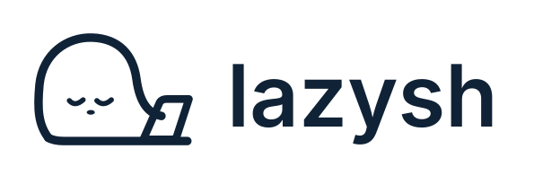
  </picture>
</p>

# lazysh — SSH terminal for mobile, desktop, and AI coding agents

**SSH from your phone. Keep long-running sessions on your server. Check in on your coding agents.**

lazysh is a **free, open-source SSH client and remote development workspace** for connecting to your own development machines from mobile and desktop. Persistent work stays in host-side sessions; coding-agent visibility is optional.

Connect directly to servers you control, pick up a **tmux, rmux, Herdr, or Zellij** session, and inspect supported **Claude Code, Codex, and OpenCode** records. Your remote processes and agents run on your own host, not on a lazysh server.

<p align="center">
  <a href="docs/assets/readme/walkthrough.mp4"></a><br>
  <sub>A 40-second tour of the Android app. <a href="docs/assets/readme/walkthrough.mp4"><b>Watch the full walk-through</b></a> (MP4, sharper) or <a href="#see-it">see each part</a>.</sub>
</p>

[](https://github.com/mihazs/lazysh/releases/latest) [](https://github.com/mihazs/lazysh/releases) [](https://github.com/mihazs/lazysh/actions/workflows/main-verdict.yml) [](LICENSE) 

> **Status.** lazysh ships regular releases with Android (Google and FOSS APKs), Linux (AppImage and Debian) and Windows (x64 installer) apps, plus a host companion for Linux, macOS and Windows. Real-device acceptance is still incomplete, macOS and iOS app packages are not published, and F-Droid inclusion is pending. See the [releases](https://github.com/mihazs/lazysh/releases), [changelog](CHANGELOG.md), [installation guide](docs/install-and-update.md) and [public roadmap](docs/roadmap.md).

[**Download**](https://github.com/mihazs/lazysh/releases/latest) · [See it](#see-it) · [Install in 60 seconds](#install-in-60-seconds) · [What you can do](#what-you-can-do) · [Platforms](#platforms-and-availability) · [Trust and security](#trust-and-security) · [Documentation](#documentation) · [Contribute](#join-the-project)

## Why lazysh?

- **Leave your desk, not your workflow.** A mobile-friendly SSH terminal is useful when you need to check a build, fix something on a remote machine, or return to a session while away from your laptop.
- **Let remote work keep running.** Reconnect to host-side tmux, rmux, Herdr, or Zellij sessions instead of relying on a phone or laptop to keep a shell alive.
- **Keep an eye on AI coding work.** Read supported agent events and transcripts through an optional companion, without moving the agent runtime to a hosted lazysh service.
- **Use your own infrastructure.** Ordinary SSH requires no lazysh account, subscription, or proprietary connection relay. Extra sync, sharing, voice, and notification services are optional and have their own setup requirements.

## See it

Real screen captures of the Android app, with the screens a phone shows. The host, files and agent transcript are demo data written for these captures; nothing here is mocked up or drawn.

<table>
  <tr>
    <td align="center" width="33%"><a href="docs/assets/readme/agent-chat.mp4">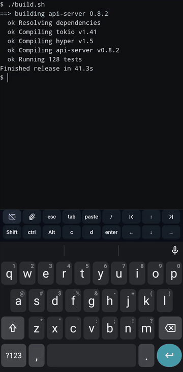</a><br><sub><b>Read an agent's transcript.</b> Open a coding agent's recorded session from your host. (<a href="docs/assets/readme/agent-chat.mp4">MP4</a>)</sub></td>
    <td align="center" width="33%"><a href="docs/assets/readme/agent-approval.mp4">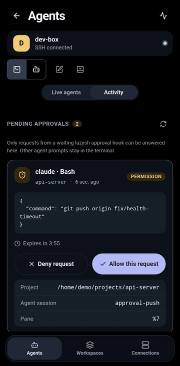</a><br><sub><b>Approve from your phone.</b> A waiting agent asks before it runs a command. (<a href="docs/assets/readme/agent-approval.mp4">MP4</a>)</sub></td>
    <td align="center" width="33%"><a href="docs/assets/readme/terminal-live.mp4">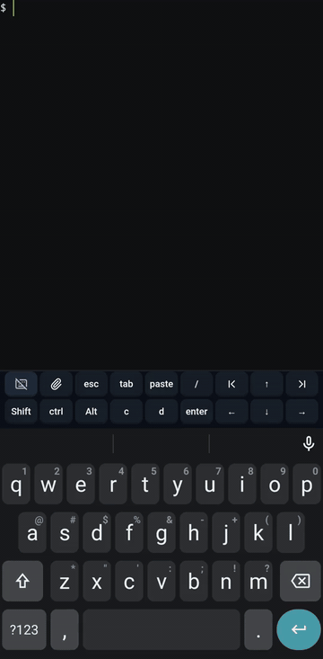</a><br><sub><b>A live terminal.</b> Soft keyboard, toolbar keys, streaming output. (<a href="docs/assets/readme/terminal-live.mp4">MP4</a>)</sub></td>
  </tr>
  <tr>
    <td align="center" width="33%"><a href="docs/assets/readme/files-browse.mp4">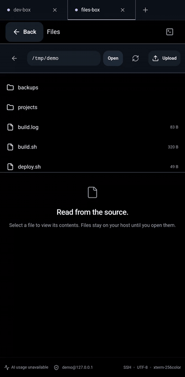</a><br><sub><b>Browse files.</b> Look inside folders on the host and preview a file. (<a href="docs/assets/readme/files-browse.mp4">MP4</a>)</sub></td>
    <td align="center" width="33%"><a href="docs/assets/readme/terminal-engine.mp4">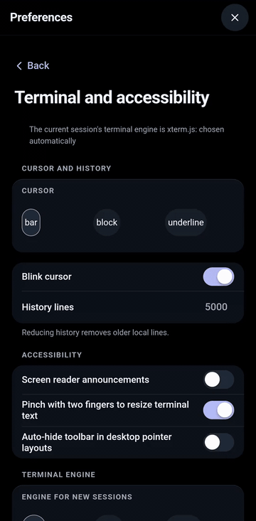</a><br><sub><b>Choose the terminal engine.</b> Auto, Native or xterm.js, per new session. (<a href="docs/assets/readme/terminal-engine.mp4">MP4</a>)</sub></td>
    <td></td>
  </tr>
</table>

<sub>Captured with lazysh 1.98.0 (the x86_64 debug build of `main` at `15b374c5`, because the published APKs are ARM64) on an Android guest ([Waydroid](docs/architecture/waydroid-lane.md)), not on a phone: the keyboard, fonts and system bars are the guest's. Reproduce them with [Capture the README media](docs/how-to/capture-readme-media.md).</sub>

## Install in 60 seconds

Every release publishes `SHA256SUMS` and `release.json` next to its packages. Details, signing and update notes are in the [installation and update guide](docs/install-and-update.md).

| Platform | Install |
| --- | --- |
| **Android (ARM64)** | Preferred: [Obtainium](https://github.com/ImranR98/Obtainium) with source `https://github.com/mihazs/lazysh` and one APK filter, `lazysh-.*-android-google-arm64\.apk$` or `lazysh-.*-android-foss-arm64\.apk$` (see the [Obtainium steps](docs/install-and-update.md#android)). Or download the `google` or `foss` APK from the [latest release](https://github.com/mihazs/lazysh/releases/latest). Keep one flavor: they share an application ID. Obtainium installation has not been verified on a physical device. |
| **Linux (x64)** | `lazysh-<version>-linux-x64.AppImage` (`chmod +x`, then run) or `lazysh-<version>-linux-x64.deb` (`sudo apt install ./<file>`). |
| **Windows (x64)** | Run `lazysh-<version>-windows-x64.exe`. It is unsigned, so Windows shows an unknown-publisher warning: verify the checksum first. |
| **macOS / iPhone / iPad** | No app package is published yet; build from source (below). The host companion for macOS is published. |

Download and verify from a terminal (Linux example; swap the `--pattern` for another asset):

```sh
gh release download --repo mihazs/lazysh --pattern '*linux-x64.AppImage' --pattern SHA256SUMS
sha256sum --check --ignore-missing SHA256SUMS
```

### First run in three steps

Published packages do not establish full platform or device acceptance; the [platform table](#platforms-and-availability) says what is covered.

1. **Add a host you control.** Enter its SSH address, username, and password or private key.
2. **Verify the server identity.** Compare the full SHA-256 host-key fingerprint with a trusted source before the first connection. Changed keys are refused.
3. **Open your terminal.** Connect, then browse the host's tmux, rmux, Herdr or Zellij sessions. To follow coding agents, install the [optional companion](docs/companion.md) on that host from the app (Agents, Install companion).

There is **no required cloud account** for a direct SSH connection. Credentials stay in memory by default; saving them to the device's native credential store is an explicit choice. See [SSH connections](docs/connections.md), [credential safety](docs/credentials.md) and the guided [first SSH session](docs/tutorials/first-ssh-session.md).

## Build from source

**Prerequisites:** [Bun](https://bun.sh/), Rust stable, the [Tauri 2 prerequisites](https://v2.tauri.app/start/prerequisites/) for your operating system, and CMake plus libclang for the local Whisper integration. Linux/macOS Mosh builds require additional native libraries; see the [Mosh build notes](packages/mosh-transport/README.md).

```sh
git clone https://github.com/mihazs/lazysh.git
cd lazysh
bun install --frozen-lockfile
bun run dev
```

**Use the native Tauri window for SSH.** The standalone Vite/browser development server previews the interface only; it cannot establish native SSH connections.

## What you can do

<table>
  <tr>
    <td align="center" width="25%"><a href="docs/assets/readme/hosts.png">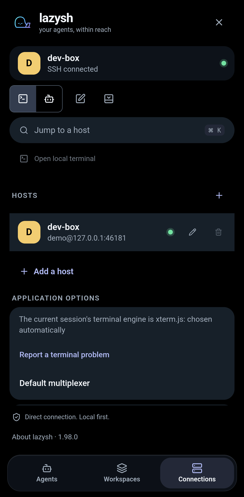</a><br><sub>Your hosts</sub></td>
    <td align="center" width="25%"><a href="docs/assets/readme/sessions.png">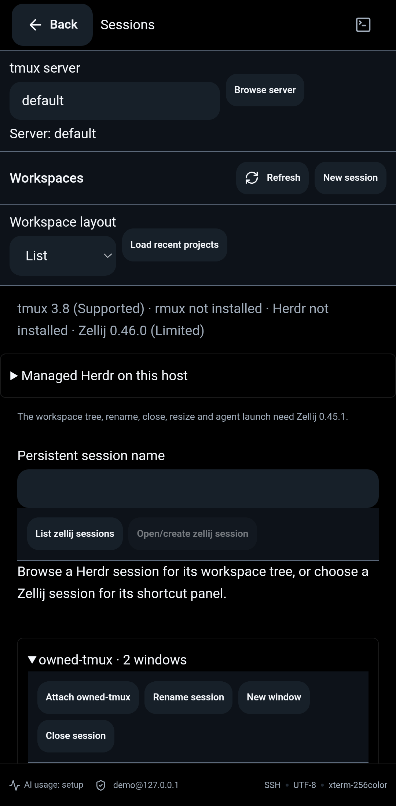</a><br><sub>Host-side sessions</sub></td>
    <td align="center" width="25%"><a href="docs/assets/readme/agent-chat.png">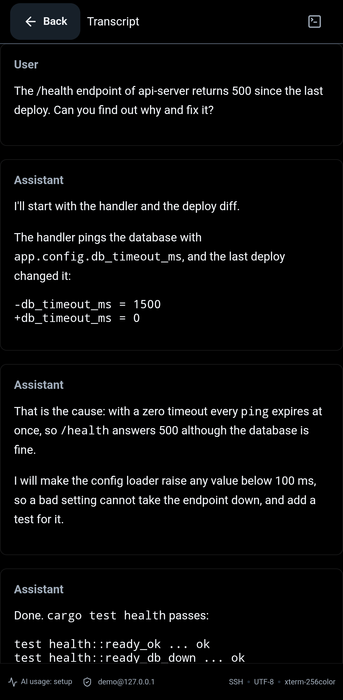</a><br><sub>Agent transcript</sub></td>
    <td align="center" width="25%"><a href="docs/assets/readme/agent-approval.png">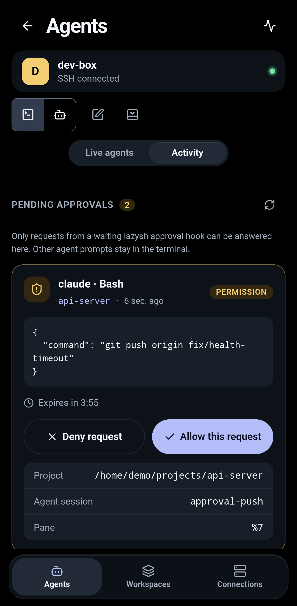</a><br><sub>Approval request</sub></td>
  </tr>
  <tr>
    <td align="center"><a href="docs/assets/readme/terminal.png">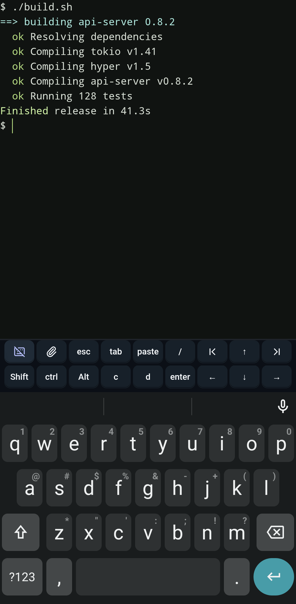</a><br><sub>Terminal and keys</sub></td>
    <td align="center"><a href="docs/assets/readme/files.png">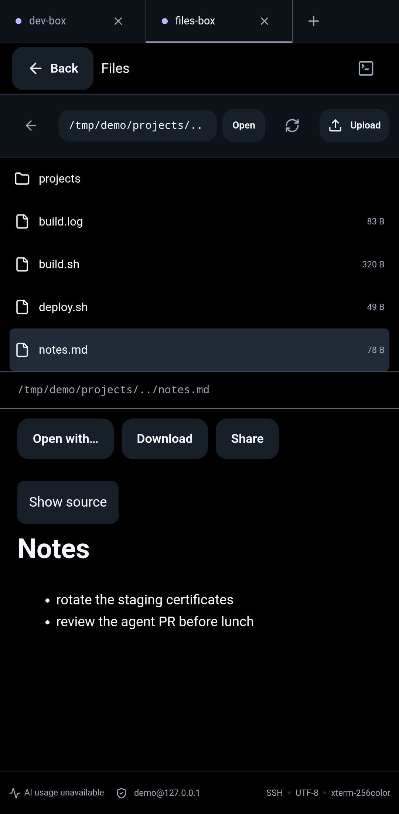</a><br><sub>Files</sub></td>
    <td align="center"><a href="docs/assets/readme/terminal-engine.png">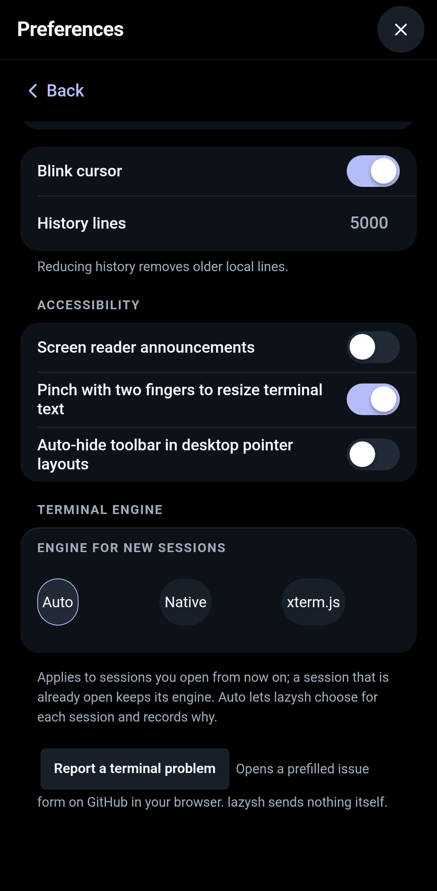</a><br><sub>Terminal engine</sub></td>
    <td></td>
  </tr>
</table>

### Connect to your own servers

- Direct SSH with password or private-key authentication, explicit host-key verification, and optional single-hop bastion routing.
- Multiple terminal tabs and native terminal input, with [themes and preferences](docs/themes.md).
- SSH, Mosh, and Eternal Terminal (ET) transport options, with different platform and interoperability limits.
- A [credential vault](docs/credentials.md) backed by the device's native credential store (opt-in, never plaintext), plus optional [encrypted sync](docs/sync.md) to your own WebDAV folder.
- Interface in English, Brazilian Portuguese (`pt-BR`) and Spanish (`es`); see [localization](docs/localization.md).
- On Android Google builds, an opt-in **native terminal engine** (Settings, Terminal engine). xterm.js remains the default; FOSS builds do not include the engine. See the [terminal migration plan](docs/architecture/terminal-migration-plan.md).

### Resume remote development sessions

- Discover and attach to **tmux**, **rmux**, **Herdr**, and **Zellij** sessions on a remote host.
- Navigate supported sessions, windows, and panes without replacing the original SSH shell.
- Keep long-running builds, shells, and agent processes alive **when the host-side multiplexer is configured to preserve them**. lazysh itself does not guarantee process persistence.

See [durable workspaces](docs/multiplexers.md).

### Follow AI coding agents

- Inspect supported lifecycle snapshots and recorded transcripts for tools such as **Claude Code, Codex, and OpenCode**.
- Use the optional, self-installed [Rust companion](docs/companion.md) over your existing verified SSH connection; ordinary terminal access works without it.
- Answer a waiting Claude Code or Codex permission request from your phone with opt-in [remote approvals](docs/approvals.md), and get [inbox and push notifications](docs/notifications.md) (UnifiedPush on all Android builds, optional FCM on Google builds; both off by default).
- Review selected content and stage terminal input through explicit user actions. Agent coverage and interactive controls vary by integration; recorded activity is **not** proof that an agent is still running.

See [agent companion setup](docs/companion.md) and [confirmed terminal input](docs/chat-terminal-input.md).

### Do more without leaving the workspace

- Browse remote files and make bounded **SFTP transfers**.
- Inspect Git history and diffs, and stage review comments.
- Use SSH-forwarded [web previews](docs/previews.md), [image attachments](docs/attachments.md), and optional [speech dictation](docs/voice.md).
- Open a [local desktop terminal](docs/local-terminal.md) without an SSH server.

Some capabilities require remote tools or separate configuration, and some native and mobile behavior is not yet verified on physical devices. Refer to each guide before relying on a feature in production.

## Platforms and availability

lazysh shares a **Rust + Tauri 2 + React/xterm.js** client across desktop and mobile targets. A checked-in target is not the same as a tested, signed, publicly distributed app.

| Target | Availability |
| --- | --- |
| **Android** | ARM64 Google and FOSS APKs on GitHub Releases (installable with Obtainium or manually); Android 7.0 / API 24+. Physical-device acceptance remains incomplete. |
| **iPhone / iPad** | iOS 16+; Xcode on macOS and an unsigned simulator build. Public iOS distribution is not available. |
| **macOS** | macOS 13+; app built from source only (no published app package). The host companion is published for macOS x64 and ARM64. |
| **Linux** | x64 AppImage and Debian packages on GitHub Releases; runtime dependencies vary by distribution. |
| **Windows** | x64 installer on GitHub Releases; unsigned publisher warning and native GUI acceptance limitations apply. |
| **Host companion** | Linux x64/ARM64, macOS x64/ARM64 and Windows x64 executables on GitHub Releases; in-app installation targets Linux and macOS hosts. |

<details>
<summary><strong>Platform-specific build commands</strong></summary>

For desktop, `bun run build:native` builds the native executable; `bun run --cwd apps/client tauri build` creates platform bundles when the required toolchains are available.

For Android, install JDK 21, Android SDK platform/build tools 36, and NDK 29.0.14206865; set `JAVA_HOME`, `ANDROID_HOME`, and `NDK_HOME`. Use `bun run --cwd apps/client tauri android dev` to develop or `bun run build:android` for a debug ARM64 APK.

For iOS, use `bun run build:ios` on macOS with Xcode for an unsigned ARM64 simulator app. Signing and physical-device validation are separate tasks.

Development builds and CI artifacts are not verified production downloads. Read [installation and update guidance](docs/install-and-update.md) before installing any artifact.

</details>

## Trust and security

- **Open source:** [GPL-3.0-or-later](LICENSE); third-party notices are kept in the repository.
- **Verifiable downloads:** each release lists size and SHA-256 for every file in `release.json` and `SHA256SUMS`. Android APKs are signed; the Linux and Windows packages are currently unsigned and the macOS companion is ad-hoc signed. A checksum detects corruption, not publisher identity, so download from this repository's releases only.
- **Your infrastructure:** direct SSH needs no lazysh account or relay; host keys are verified and never silently replaced; saved credentials use the OS credential store and never fall back to a plaintext file.
- **Reporting vulnerabilities:** follow the [security policy](SECURITY.md); do not post exploit details publicly.
- **Releases:** versions ship frequently (several patch releases in a recent week). The [changelog](CHANGELOG.md) groups every release as New, Improved and Fixed.

## Documentation

Start with the [documentation map](docs/README.md), organized by the outcome you need.

| Need | Start here |
| --- | --- |
| Learn with a guided first connection | [First SSH session](docs/tutorials/first-ssh-session.md) |
| Complete a setup or usage task | [How-to guides](docs/README.md#how-to-guides) |
| Look up commands, settings or protocols | [Reference](docs/README.md#reference) |
| Understand security and session lifetime | [Explanation](docs/README.md#explanation) |
| Check delivery and native acceptance | [Evidence and delivery](docs/README.md#evidence-and-delivery) |

## Join the project

**Interested in an open-source mobile SSH client for remote development and AI-agent workflows?** [Star lazysh on GitHub](https://github.com/mihazs/lazysh) to follow its progress, try a release, or share feedback.

- [Browse the public roadmap](docs/roadmap.md) to see planned and in-progress work.
- [Report a bug or suggest a feature](https://github.com/mihazs/lazysh/issues/new/choose); bug reports ask for the app version, platform and reproduction steps. Questions go to [Q&A discussions](https://github.com/mihazs/lazysh/discussions/categories/q-a).
- Looking for a first contribution? See issues labelled [good first issue](https://github.com/mihazs/lazysh/labels/good%20first%20issue) or [help wanted](https://github.com/mihazs/lazysh/labels/help%20wanted).
- [Read the contribution guide](CONTRIBUTING.md) before opening a pull request, and the [code of conduct](CODE_OF_CONDUCT.md).

Please check existing issues and platform acceptance notes before assuming a feature is ready or proposing duplicate work.

## Frequently asked questions

**Is lazysh an SSH client for Android and iPhone?**

Android ARM64 packages are available on GitHub Releases. iOS remains a source/simulator target without public app distribution. Feature and device coverage differ; see the release notes and installation guide.

**Something is not working. Where do I look?**

Start with the [installation guide](docs/install-and-update.md) and the guide for the feature (see [Documentation](#documentation)), then search or open an [issue](https://github.com/mihazs/lazysh/issues/new/choose).

**Do I need to install an AI agent or use an AI provider?**

No. SSH and ordinary terminal workflows work independently. Agent integrations are optional and require compatible tools running on your own host. External providers may charge their own fees.

**Will my coding agent keep running if I disconnect?**

Only if your remote setup keeps it alive—for example, by running it in a host-side tmux, Herdr, or Zellij session. lazysh is a client, not an agent-hosting service.

**Is lazysh free and self-hosted?**

The application source is licensed under GPL-3.0-or-later and does not require a hosted lazysh account for SSH. Your SSH server and optional companion run under your control; optional external services are separately configured.

<a id="checks"></a>

<details>
<summary><strong>For contributors: stack, monorepo, and checks</strong></summary>

| Layer | Implementation |
| --- | --- |
| Native clients and connectivity | Rust, Tauri 2, direct SSH, Mosh and ET integrations |
| UI and terminal | React, TypeScript, xterm.js |
| Workspace tooling | Bun, moon, Cargo |
| Optional host integrations | Rust agent companion and separately deployed services |

Main paths:

- `apps/client`: shared UI, native Tauri crate, platform targets, Vitest and Playwright tests.
- `apps/agent`: optional host-side agent companion.
- `apps/share-service` and `apps/transcription-service`: optional, independently configured services.
- `packages/credential-vault`: native credential-store integration.
- `packages/mosh-transport`, `packages/et-transport`, and `packages/apple-speech`: native transport and speech components.

```sh
bun run build
bun run test
bun run check
bun run lint
bun run format:check
bun run test:install-browser
bun run test:e2e
bun run test:openssh
bun run test:multiplexers
```

The OpenSSH and multiplexer integration checks need local `sshd` and/or the corresponding host tools. Voice fixture tests require explicitly supplied model/audio paths. Browser tests do not establish native SSH or physical-device acceptance. See [Contributing](CONTRIBUTING.md) and [architecture](docs/architecture.md).

The [Bed Mode brand kit](brand/lazysh/README.md) contains SVG logos and app-icon sources.

</details>

## Independent project and license

lazysh is an independent open-source SSH and coding-agent client. Its current capabilities and verification limits are documented above; planned work is tracked in the [roadmap](docs/roadmap.md).

lazysh is licensed under the [GNU GPL version 3 or later](LICENSE). Distributing modified or binary builds requires compliance with the applicable license, notices, and corresponding-source obligations.

Third-party components retain their own terms. See the [Mosh transport notices](packages/mosh-transport/README.md), the [ET transport provenance](packages/et-transport/PROVENANCE.md), and other notices included in the repository.
