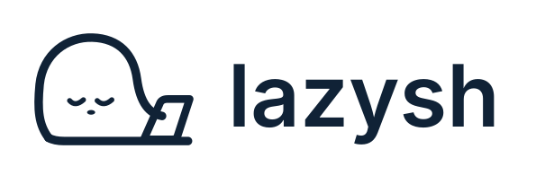

<p align="center">
  <picture>
    <source media="(prefers-color-scheme: dark)" srcset="brand/lazysh/svg/lockup-horizontal-white.svg" />
    
  </picture>
</p>

# lazysh — SSH terminal for mobile, desktop, and AI coding agents

**SSH from your phone. Keep long-running sessions on your server. Check in on your coding agents.**

lazysh is a **free, open-source SSH client and remote development workspace** for connecting to your own development machines from mobile and desktop. Persistent work stays in host-side sessions; coding-agent visibility is optional.

Connect directly to servers you control, pick up a **tmux, Herdr, or Zellij** session, and inspect supported **Claude Code, Codex, and OpenCode** records. Your remote processes and agents run on your own host, not on a lazysh server.

> **Development preview.** GitHub releases include Android, Linux and Windows packages, but feature coverage and real-device acceptance vary. Apple app distribution and F-Droid inclusion remain pending. Check the [installation guide](docs/install-and-update.md), release notes and [public roadmap](docs/roadmap.md) before trying a build.

[**Download Preview**](https://github.com/mihazs/lazysh/releases) · [Documentation](#documentation) · [Explore the workflows](#what-you-can-do) · [Contribute](CONTRIBUTING.md)

## Why lazysh?

- **Leave your desk, not your workflow.** A mobile-friendly SSH terminal is useful when you need to check a build, fix something on a remote machine, or return to a session while away from your laptop.
- **Let remote work keep running.** Reconnect to host-side tmux, Herdr, or Zellij sessions instead of relying on a phone or laptop to keep a shell alive.
- **Keep an eye on AI coding work.** Read supported agent events and transcripts through an optional companion, without moving the agent runtime to a hosted lazysh service.
- **Use your own infrastructure.** Ordinary SSH requires no lazysh account, subscription, or proprietary connection relay. Extra sync, sharing, voice, and notification services are optional and have their own setup requirements.

## Android: install with Obtainium (preferred)

Use [Obtainium](https://github.com/ImranR98/Obtainium) to install and track updates
from `https://github.com/mihazs/lazysh`. Select one Android ARM64 APK flavor and
keep that signing channel. Follow the [Obtainium setup, APK filters and verification
steps](docs/install-and-update.md#android). Manual APK download remains available.
This is a development preview; installation through Obtainium still needs
native device verification.

## Get started

Download a package from [GitHub Releases](https://github.com/mihazs/lazysh/releases), then follow the [installation and update guide](docs/install-and-update.md) for architecture, signing, checksums and platform-specific limitations. Published packages do not establish full platform or device acceptance.

To build from source instead:

**Prerequisites:** [Bun](https://bun.sh/), Rust stable, the [Tauri 2 prerequisites](https://v2.tauri.app/start/prerequisites/) for your operating system, and CMake plus libclang for the local Whisper integration. Linux/macOS Mosh builds require additional native libraries; see the [Mosh build notes](packages/mosh-transport/README.md).

```sh
git clone https://github.com/mihazs/lazysh.git
cd lazysh
bun install --frozen-lockfile
bun run dev
```

**Use the native Tauri window for SSH.** The standalone Vite/browser development server previews the interface only; it cannot establish native SSH connections.

Once the app is running:

1. **Add a host you control.** Enter its SSH address, username, and authentication method (password or private key).
2. **Verify the server identity.** Compare the full SHA-256 host-key fingerprint with a trusted source before accepting a first connection. Changed keys are refused.
3. **Open your terminal.** Connect, then optionally browse the host's tmux/Herdr/Zellij sessions. To inspect AI-agent records, set up the [optional companion](docs/companion.md) on that host.

There is **no required cloud account** for a direct SSH connection. Credentials stay in memory by default; saving them to the device's native credential store is an explicit choice. See [SSH connections](docs/connections.md) and [credential safety](docs/credentials.md).

## What you can do

### Connect to your own servers

- Direct SSH with password or private-key authentication, explicit host-key verification, and optional single-hop bastion routing.
- Multiple terminal tabs and native terminal input, with [themes and preferences](docs/themes.md).
- SSH, Mosh, and Eternal Terminal (ET) transport options, with different platform and interoperability limits.

### Resume remote development sessions

- Discover and attach to **tmux**, **Herdr**, and **Zellij** sessions on a remote host.
- Navigate supported sessions, windows, and panes without replacing the original SSH shell.
- Keep long-running builds, shells, and agent processes alive **when the host-side multiplexer is configured to preserve them**. lazysh itself does not guarantee process persistence.

See [durable workspaces](docs/multiplexers.md).

### Follow AI coding agents

- Inspect supported lifecycle snapshots and recorded transcripts for tools such as **Claude Code, Codex, and OpenCode**.
- Use the optional, self-installed [Rust companion](docs/companion.md) over your existing verified SSH connection; ordinary terminal access works without it.
- Review selected content and stage terminal input through explicit user actions. Agent coverage and interactive controls vary by integration; recorded activity is **not** proof that an agent is still running.

See [agent companion setup](docs/companion.md) and [confirmed terminal input](docs/chat-terminal-input.md).

### Do more without leaving the workspace

- Browse remote files and make bounded **SFTP transfers**.
- Inspect Git history and diffs, and stage review comments.
- Use SSH-forwarded [web previews](docs/previews.md), [image attachments](docs/attachments.md), and optional [speech dictation](docs/voice.md).
- Open a [local desktop terminal](docs/local-terminal.md) without an SSH server.

Some capabilities require remote tools or separate configuration, and native/mobile behavior is still being verified. Refer to each guide before relying on a feature in production.

## Platforms and availability

lazysh shares a **Rust + Tauri 2 + React/xterm.js** client across desktop and mobile targets. A checked-in target is not the same as a tested, signed, publicly distributed app.

| Target | Availability |
| --- | --- |
| **Android** | ARM64 Google and FOSS APKs on GitHub Releases; Android 7.0 / API 24+. Physical-device and feature acceptance remain incomplete. |
| **iPhone / iPad** | iOS 16+; Xcode on macOS and an unsigned simulator build. Public iOS distribution is not available. |
| **macOS** | macOS 13+; native source builds. |
| **Linux** | x64 AppImage and Debian packages on GitHub Releases; runtime dependencies vary by distribution. |
| **Windows** | x64 installer on GitHub Releases; unsigned publisher warning and native GUI acceptance limitations apply. |

<details>
<summary><strong>Platform-specific build commands</strong></summary>

For desktop, `bun run build:native` builds the native executable; `bun run --cwd apps/client tauri build` creates platform bundles when the required toolchains are available.

For Android, install JDK 21, Android SDK platform/build tools 36, and NDK 29.0.14206865; set `JAVA_HOME`, `ANDROID_HOME`, and `NDK_HOME`. Use `bun run --cwd apps/client tauri android dev` to develop or `bun run build:android` for a debug ARM64 APK.

For iOS, use `bun run build:ios` on macOS with Xcode for an unsigned ARM64 simulator app. Signing and physical-device validation are separate tasks.

Development builds and CI artifacts are not verified production downloads. Read [installation and update guidance](docs/install-and-update.md) before installing any artifact.

</details>

## Documentation

| Topic | Guide |
| --- | --- |
| SSH, bastions, and host-key verification | [Connections](docs/connections.md) |
| Saved secrets and native credential storage | [Credentials](docs/credentials.md) |
| Remote sessions and multiplexers | [Durable workspaces](docs/multiplexers.md) |
| Coding-agent events and transcript access | [Companion](docs/companion.md) |
| Remote previews, files, and voice | [Previews](docs/previews.md) · [Attachments](docs/attachments.md) · [Voice](docs/voice.md) |
| Architecture, security boundaries, and feature limits | [Architecture](docs/architecture.md) · [Implementation evidence](docs/reference-evidence.md) |
| Planned work and platform verification | [Roadmap](docs/roadmap.md) |
| Builds, releases, and updates | [Install and update](docs/install-and-update.md) · [Release artifacts](docs/release-artifacts.md) |

## Join the project

**Interested in an open-source mobile SSH client for remote development and AI-agent workflows?** [Star lazysh on GitHub](https://github.com/mihazs/lazysh) to follow its progress, try the source preview, or share feedback.

- [Browse the public roadmap](docs/roadmap.md) to see planned and in-progress work.
- [Report a bug or suggest an improvement](https://github.com/mihazs/lazysh/issues/new).
- [Read the contribution guide](CONTRIBUTING.md) before opening a pull request.

Please check existing issues and platform acceptance notes before assuming a feature is ready or proposing duplicate work.

## Frequently asked questions

**Is lazysh an SSH client for Android and iPhone?**

Android ARM64 packages are available on GitHub Releases. iOS remains a source/simulator target without public app distribution. Feature and device coverage differ; see the release notes and installation guide.

**Do I need to install an AI agent or use an AI provider?**

No. SSH and ordinary terminal workflows work independently. Agent integrations are optional and require compatible tools running on your own host. External providers may charge their own fees.

**Will my coding agent keep running if I disconnect?**

Only if your remote setup keeps it alive—for example, by running it in a host-side tmux, Herdr, or Zellij session. lazysh is a client, not an agent-hosting service.

**Is lazysh free and self-hosted?**

The application source is licensed under GPL-3.0-or-later and does not require a hosted lazysh account for SSH. Your SSH server and optional companion run under your control; optional external services are separately configured.

<details>
<summary><strong>For contributors: stack, monorepo, and checks</strong></summary>

| Layer | Implementation |
| --- | --- |
| Native clients and connectivity | Rust, Tauri 2, direct SSH, Mosh and ET integrations |
| UI and terminal | React, TypeScript, xterm.js |
| Workspace tooling | Bun, Turborepo, Cargo |
| Optional host integrations | Rust agent companion and separately deployed services |

Main paths:

- `apps/client`: shared UI, native Tauri crate, platform targets, Vitest and Playwright tests.
- `apps/agent`: optional host-side agent companion.
- `apps/share-service` and `apps/transcription-service`: optional, independently configured services.
- `packages/credential-vault`: native credential-store integration.
- `packages/mosh-transport`, `packages/et-transport`, and `packages/apple-speech`: native transport and speech components.

```sh
bun run build
bun run test
bun run check
bun run lint
bun run format:check
bun run test:install-browser
bun run test:e2e
bun run test:openssh
bun run test:multiplexers
```

The OpenSSH and multiplexer integration checks need local `sshd` and/or the corresponding host tools. Voice fixture tests require explicitly supplied model/audio paths. Browser tests do not establish native SSH or physical-device acceptance. See [Contributing](CONTRIBUTING.md) and [architecture](docs/architecture.md).

The [Bed Mode brand kit](brand/lazysh/README.md) contains SVG logos and app-icon sources.

</details>

## Independent project and license

lazysh is an independent open-source SSH and coding-agent client. Its current capabilities and verification limits are documented above; planned work is tracked in the [roadmap](docs/roadmap.md).

lazysh is licensed under the [GNU GPL version 3 or later](LICENSE). Distributing modified or binary builds requires compliance with the applicable license, notices, and corresponding-source obligations.

Third-party components retain their own terms. See the [Mosh transport notices](packages/mosh-transport/README.md), the [ET transport provenance](packages/et-transport/PROVENANCE.md), and other notices included in the repository.
