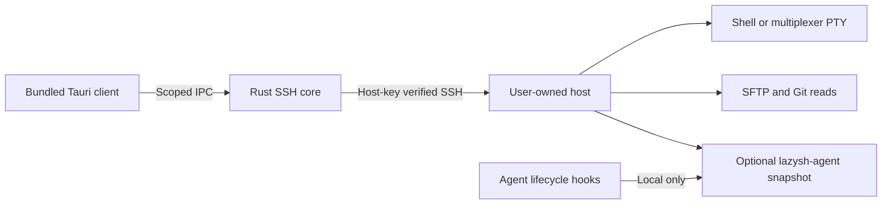

# lazysh implementation boundary

The user-selected stack is **Tauri 2 + Rust + React/TypeScript + Bun/Turborepo**. Android/iOS and desktop share the client source. Native packaging, OS lifecycle behavior and platform extensions still require platform toolchains and acceptance tests.

## Components

- `apps/client/src/`: accessible host/session workspace, xterm.js terminal, SFTP and diff views, and companion event board. Terminal models live outside React render cycles and remain mounted across view changes. Only connection metadata and native-owned pins persist; credentials are prompted per connection.
- `apps/client/src-tauri/`: direct Rust SSH transport (`russh`), local host metadata, strict SHA-256 host verification before authentication, PTY streaming/resize, bounded SFTP reads/uploads, explicit Git diffs and multiplexer discovery. All native commands are restricted to the bundled main window. Remote file content is text, never executable HTML.
- `apps/agent/`: optional Rust CLI that accepts lifecycle events and emits a bounded local SQLite snapshot. It does not own agent processes, run an HTTP server, or grant approvals. The authenticated SSH connection carries snapshots.

The Bun workspace has two package-owned task sets, coordinated by Turbo; the Cargo workspace has both Rust crates and one root lockfile. No empty shared packages or duplicate configuration packages are introduced. The client owns its TypeScript/Vite/Vitest/Playwright configuration. Rust tests use Cargo's unit/integration conventions. Native tasks use Cargo's compilation cache and bypass Turbo artifact/test caching, avoiding cross-platform artifact reuse or cached integration results. Frontend outputs use an explicit `dist/**` cache boundary. There is no custom test runner or `scripts/` directory.

## Decisions and alternatives

The empty repository offered no existing application patterns. Tauri follows the user's explicit stack choice; Flutter was considered before that preference and is not part of the project. A native SSH library avoids a local websocket relay and works on mobile where a desktop `ssh` subprocess is unavailable. xterm.js provides tested terminal parsing/IME/scrollback behavior rather than a new terminal emulator. An optional local event CLI gives agent visibility without owning, replacing or restarting an agent runtime.

Credentials stay in memory in this first slice. Platform vault/biometrics are tracked separately; there is no plaintext password setting or pretend secure store. Native chat and approvals remain gated on real agent adapters and exact pending-prompt validation. Missing usage data stays unknown. The first iteration manually refreshes bounded snapshots; background polling is not implied.

## Acceptance and delivery

The [Project](https://github.com/users/mihazs/projects/2) and [parity epic](https://github.com/mihazs/lazysh/issues/1) are the delivery record. The [evidence catalog](moshi-evidence.md) lists the full Moshi boundary and unresolved runtime claims. Current implementation work is reviewed through PRs; future features are separate sub-issues with executable acceptance criteria.

For this first slice: build the native Linux app; establish real SSH password/key and first-use/changed-key tests; test UTF-8 PTY/resize/close; exercise host/credential UI and native IPC contracts; run the companion CLI under malformed/oversized/concurrent input; verify file limits and no-overwrite transfers. Mobile releases and performance claims need real device measurements.

Rollback is removal of the client/optional hooks. Multiplexer sessions remain owned by the host. Do not delete host state or credentials to roll back code. The companion's optional local summary database can be removed independently.

## Unresolved delivery work

This is an initial direct-SSH implementation, **not full Moshi parity**. Mosh/ET, bastions, native agent chat/adapters, race-safe approvals, complete Herdr/Zellij controls, vault/biometrics, previews, voice, annotations, push, sync, Apple extensions, simulator streaming, historical/media browsing and full native release/performance gates remain open. See issues #5–#20 for the bounded work and acceptance conditions.
