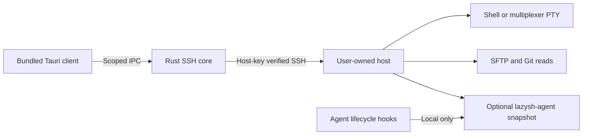

# lazysh implementation boundary

The user-selected stack is **Tauri 2 + Rust + React/TypeScript + Bun/Turborepo**. Android/iOS and desktop share the client source. Native packaging, OS lifecycle behavior and platform extensions still require platform toolchains and acceptance tests.

## Components

- `apps/client/src/`: host/session workspace, xterm.js terminal, agent transcripts, repository review, attachments, previews and editable dictation. Terminal models live outside React render cycles and remain mounted across view changes. Heavy panels and syntax highlighting load on demand. Connection intentions and preferences persist without credentials or terminal output.
- `apps/client/src-tauri/`: direct Rust SSH transport (`russh`), local host metadata, strict SHA-256 host verification before authentication, PTY streaming/resize, bounded SFTP reads/uploads, explicit Git diffs and multiplexer discovery. All native commands are restricted to the bundled main window. Remote file content is text, never executable HTML.
- `apps/agent/`: optional Rust CLI accepting lifecycle events and emitting bounded snapshots, transcript discovery and normalized records. Claude has an explicit active-branch snapshot; other adapters expose recorded messages. Hermes/OpenCode readers use read-only SQLite with query/row budgets. Optional Claude permission hooks await exact, expiring user decisions through a private queue. SDK commands provide bounded remote device controls. The authenticated SSH connection carries results.
- `packages/credential-vault`: native-only Tauri plugin using platform credential stores. Host identity and route bind saved secrets; the frontend receives presence only. Per-host operation guards serialize save, forget, host edits and deletion. Windows uses journaled Credential Manager chunks because a single item cannot hold common private keys.
- `packages/mosh-transport` and `packages/et-transport`: authenticated persistent terminal transports bootstrapped through verified SSH. The SSH control connection remains available for files and companion operations. Forced transport selection never silently falls back. Mosh embeds the official core on Linux/macOS, Android and iOS (both mobile library runtime suites passed in simulators; app/physical-device acceptance remains separate); ET is Rust and preserves encrypted packet history across reconnects.
- `packages/apple-speech`: optional iOS 26+ SpeechAnalyzer integration with explicit asset management and operation-scoped cancellation. Whisper remains available independently.
- `packages/apple-status` and the client Apple targets: opt-in fresh status snapshots, Live Activities, Watch inbox/review navigation and complications. Native approval execution is not exposed on Watch.
- `packages/push-registration`: explicit Android FCM enrollment/revocation with native token ownership. An unconfigured build remains unavailable; registration alone does not provide delivery.
- `apps/share-service`: separately deployed optional HTTPS-facing upload service behind a loopback reverse proxy. The native client keeps management credentials in the OS vault; browser IPC uploads use bounded chunks. Expiring public links are created only after explicit user action.

The Bun workspace has app- and package-owned tasks coordinated by Turbo; Cargo owns the native crates and one root lockfile. The client declares its vault package dependency in both graphs. The client owns TypeScript/Vite/Vitest/Playwright configuration. Rust tests use Cargo's unit/integration conventions. Native tasks use Cargo's compilation cache and bypass Turbo artifact/test caching. Frontend outputs use an explicit `dist/**` cache boundary. There is no custom test runner or `scripts/` directory.

## Decisions and alternatives

The empty repository offered no existing application patterns. Tauri follows the user's explicit stack choice; Flutter was considered before that preference and is not part of the project. A native SSH library avoids a local websocket relay and works on mobile where a desktop `ssh` subprocess is unavailable. xterm.js provides tested terminal parsing/IME/scrollback behavior rather than a new terminal emulator. An optional local event CLI gives agent visibility without owning, replacing or restarting an agent runtime.

Credentials stay in memory unless explicitly saved to the native vault. Android/iOS/macOS biometric protection is optional and device-local; secure storage alone is not biometric authentication. Explicit private-key export requires fresh native authentication, and displayed keys clear on backgrounding. Optional sync uses authenticated age encryption and HTTPS conditional writes, with separate settings and credential actions. Transcript views never send approvals. Review comments, attachments and dictation stage text in a matching terminal's editable composer, with explicit user sending. Recorded usage displays its source window and freshness; missing quota/context data stays unknown.

One-hop bastions use independent credentials and pins for each handshake. A rejected destination key receives no destination credentials. Workspace restoration uses saved vault entries and exact tmux/Herdr names; Zellij remains an explicit attach. Closing a temporary parent shell preserves independently attached multiplexer PTYs.

Browser previews bind only device loopback and connect through existing SSH. Their sandboxed remote origin has no Tauri command permissions. Limits apply per session, application and active socket; disconnect cancels listeners and connections. Other local applications can reach loopback forwards. Voice inference is local Whisper with bounded model imports, audio and execution, no automatic model download, and suppressed native speech logs. Platform microphone/preview behavior still needs real-device checks.

## Acceptance and delivery

The [Project](https://github.com/users/mihazs/projects/2) and [parity epic](https://github.com/mihazs/lazysh/issues/1) are the delivery record. The [evidence catalog](moshi-evidence.md) lists the full Moshi boundary and unresolved runtime claims. Current implementation work is reviewed through PRs; future features are separate sub-issues with executable acceptance criteria.

For this first slice: build the native Linux app; establish real SSH password/key and first-use/changed-key tests; test UTF-8 PTY/resize/close; exercise host/credential UI and native IPC contracts; run the companion CLI under malformed/oversized/concurrent input; verify file limits and no-overwrite transfers. Mobile releases and performance claims need real device measurements.

Rollback is removal of the client/optional hooks. Multiplexer sessions remain owned by the host. Do not delete host state or credentials to roll back code. The companion's optional local summary database can be removed independently.

## Unresolved delivery work

This remains **not full Moshi parity**. Mosh iOS/Windows and mobile transport roaming acceptance, remaining native transcript formats and live verification, broader same-pane chat/approvals, Windows/Linux biometric gating and app resume locks, remaining gesture/appearance controls, additional voice engines, visual DOM annotations, background push delivery, Apple extension/watchOS acceptance, real SDK/device validation of continuous simulator video and iOS touch, and full native release/performance gates remain open. Encrypted sync, sharing, biometric hardware and Apple speech still require real-service/device acceptance. Implemented subsets do not close their broader issues; see #5–#20 for acceptance conditions.
