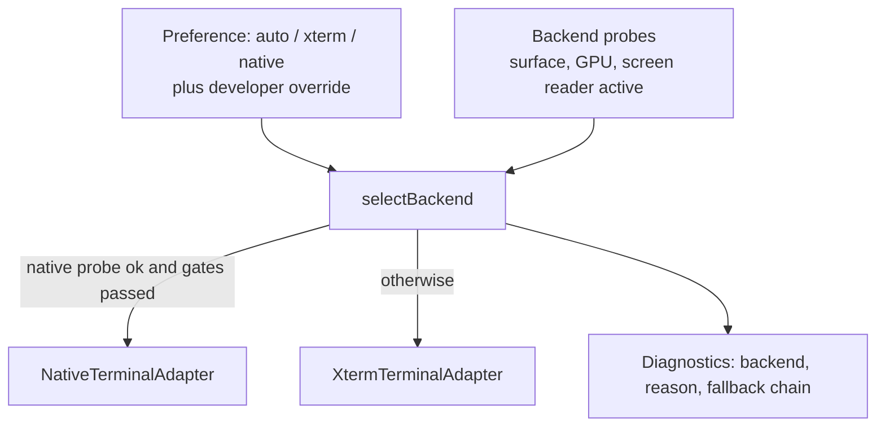

# TerminalAdapter contract

Status: **proposed reference** (nothing here is implemented). The interface below was derived from what `apps/client/src` actually calls on xterm today, then adjusted from the illustrative shape in the original brief. Tracking: [#1304](https://github.com/mihazs/lazysh/issues/1304) (contract), [#1305](https://github.com/mihazs/lazysh/issues/1305) (contract tests), [#1306](https://github.com/mihazs/lazysh/issues/1306) (xterm adapter), [#1307](https://github.com/mihazs/lazysh/issues/1307) (xterm seams), [#1308](https://github.com/mihazs/lazysh/issues/1308) (decoupling), [#1309](https://github.com/mihazs/lazysh/issues/1309) (registry), [#1321](https://github.com/mihazs/lazysh/issues/1321) (native adapter). Related: [runtime](terminal-runtime.md) · [migration plan](terminal-migration-plan.md).

## Coupling inventory (current code)

| Concern | Where xterm is touched |
| --- | --- |
| Type of a live terminal | `terminal.ts:20` `LiveSession.terminal: Terminal`; `createTerminal()` `terminal.ts:7`; constructed in `App.tsx:131-138` |
| Output and acknowledgement | `App.tsx:170-176` `terminal.write(bytes, callback)` then `ackOutput` |
| Disposal | `App.tsx:120-123` `disposeTerminal` |
| Options and theme | `preferences.ts:5,257` returns xterm `ITerminalOptions`/`ITheme`; `themeImport.ts:2`; `terminalBold.ts` |
| Fit and geometry | `terminalFit.ts` (reads `_core._renderService` and `.xterm-viewport`); `TerminalPane.tsx:771-806` |
| Viewport and scroll seams | `terminal.ts:40-80` (`_core.viewport`), `TerminalPane.tsx:755-768`, wheel/touch routing around `TerminalPane.tsx:500-545` |
| Input and IME | `terminal.ts:85-110` `observeTerminalInput` (`_core.coreService.onUserInput`), `terminalIme.ts` (`_core._compositionHelper`, the helper textarea), key handler `TerminalPane.tsx:694-707`, `softKeyboard.ts:10`, `keyboard.ts:9` |
| Mosh canonical resize | `moshResize.ts` (`_core._bufferService.buffers.resize`, parser OSC 7777), installed at `App.tsx:233`, consumed at `TerminalPane.tsx:753-756,783-791` |
| Selection and touch selection | `terminalTouchSelection.ts` (`buffer.getLine().getCell()`, `.xterm-screen` rect), `TerminalSelectionTools.tsx` (`getSelectionPosition`, `onSelectionChange`, `onRender`, `onScroll`, `onResize`), `TerminalPane.tsx:444-482` |
| Search | `TerminalPane.tsx:907-925` scans `buffer.getLine().translateToString` |
| Links and clipboard | `WebLinksAddon` and OSC 52 handler `TerminalPane.tsx:679-691`; `decodeClipboardRequest` in `preferences.ts` |
| Mode queries | `modes.bracketedPasteMode`, `options.ignoreBracketedPasteMode` (`App.tsx:1361`, `TerminalPane.tsx:896`); `modes.mouseTrackingMode`, `buffer.active.type` (`TerminalPane.tsx:503-507`) |
| Herdr inspection | `herdrNavigationCells.ts` (`buffer.getLine().translateToString`), used at `TerminalPane.tsx:661` |
| DOM and CSS contracts | `.xterm`, `.xterm-screen`, `.xterm-viewport`, `.xterm-helper-textarea` in `keyboard.ts`, `textInteraction.ts:104-114`, `styles.css:714-723`, `TerminalComposerSheet.css` |

Modules that import `@xterm/*`: `terminal.ts`, `terminalFit.ts`, `terminalBold.ts`, `terminalIme.ts`, `moshResize.ts`, `terminalTouchSelection.ts`, `TerminalSelectionTools.tsx`, `herdrNavigationCells.ts`, `preferences.ts`, `themeImport.ts`, `TerminalPane.tsx`.

## Changes from the illustrative interface

1. **Write acknowledgement.** `write(bytes)` returns a promise that resolves when the bytes are applied; this is the point at which credits are returned (`App.tsx:173`). Native-owned data paths declare `dataPath: 'runtime'` and expose no `write`.
2. **Input origin.** `TerminalPane` distinguishes keyboard, literal paste and pointer lanes and `terminal-user` versus `terminal-nonuser` writes; input events carry an `origin` instead of bare bytes.
3. **Resize is two things.** A UI size request (intent) is separate from the geometry that the transport imposes. Mosh makes the transport authoritative; xterm's `resize` is replaced by `requestSize` today.
4. **Screen inspection is text only** (`readRows`), under its own capability. Cells never leave the adapter.
5. **Selection uses absolute buffer coordinates** and an event on change; handle placement uses a `viewport` event, not `onRender`.
6. **Mount target is a union**, and a native target still has a DOM anchor so layout stays in React.
7. **Input is a string today** (`api.write(sessionId, data: string)`); the adapter's `sendInput` accepts `string | Uint8Array` so a binary-safe path can be introduced behind the same interface.

## Proposed TypeScript

```ts
export type TerminalBackendId = 'native' | 'xterm';

export interface TerminalSize { columns: number; rows: number; pixelWidth?: number; pixelHeight?: number }

export interface TerminalCapabilities {
  readonly nativeRendering: boolean;
  readonly selection: boolean;
  readonly scrollback: boolean;
  readonly mouseReporting: boolean;
  readonly ime: boolean;
  readonly accessibility: boolean;        // screen-reader access to content
  readonly screenInspection: boolean;     // readRows
  readonly canonicalMoshResize: boolean;  // transport-authoritative geometry
  readonly customBoldColor: boolean;
}

export type TerminalMountTarget =
  | { kind: 'dom'; element: HTMLElement }
  | { kind: 'native'; anchorId: string }; // anchor element reports its rect; surface is native

export interface TerminalPreferences {   // replaces ITerminalOptions/ITheme in preferences.ts
  fontFamily: string; fontSize: number; lineHeight: number;
  cursorStyle: 'block' | 'underline' | 'bar'; cursorBlink: boolean;
  scrollbackLines: number; optionAsMeta: boolean; screenReader: boolean;
  colors: { foreground: string; background: string; cursor?: string; selection?: string;
            ansi: readonly string[]; extendedAnsi?: readonly string[]; bold?: string };
}

export type TerminalScrollAction =
  | { kind: 'lines'; delta: number } | { kind: 'pages'; delta: number }
  | { kind: 'toTop' } | { kind: 'toBottom' } | { kind: 'toRow'; row: number };

export interface TerminalCell { column: number; row: number }       // row is absolute in the buffer
export interface TerminalRange { start: TerminalCell; end: TerminalCell } // end inclusive
export interface TerminalSelection { range: TerminalRange; text: string }
export interface TerminalModes {
  bracketedPaste: boolean; mouseTracking: 'none' | 'x10' | 'vt200' | 'drag' | 'any';
  alternateScreen: boolean; applicationCursorKeys: boolean;
}
export interface TerminalViewport { top: number; rows: number; bottom: number; following: boolean }

export type TerminalInputOrigin = 'keyboard' | 'ime' | 'paste' | 'pointer' | 'terminal-reply';

export type TerminalEvent =
  | { type: 'input'; origin: TerminalInputOrigin; data: string | Uint8Array }  // js-fed backends
  | { type: 'resizeIntent'; size: TerminalSize }                               // tell the transport
  | { type: 'geometry'; size: TerminalSize; authority: 'local' | 'transport' }
  | { type: 'viewport'; viewport: TerminalViewport }
  | { type: 'selection'; selection: TerminalSelection | undefined }
  | { type: 'modes'; modes: TerminalModes }                                    // includes alternate screen change
  | { type: 'clipboardWrite'; base64: string }                                 // OSC 52, bounded, consent in React
  | { type: 'link'; uri: string }
  | { type: 'title'; title: string } | { type: 'bell' }
  | { type: 'unappliedEdit'; edit: { text: string; truncated: boolean } | null } // IME
  | { type: 'failure'; reason: 'invalid-frame' | 'partial-frame' | 'renderer-lost' | 'core-error' }
  | { type: 'surface'; state: 'lost' | 'restored' };

export interface Disposable { dispose(): void }

export interface TerminalAdapter {
  readonly backend: TerminalBackendId;
  readonly capabilities: TerminalCapabilities;
  readonly dataPath: 'renderer' | 'runtime';        // who receives transport bytes

  // lifecycle: the session outlives any view
  attach(target: TerminalMountTarget): Promise<void>;
  detach(): Promise<void>;
  setActive(active: boolean): void;                 // inactive: parse, never draw
  dispose(): Promise<void>;                         // async, idempotent

  // data plane (dataPath === 'renderer' only)
  write?(bytes: Uint8Array): Promise<void>;         // resolves after apply: the ack point
  sendInput(data: string | Uint8Array, origin: TerminalInputOrigin): void; // encodes paste/keys when needed

  // geometry and view
  requestSize(size: TerminalSize): void;            // UI intent; may be ignored if transport-authoritative
  metrics(): { columns: number; rows: number; cellWidth: number; cellHeight: number };
  applyPreferences(preferences: TerminalPreferences): void;
  scroll(action: TerminalScrollAction): void;
  viewport(): TerminalViewport;
  modes(): TerminalModes;

  // selection and inspection
  cellAt(clientX: number, clientY: number): TerminalCell | undefined;
  getSelection(): TerminalSelection | undefined;
  select(range: TerminalRange): void;
  selectWordAt(cell: TerminalCell): TerminalRange;
  selectAll(): void;
  clearSelection(): void;
  readRows?(first: number, count: number): string[];          // capability screenInspection
  search(query: string, direction: 1 | -1): { row: number } | undefined;

  // input and focus
  focus(): void; blur(): void;
  ime?: { idle(): boolean; composing(): boolean; flush(): void; settle(): void; reset(): void;
          clear(): void; resume(): void; dismiss(): void };    // capability ime
  paste(text: string): void;                        // bracketed-paste aware

  subscribe(listener: (event: TerminalEvent) => void): Disposable;
}
```

Constraints encoded in the shape:

- Capabilities are truthful: a backend that cannot inspect rows reports `screenInspection: false` and omits `readRows`; the contract suite fails if a capability is claimed without a passing test group.
- React never receives cells. `readRows` returns trimmed text for a bounded range.
- `subscribe` listeners are ordered per adapter and must not outlive `dispose`.
- `setActive(false)` stops drawing; it does not stop parsing or transport.
- Switching the active session is a pair of `setActive` calls serialized by the controller; the contract suite includes a rapid-switch race test.

## Mapping from today's members

| Today | Adapter member |
| --- | --- |
| `terminal.write(bytes, cb)` + `ackOutput` | `write` (promise = ack point) |
| `observeTerminalInput` return value (`idle`, `reset`, `clear`, `resume`, `flush`, `settle`, `dismiss`, `composing`) | `ime` |
| `moshResize.onResizeIntent`, `requestSize`, `failure` | `resizeIntent`/`geometry`/`failure` events, `requestSize` |
| `getSelectionPosition`, `select`, `selectAll`, `hasSelection`, `clearSelection` | selection members |
| `buffer.active.getLine().translateToString` (Herdr cell, search) | `readRows`, `search` |
| `scrollLines`, `scrollToLine`, `scrollToBottom` | `scroll` |
| `modes.bracketedPasteMode`, `mouseTrackingMode`, `buffer.active.type` | `modes()` |
| `onSelectionChange`, `onScroll`, `onRender`, `onResize` | `selection`, `viewport`, `geometry` events |
| OSC 52 parser hook, `WebLinksAddon` | `clipboardWrite`, `link` events |
| `options.*`, `applyTerminalTheme`, `terminalBold` | `applyPreferences` (+ `customBoldColor`) |

## Backend registry and selection



- Each backend registers `{ id, probe(): Promise<ProbeResult>, create(config): TerminalAdapter }`.
- Selection happens at session creation; a failed probe is recorded with its reason and never silently ignored. A developer override cannot enable a backend whose probe failed.
- Native is not the default until its platform gate passes ([migration plan](terminal-migration-plan.md)). A renderer failure inside a session is handled by the backend (`surface` events), not by swapping backends.

## Contract tests

One parametrized suite, run against every adapter and a fake:

- write ordering and acknowledgement after apply; dispose idempotence and subscription cleanup;
- resize intent versus transport-authoritative geometry, using `mosh-resize-frames.json`;
- scroll, selection coordinates (including wide characters), mode reporting;
- IME composition commits without duplicates, reusing the scenarios behind `terminal-ime.spec.ts` and `terminal-swiftkey.spec.ts`;
- active-session switching races; capability honesty.

Existing xterm-specific tests stay and are never weakened.

## Unresolved questions

- Whether `sendInput` should return a promise to surface the `backpressure` error that `write_stdin` can raise today (`TerminalPane.tsx:186-200`; related #661).
- Whether the IME bridge on a native surface is a hidden DOM editor or a native input connection ([native rendering](native-rendering.md#input-and-ime)).
- The shape of accessibility on a native surface ([platform integration](platform-integration.md#accessibility)).
