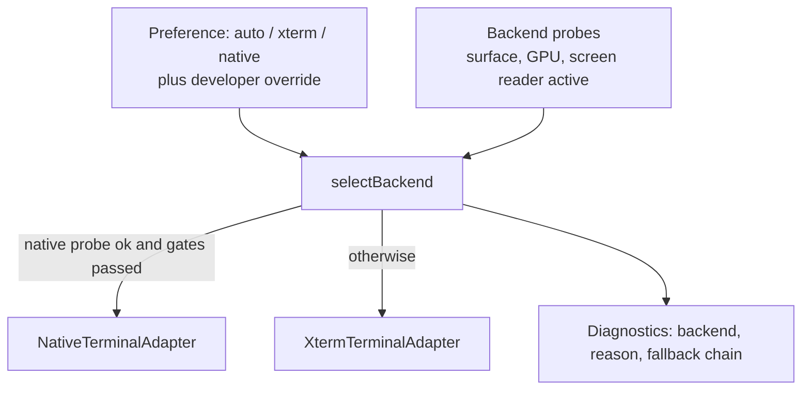

# TerminalAdapter contract

Status: **contract and xterm backend implemented** (see [Implementation status](#implementation-status)); the native backend's TypeScript adapter exists and passes the contract over a stand-in core, but it has no Rust commands, no registration and no renderer yet ([Native backend](#native-backend-1321)). The interface below was derived from what `apps/client/src` actually calls on xterm today, then adjusted from the illustrative shape in the original brief. Tracking: [#1304](https://github.com/mihazs/lazysh/issues/1304) (contract), [#1305](https://github.com/mihazs/lazysh/issues/1305) (contract tests), [#1306](https://github.com/mihazs/lazysh/issues/1306) (xterm adapter), [#1307](https://github.com/mihazs/lazysh/issues/1307) (xterm seams), [#1308](https://github.com/mihazs/lazysh/issues/1308) (decoupling), [#1309](https://github.com/mihazs/lazysh/issues/1309) (registry), [#1321](https://github.com/mihazs/lazysh/issues/1321) (native adapter). Related: [runtime](terminal-runtime.md) · [migration plan](terminal-migration-plan.md).

## Coupling inventory (current code)

| Concern | Where xterm is touched |
| --- | --- |
| Type of a live terminal | `terminal.ts:20` `LiveSession.terminal: Terminal`; `createTerminal()` `terminal.ts:7`; constructed in `App.tsx:131-138` |
| Output and acknowledgement | `App.tsx:170-176` `terminal.write(bytes, callback)` then `ackOutput` |
| Disposal | `App.tsx:120-123` `disposeTerminal` |
| Options and theme | `preferences.ts:5,257` returns xterm `ITerminalOptions`/`ITheme`; `themeImport.ts:2`; `terminalBold.ts` |
| Fit and geometry | `terminalFit.ts` (reads `_core._renderService` and `.xterm-viewport`); `TerminalPane.tsx:771-806` |
| Viewport and scroll seams | `terminal.ts:40-80` (`_core.viewport`), `TerminalPane.tsx:755-768`, wheel/touch routing around `TerminalPane.tsx:500-545` |
| Input and IME | `terminal.ts:85-110` `observeTerminalInput` (`_core.coreService.onUserInput`), `terminalIme.ts` (`_core._compositionHelper`, the helper textarea), key handler `TerminalPane.tsx:694-707`, `softKeyboard.ts:10`, `keyboard.ts:9` |
| Mosh canonical resize | `moshResize.ts` (`_core._bufferService.buffers.resize`, parser OSC 7777), installed at `App.tsx:233`, consumed at `TerminalPane.tsx:753-756,783-791` |
| Selection and touch selection | `terminalTouchSelection.ts` (`buffer.getLine().getCell()`, `.xterm-screen` rect), `TerminalSelectionTools.tsx` (`getSelectionPosition`, `onSelectionChange`, `onRender`, `onScroll`, `onResize`), `TerminalPane.tsx:444-482` |
| Search | `TerminalPane.tsx:907-925` scans `buffer.getLine().translateToString` |
| Links and clipboard | `WebLinksAddon` and OSC 52 handler `TerminalPane.tsx:679-691`; `decodeClipboardRequest` in `preferences.ts` |
| Mode queries | `modes.bracketedPasteMode`, `options.ignoreBracketedPasteMode` (`App.tsx:1361`, `TerminalPane.tsx:896`); `modes.mouseTrackingMode`, `buffer.active.type` (`TerminalPane.tsx:503-507`) |
| Herdr inspection | `herdrNavigationCells.ts` (`buffer.getLine().translateToString`), used at `TerminalPane.tsx:661` |
| DOM and CSS contracts | `.xterm`, `.xterm-screen`, `.xterm-viewport`, `.xterm-helper-textarea` in `keyboard.ts`, `textInteraction.ts:104-114`, `styles.css:714-723`, `TerminalComposerSheet.css` |

Modules that import `@xterm/*`: `terminal.ts`, `terminalFit.ts`, `terminalBold.ts`, `terminalIme.ts`, `moshResize.ts`, `terminalTouchSelection.ts`, `TerminalSelectionTools.tsx`, `herdrNavigationCells.ts`, `preferences.ts`, `themeImport.ts`, `TerminalPane.tsx`.

## Changes from the illustrative interface

1. **Write acknowledgement.** `write(bytes)` returns a promise that resolves when the bytes are applied; this is the point at which credits are returned (`App.tsx:173`). Native-owned data paths declare `dataPath: 'runtime'` and expose no `write`.
2. **Input origin.** `TerminalPane` distinguishes keyboard, literal paste and pointer lanes and `terminal-user` versus `terminal-nonuser` writes; input events carry an `origin` instead of bare bytes.
3. **Resize is two things.** A UI size request (intent) is separate from the geometry that the transport imposes. Mosh makes the transport authoritative; xterm's `resize` is replaced by `requestSize` today.
4. **Screen inspection is text only** (`readRows`), under its own capability. Cells never leave the adapter.
5. **Selection uses absolute buffer coordinates** and an event on change; handle placement uses a `viewport` event, not `onRender`.
6. **Mount target is a union**, and a native target still has a DOM anchor so layout stays in React.
7. **Input is a string today** (`api.write(sessionId, data: string)`); the adapter's `sendInput` accepts `string | Uint8Array` so a binary-safe path can be introduced behind the same interface.

## The interface

The interface is implemented; `apps/client/src/terminalAdapter.ts` is its source of truth and carries a comment for every member. In short, a `TerminalAdapter` has:

- identity: `backend` (`'native' | 'xterm'`), `capabilities` (truthful flags, one per optional member group) and `dataPath` (`'renderer'` when the WebView feeds bytes through `write`, `'runtime'` when a native runtime owns the transport);
- lifecycle: `attach`/`detach` (state survives a view), `setActive`, and an async idempotent `dispose`;
- data plane: `write` (resolves when applied, the credit-return point), `sendInput` with an origin lane, `paste`, `observeInput` (IME) and `enableCanonicalResize` (Mosh);
- geometry and view: `requestSize` (intent), `metrics`, `applyPreferences`, `scroll`, `viewport`, `modes`;
- selection and inspection in absolute buffer coordinates: `cellAt`, `getSelection`, `select`, `selectWordAt`, `selectAll`, `clearSelection`, `readRows` (text only), `search`;
- `focus`, `blur` and `subscribe` over a `TerminalEvent` union (`resizeIntent`, `geometry` with `authority`, `viewport`, `selection`, `modes`, `title`, `bell`, `failure`).

Constraints encoded in the shape:

- Capabilities are truthful: a backend that cannot inspect rows reports `screenInspection: false` and omits `readRows`; the contract suite fails when `screenInspection`, `ime` or `canonicalMoshResize` is claimed without its members (or the members exist without the claim). A guard that fails when any claimed capability has no test group, and registry enforcement that a backend passed the suite before it can be registered, are not implemented yet ([#1305](https://github.com/mihazs/lazysh/issues/1305) stays open for them).
- React never receives cells. `readRows` returns trimmed text for a bounded range.
- `subscribe` listeners are ordered per adapter and must not outlive `dispose`.
- `setActive(false)` stops drawing; it does not stop parsing or transport.
- Switching the active session is a pair of `setActive` calls serialized by the controller; the contract suite includes a rapid-switch race test.

## Mapping from today's members

| Today | Adapter member |
| --- | --- |
| `terminal.write(bytes, cb)` + `ackOutput` | `write` (promise = ack point) |
| `observeTerminalInput` return value (`idle`, `reset`, `clear`, `resume`, `flush`, `settle`, `dismiss`, `composing`) | `ime` |
| `moshResize.onResizeIntent`, `requestSize`, `failure` | `resizeIntent`/`geometry`/`failure` events, `requestSize` |
| `getSelectionPosition`, `select`, `selectAll`, `hasSelection`, `clearSelection` | selection members |
| `buffer.active.getLine().translateToString` (Herdr cell, search) | `readRows`, `search` |
| `scrollLines`, `scrollToLine`, `scrollToBottom` | `scroll` |
| `modes.bracketedPasteMode`, `mouseTrackingMode`, `buffer.active.type` | `modes()` |
| `onSelectionChange`, `onScroll`, `onRender`, `onResize` | `selection`, `viewport`, `geometry` events |
| OSC 52 parser hook, `WebLinksAddon` | `clipboardWrite`, `link` events |
| `options.*`, `applyTerminalTheme`, `terminalBold` | `applyPreferences` (+ `customBoldColor`) |

## Backend registry and selection

- Each backend registers `{ id, probe(): Promise<ProbeResult>, create(config): TerminalAdapter }`.
- Selection happens at session creation; a failed probe is recorded with its reason and never silently ignored. A developer override cannot enable a backend whose probe failed.
- Native is not the default until its platform gate passes ([migration plan](terminal-migration-plan.md)). A renderer failure inside a session is handled by the backend (`surface` events), not by swapping backends.

## Contract tests

One parametrized suite, run against every adapter and a fake:

- write ordering and acknowledgement after apply; dispose idempotence and subscription cleanup;
- resize intent versus transport-authoritative geometry, using `mosh-resize-frames.json`;
- scroll, selection coordinates (including wide characters), mode reporting;
- IME composition commits without duplicates, reusing the scenarios behind `terminal-ime.spec.ts` and `terminal-swiftkey.spec.ts`;
- active-session switching races; capability honesty.

Existing xterm-specific tests stay and are never weakened.

## Implementation status

The contract lives in `apps/client/src/terminalAdapter.ts`, the xterm backend in `xtermTerminalAdapter.ts`, selection in `terminalBackendRegistry.ts` (pure) and `terminalBackends.ts` (the registrations), and the behavioural suite in `terminalAdapter.contract.ts`, run by `xtermTerminalAdapter.test.ts`. The code refined the proposal above:

- `ime` became `observeInput(listener, acceptsInput, onUnappliedEdit)`, returning the observer `TerminalPane` already drives. It is present exactly when the `ime` capability is claimed.
- Canonical Mosh resize is `enableCanonicalResize()`, present exactly when `canonicalMoshResize` is claimed. It returns the controller `TerminalPane` already uses (`{cols, rows}` sizes) so the pane needed no change; the adapter also emits `resizeIntent`, `geometry` (`authority: 'transport'`) and `failure` events.
- `TerminalPreferences` carries `scrollbackLines`, `brightBold`, `boldColor` and a theme object instead of xterm option names; `preferences.ts` produces it (`terminalPreferences`) and `xtermOptions.ts` maps it back.
- `write(bytes, onApplied?)` also takes a callback that runs synchronously at the apply point, so transport credit is returned in the same turn the terminal consumed the chunk (a promise continuation would add a microtask turn).
- `search(query, direction, from)` returns row, column and length; `readRows` takes an optional column span (Herdr navigation reads the right edge).
- `setActive(false)` cannot stop the xterm DOM renderer from drawing dirty rows; it only guarantees a repaint on reactivation. A native backend is expected to suspend drawing.
- `App.tsx` creates, feeds, acknowledges, resizes (Mosh), queries paste mode of and disposes each session's terminal through its adapter (`LiveSession.adapter`, the only terminal handle a session has). `TerminalPane`, `TerminalSelectionTools`, the Herdr navigation cells, the Agent view's dialog lift (`AgentPickerDock`, which reads the live rows with `readRows` and re-reads on the `output` event), search, copy and paste mode, the selection handles, links, OSC 7/52, key interception, fit and viewport repair, theming, IME and Mosh resize go through it too. No module outside the xterm backend imports `@xterm/*` or touches xterm internals; `xtermImportBoundary.test.ts` resolves every project import with the TypeScript compiler API to enforce it. The backend is `xtermTerminalAdapter.ts`, `xtermOptions.ts` and `src/xterm/` (the seams that patch xterm 5.5.0 internals: `moshResize.ts`, `terminalIme.ts`, `terminalBold.ts`, `terminalFit.ts`, `terminal.ts` viewport and input seams, `links.ts`, `selection.ts`). The registry offers no other backend yet, and the native backend is not auto-eligible.
- DOM markers: a DOM backend sets `data-terminal-root` on the root of the drawn terminal and `data-terminal-editor` on its typed-input editor when it attaches (`terminalRootSelector` and `terminalEditorSelector` in `terminalAdapter.ts`). `keyboard.ts`, `privateKeyboard.ts` and `textInteraction.ts` match those instead of xterm's class names. Left on purpose: the CSS selectors `.xterm`, `.xterm-viewport`, `.xterm-rows` and `.xterm-helper-textarea` in `styles.css` and `TerminalComposerSheet.css`, which style the nodes only the xterm backend creates; a backend that draws other nodes ships its own style sheet (`inputElement()` and `screenElement()` give layout code the nodes).
- Members added beyond the first draft, each because a consumer needed it: `hasSelection`, `selectionRange` (cells without text, cheap while dragging a large selection), `selectedText`, `size` (free, unlike `metrics`, which measures the drawn screen), `screenBounds` (where overlays are placed), `cursor`, `followLive`, `wheel`, `atLiveScreen` (fails closed), `metrics().scrollbackLines`, `inputElement`, `screenElement`, `layoutRowHeight`, `proposeSize`, `fit`, `syncViewport`, `interceptKeys` and `registerLinks`. `attach` mounts synchronously on the DOM backend (the terminal is measurable when the promise is created); `detach` also undoes the viewport seams.
- Events: `selection` carries the range only (read `selectedText()`), so a drag over a large selection does not build its text on every move; `viewport` also fires on a redraw, which replaces `onRender` for handle placement; `output` fires once per applied write and replaces `onWriteParsed` for Herdr detection; `cwd` and `clipboard` replace the OSC 7 and OSC 52 parser hooks the pane registered. `subscribe(listener, types?)` takes the event types the listener wants; the xterm backend wires an xterm listener only when a type is first requested.
- A developer override is the `lazysh.terminal.backend` key in `localStorage` (`xterm` or `native`); it never enables a backend whose probe failed.

## Native backend (#1321)

`nativeTerminalAdapter.ts` is the adapter for a Rust core (the [runtime](terminal-runtime.md)), over the control-plane interface in `nativeCoreBridge.ts`. It passes `terminalAdapter.contract.ts` unchanged. It is not registered, so nothing can select it; that comes with the Tauri commands.

- **Control plane only.** Every bridge answer is a `NativeCoreSnapshot`: a small `state` (size, cursor, modes, viewport, history setting) and a `window` of row text. No command returns cells, styles or pixels; a test checks the keys and types of every answer the contract run produces.
- **Synchronous readers serve from a mirror.** The adapter contract is synchronous (`modes()`, `viewport()`, `readRows`, `getSelection`), and IPC is not. The adapter keeps the last snapshot, every command answers with a fresh one, and commands run one at a time in the order issued, so a reader always sees a state the core really had. Resize and scroll update the mirror at once and the core's answer replaces it.
- **The window is bounded and chosen by the core** (rows around the viewport, at most 256 in the stand-in). Rows outside it read as empty, `search` and selection text only see it, and selection joins rows with a newline where the xterm backend joins soft-wrapped rows. These limits go away when selection, search and links move into the core ([#1320](https://github.com/mihazs/lazysh/issues/1320)); column cuts use an approximation of the core's width table until then.
- **Two data paths, one adapter.** When the bridge has `feed` the WebView hands transport bytes to the core and the adapter has `dataPath: 'renderer'` and a `write` (a core-only build, and the way the contract runs). Without it the adapter has `dataPath: 'runtime'` and no `write`: the transport feeds the core in Rust and rings a doorbell (`changed`). The adapter then pulls a snapshot at most once per refresh interval (16 ms) and not at all while inactive, so control-plane calls follow the screen's refresh rate, not the output volume. A test pushes 5,000 chunks and counts the pulls.
- **Honest capabilities.** `nativeRendering`, `ime`, `canonicalMoshResize`, `mouseReporting`, `accessibility` and `customBoldColor` are false; `selection`, `scrollback` and `screenInspection` are true. Mouse reports, IME, links, key interception and fitting are absent until the input and renderer slices ([#1328](https://github.com/mihazs/lazysh/issues/1328), [#1334](https://github.com/mihazs/lazysh/issues/1334), [#1327](https://github.com/mihazs/lazysh/issues/1327)).
- **Evidence and its limit.** The suite runs against `src/xterm/nativeCoreHeadless.ts`, a stand-in core on headless xterm.js; it proves the adapter and the bridge semantics, not the Rust core. It lives with the xterm backend and goes with it ([#1343](https://github.com/mihazs/lazysh/issues/1343)).

## Unresolved questions

- Whether `sendInput` should return a promise to surface the `backpressure` error that `write_stdin` can raise today (`TerminalPane.tsx:186-200`; related #661).
- Whether the IME bridge on a native surface is a hidden DOM editor or a native input connection ([native rendering](native-rendering.md#input-and-ime)).
- The shape of accessibility on a native surface ([platform integration](platform-integration.md#accessibility)).
