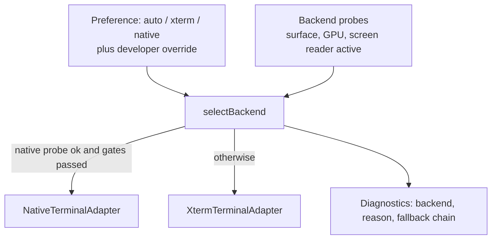

# TerminalAdapter contract

Status: **contract and xterm backend implemented** (see [Implementation status](#implementation-status)); the native backend's TypeScript adapter exists and passes the contract over a stand-in core, and the Rust core answers the commands it needs (`terminal_core_snapshot`, `_scroll`, `_resize` and `_set_active`, with an event stream on the session's Channel), and the client has a bridge over them (`tauriNativeCoreBridge.ts`) that nothing calls yet, there is no registration and no renderer ([Native backend](#native-backend-1321)). The interface below was derived from what `apps/client/src` actually calls on xterm today, then adjusted from the illustrative shape in the original brief. Tracking: [#1304](https://github.com/mihazs/lazysh/issues/1304) (contract), [#1305](https://github.com/mihazs/lazysh/issues/1305) (contract tests), [#1306](https://github.com/mihazs/lazysh/issues/1306) (xterm adapter), [#1307](https://github.com/mihazs/lazysh/issues/1307) (xterm seams), [#1308](https://github.com/mihazs/lazysh/issues/1308) (decoupling), [#1309](https://github.com/mihazs/lazysh/issues/1309) (registry), [#1321](https://github.com/mihazs/lazysh/issues/1321) (native adapter). Related: [runtime](terminal-runtime.md) · [migration plan](terminal-migration-plan.md) · [feature parity with xterm.js](terminal-native-parity.md).

## Coupling inventory (current code)

| Concern | Where xterm is touched |
| --- | --- |
| Type of a live terminal | `terminal.ts:20` `LiveSession.terminal: Terminal`; `createTerminal()` `terminal.ts:7`; constructed in `App.tsx:131-138` |
| Output and acknowledgement | `App.tsx:170-176` `terminal.write(bytes, callback)` then `ackOutput` |
| Disposal | `App.tsx:120-123` `disposeTerminal` |
| Options and theme | `preferences.ts:5,257` returns xterm `ITerminalOptions`/`ITheme`; `themeImport.ts:2`; `terminalBold.ts` |
| Fit and geometry | `terminalFit.ts` (reads `_core._renderService` and `.xterm-viewport`); `TerminalPane.tsx:771-806` |
| Viewport and scroll seams | `terminal.ts:40-80` (`_core.viewport`), `TerminalPane.tsx:755-768`, wheel/touch routing around `TerminalPane.tsx:500-545` |
| Input and IME | `terminal.ts:85-110` `observeTerminalInput` (`_core.coreService.onUserInput`), `terminalIme.ts` (`_core._compositionHelper`, the helper textarea), key handler `TerminalPane.tsx:694-707`, `softKeyboard.ts:10`, `keyboard.ts:9` |
| Mosh canonical resize | `moshResize.ts` (`_core._bufferService.buffers.resize`, parser OSC 7777), installed at `App.tsx:233`, consumed at `TerminalPane.tsx:753-756,783-791` |
| Selection and touch selection | `terminalTouchSelection.ts` (`buffer.getLine().getCell()`, `.xterm-screen` rect), `TerminalSelectionTools.tsx` (`getSelectionPosition`, `onSelectionChange`, `onRender`, `onScroll`, `onResize`), `TerminalPane.tsx:444-482` |
| Search | `TerminalPane.tsx:907-925` scans `buffer.getLine().translateToString` |
| Links and clipboard | `WebLinksAddon` and OSC 52 handler `TerminalPane.tsx:679-691`; `decodeClipboardRequest` in `preferences.ts` |
| Mode queries | `modes.bracketedPasteMode`, `options.ignoreBracketedPasteMode` (`App.tsx:1361`, `TerminalPane.tsx:896`); `modes.mouseTrackingMode`, `buffer.active.type` (`TerminalPane.tsx:503-507`) |
| Herdr inspection | `herdrNavigationCells.ts` (`buffer.getLine().translateToString`), used at `TerminalPane.tsx:661` |
| DOM and CSS contracts | `.xterm`, `.xterm-screen`, `.xterm-viewport`, `.xterm-helper-textarea` in `keyboard.ts`, `textInteraction.ts:104-114`, `styles.css:714-723`, `TerminalComposerSheet.css` |

Modules that import `@xterm/*`: `terminal.ts`, `terminalFit.ts`, `terminalBold.ts`, `terminalIme.ts`, `moshResize.ts`, `terminalTouchSelection.ts`, `TerminalSelectionTools.tsx`, `herdrNavigationCells.ts`, `preferences.ts`, `themeImport.ts`, `TerminalPane.tsx`.

## Changes from the illustrative interface

1. **Write acknowledgement.** `write(bytes)` returns a promise that resolves when the bytes are applied; this is the point at which credits are returned (`App.tsx:173`). Native-owned data paths declare `dataPath: 'runtime'` and expose no `write`.
2. **Input origin.** `TerminalPane` distinguishes keyboard, literal paste and pointer lanes and `terminal-user` versus `terminal-nonuser` writes; input events carry an `origin` instead of bare bytes.
3. **Resize is two things.** A UI size request (intent) is separate from the geometry that the transport imposes. Mosh makes the transport authoritative; xterm's `resize` is replaced by `requestSize` today.
4. **Screen inspection is text only** (`readRows`), under its own capability. Cells never leave the adapter.
5. **Selection uses absolute buffer coordinates** and an event on change; handle placement uses a `viewport` event, not `onRender`.
6. **Mount target is a union**, and a native target still has a DOM anchor so layout stays in React.
7. **Input is a string today** (`api.write(sessionId, data: string)`); the adapter's `sendInput` accepts `string | Uint8Array` so a binary-safe path can be introduced behind the same interface.

## The interface

The interface is implemented; `apps/client/src/terminalAdapter.ts` is its source of truth and carries a comment for every member. In short, a `TerminalAdapter` has:

- identity: `backend` (`'native' | 'xterm'`), `capabilities` (truthful flags, one per optional member group) and `dataPath` (`'renderer'` when the WebView feeds bytes through `write`, `'runtime'` when a native runtime owns the transport);
- lifecycle: `attach`/`detach` (state survives a view), `setActive`, and an async idempotent `dispose`;
- data plane: `write` (resolves when applied, the credit-return point), `sendInput` with an origin lane, `paste`, `observeInput` (IME) and `enableCanonicalResize` (Mosh);
- geometry and view: `requestSize` (intent), `metrics`, `applyPreferences`, `scroll`, `viewport`, `modes`;
- selection and inspection in absolute buffer coordinates: `cellAt`, `getSelection`, `select`, `selectWordAt`, `selectAll`, `clearSelection`, `readRows` (text only), `search`;
- `focus`, `blur` and `subscribe` over a `TerminalEvent` union (`resizeIntent`, `geometry` with `authority`, `viewport`, `selection`, `modes`, `title`, `bell`, `failure`).

Constraints encoded in the shape:

- Capabilities are truthful: a backend that cannot inspect rows reports `screenInspection: false` and omits `readRows`; the contract suite fails when `screenInspection`, `ime` or `canonicalMoshResize` is claimed without its members (or the members exist without the claim). A guard fails when a capability is claimed without a passing test case (`terminalCapabilityTests.ts`: each capability lists its cases, an empty list means nothing may claim it, and a renamed or failing case takes its capability with it), and `terminalBackends.contract.test.ts` runs the suite for every registration in `terminalBackends.ts` and fails a registration that has no harness or declares a capability without a passing case ([#1305](https://github.com/mihazs/lazysh/issues/1305)).
- React never receives cells. `readRows` returns trimmed text for a bounded range.
- `subscribe` listeners are ordered per adapter and must not outlive `dispose`.
- `setActive(false)` stops drawing; it does not stop parsing or transport.
- Switching the active session is a pair of `setActive` calls serialized by the controller; the contract suite includes a rapid-switch race test.

## Mapping from today's members

| Today | Adapter member |
| --- | --- |
| `terminal.write(bytes, cb)` + `ackOutput` | `write` (promise = ack point) |
| `observeTerminalInput` return value (`idle`, `reset`, `clear`, `resume`, `flush`, `settle`, `dismiss`, `composing`) | `ime` |
| `moshResize.onResizeIntent`, `requestSize`, `failure` | `resizeIntent`/`geometry`/`failure` events, `requestSize` |
| `getSelectionPosition`, `select`, `selectAll`, `hasSelection`, `clearSelection` | selection members |
| `buffer.active.getLine().translateToString` (Herdr cell, search) | `readRows`, `search` |
| `scrollLines`, `scrollToLine`, `scrollToBottom` | `scroll` |
| `modes.bracketedPasteMode`, `mouseTrackingMode`, `buffer.active.type` | `modes()` |
| `onSelectionChange`, `onScroll`, `onRender`, `onResize` | `selection`, `viewport`, `geometry` events |
| OSC 52 parser hook, `WebLinksAddon` | `clipboardWrite`, `link` events |
| `options.*`, `applyTerminalTheme`, `terminalBold` | `applyPreferences` (+ `customBoldColor`) |

## Backend registry and selection

- Each backend registers `{ id, probe(): Promise<ProbeResult>, create(config): TerminalAdapter }`.
- Selection happens at session creation; a failed probe is recorded with its reason and never silently ignored. A developer override cannot enable a backend whose probe failed.
- Native is not the default until its platform gate passes ([migration plan](terminal-migration-plan.md)). A renderer failure inside a session is handled by the backend (`surface` events), not by swapping backends.

## Contract tests

One parametrized suite, run against every adapter and a fake:

- write ordering and acknowledgement after apply; dispose idempotence and subscription cleanup;
- resize intent versus transport-authoritative geometry, using `mosh-resize-frames.json`;
- scroll, selection coordinates (including wide characters), mode reporting;
- IME composition commits without duplicates, reusing the scenarios behind `terminal-ime.spec.ts` and `terminal-swiftkey.spec.ts`;
- active-session switching races; capability honesty.

Existing xterm-specific tests stay and are never weakened.

## Implementation status

The contract lives in `apps/client/src/terminalAdapter.ts`, the xterm backend in `xtermTerminalAdapter.ts`, selection in `terminalBackendRegistry.ts` (pure) and `terminalBackends.ts` (the registrations), and the behavioural suite in `terminalAdapter.contract.ts`, run by `xtermTerminalAdapter.test.ts`, by `nativeTerminalAdapter.test.ts` (over a stand-in core), by `nativeTerminalAdapter.realCore.test.ts` (over the real core) and, for each registered backend, by `terminalBackends.contract.test.ts`, which adds the capability cases of `terminalCapabilityTests.ts` (mouse tracking levels and a wheel notch for `mouseReporting`, the list a screen reader walks for `accessibility`, the colour of bold text for `customBoldColor`; they observe what a DOM backend draws and run only for a backend that claims the capability). The code refined the proposal above:

- `ime` became `observeInput(listener, acceptsInput, onUnappliedEdit)`, returning the observer `TerminalPane` already drives. It is present exactly when the `ime` capability is claimed.
- Canonical Mosh resize is `enableCanonicalResize()`, present exactly when `canonicalMoshResize` is claimed. It returns the controller `TerminalPane` already uses (`{cols, rows}` sizes) so the pane needed no change; the adapter also emits `resizeIntent`, `geometry` (`authority: 'transport'`) and `failure` events.
- `TerminalPreferences` carries `scrollbackLines`, `brightBold`, `boldColor` and a theme object instead of xterm option names; `preferences.ts` produces it (`terminalPreferences`) and `xtermOptions.ts` maps it back.
- `write(bytes, onApplied?)` also takes a callback that runs synchronously at the apply point, so transport credit is returned in the same turn the terminal consumed the chunk (a promise continuation would add a microtask turn).
- `search(query, direction, from)` returns row, column and length; `searchBuffer` is the same search as a promise, present only on a backend that must ask for the answer (the native one, [below](#native-backend-1321)), and the find box prefers it; `readRows` takes an optional column span (Herdr navigation reads the right edge).
- `setActive(false)` cannot stop the xterm DOM renderer from drawing dirty rows; it only guarantees a repaint on reactivation. A native backend is expected to suspend drawing.
- `App.tsx` creates, feeds, acknowledges, resizes (Mosh), queries paste mode of and disposes each session's terminal through its adapter (`LiveSession.adapter`, the only terminal handle a session has). `TerminalPane`, `TerminalSelectionTools`, the Herdr navigation cells, the Agent view's dialog lift (`AgentPickerDock`, which reads the live rows with `readRows` and re-reads on the `output` event), search, copy and paste mode, the selection handles, links, OSC 7/52, key interception, fit and viewport repair, theming, IME and Mosh resize go through it too. No module outside the xterm backend imports `@xterm/*` or touches xterm internals; `xtermImportBoundary.test.ts` resolves every project import with the TypeScript compiler API to enforce it. The backend is `xtermTerminalAdapter.ts`, `xtermOptions.ts` and `src/xterm/` (the seams that patch xterm 5.5.0 internals: `moshResize.ts`, `terminalIme.ts`, `terminalBold.ts`, `terminalFit.ts`, `terminal.ts` viewport and input seams, `links.ts`, `selection.ts`). The registry offers no other backend yet, and the native backend is not auto-eligible.
- DOM markers: a DOM backend sets `data-terminal-root` on the root of the drawn terminal and `data-terminal-editor` on its typed-input editor when it attaches (`terminalRootSelector` and `terminalEditorSelector` in `terminalAdapter.ts`). `keyboard.ts`, `privateKeyboard.ts` and `textInteraction.ts` match those instead of xterm's class names. Left on purpose: the CSS selectors `.xterm`, `.xterm-viewport`, `.xterm-rows` and `.xterm-helper-textarea` in `styles.css` and `TerminalComposerSheet.css`, which style the nodes only the xterm backend creates; a backend that draws other nodes ships its own style sheet (`inputElement()` and `screenElement()` give layout code the nodes).
- Members added beyond the first draft, each because a consumer needed it: `hasSelection`, `selectionRange` (cells without text, cheap while dragging a large selection), `selectedText`, `size` (free, unlike `metrics`, which measures the drawn screen), `screenBounds` (where overlays are placed), `cursor`, `followLive`, `wheel`, `atLiveScreen` (fails closed), `metrics().scrollbackLines`, `inputElement`, `screenElement`, `layoutRowHeight`, `proposeSize`, `fit`, `syncViewport`, `interceptKeys` and `registerLinks`. `attach` mounts synchronously on the DOM backend (the terminal is measurable when the promise is created); `detach` also undoes the viewport seams.
- Events: `selection` carries the range only (read `selectedText()`), so a drag over a large selection does not build its text on every move; `viewport` also fires on a redraw, which replaces `onRender` for handle placement; `output` fires once per applied write and replaces `onWriteParsed` for Herdr detection; `cwd` and `clipboard` replace the OSC 7 and OSC 52 parser hooks the pane registered. `subscribe(listener, types?)` takes the event types the listener wants; the xterm backend wires an xterm listener only when a type is first requested.
- A developer override is the `lazysh.terminal.backend` key in `localStorage` (`xterm` or `native`); it never enables a backend whose probe failed.
- The user's engine choice is the device-local `terminalEngine` preference (`native` or `xterm`; absent means Auto, and it is never synced). `prepareSession` passes it to `createTerminalAdapter` as the `preference`, so a developer override still wins, and `LiveSession.selection` keeps the registry's `BackendSelection` (engine, reason, fallbacks) for the life of the session: a changed setting applies to the next session and an open one keeps its engine. `describeTerminalEngine` (`terminalEngineReason.ts`) turns that record into the translated one-line reason the diagnostics will show. Native is registered behind a probe (below) that no release build passes, so every value runs xterm.js today and a Native choice records the probe's reason; the control is Settings, Terminal engine ([#2092](https://github.com/mihazs/lazysh/issues/2092)). **A native session that fails to start** (`createNativeTerminalAdapter` rejects) begins on xterm.js: `registry.create` records the failure (`failed: <error>`, 200 characters at most) among the selection's `fallbacks`, so the engine line says why, and keeps it in the device's `localStorage` bound to the app version (`terminalBackends.ts`). Under Auto the registry then skips native with that reason until the app is updated; an explicit Native choice or developer override is never blocked by the record, and a native start that works clears it. A refusal of the app's lock (`StaleAccessError`) is not a failure. Settings shows the recorded failure beside the engine choice. **Leaving a live native session:** the Workspace tools page that shows the engine line has "Switch this session to xterm.js" for a native session, and a surface the shell cannot place does the same on its own and records the failure (a locked app is not a failure); the new selection reads `switched` or `fallback` with the failure.
- The build-time kill switch ([#1342](https://github.com/mihazs/lazysh/issues/1342)) is `LAZYSH_NATIVE_TERMINAL=off` (`on` or unset is the default; any other value fails the build): the client build (Bun, and Vite for the dev server and tests; `apps/client/build/sourceRevision.ts`) defines `__LAZYSH_NATIVE_TERMINAL_OFF__` and `src-tauri/build.rs` emits the `native_terminal_disabled` cfg. In such a build the registry never selects, probes or creates `native` (the preference, the developer override and a registration are all ignored), records `disabled in this build` as the reason it was refused (also under Auto), `selectableTerminalEngines()` omits Native for the Settings choice to list, and the Rust bridge commands (`terminal_core_open`, the Android surface commands) refuse with the same words even when the `native-terminal` feature is on. A stored `terminalEngine` preference is kept, not rewritten, so a later build without the switch honours it again.

## Native backend (#1321)

`nativeTerminalAdapter.ts` is the adapter for a Rust core (the [runtime](terminal-runtime.md)), over the control-plane interface in `nativeCoreBridge.ts`. It passes `terminalAdapter.contract.ts` unchanged. It is registered in `terminalBackends.ts` (`registerNativeBackend`) with `nativeCapabilities`, `autoEligible: false` and the probe below, so Auto never picks it and a Native choice or the developer override selects it only when the probe passes; a refused request is recorded with the probe's reason and uses xterm.js, and a screen reader still refuses it for lacking `accessibility`. Both halves of its bridge exist (below): the Rust commands and the client's Tauri bridge over them. The session start (`prepareSession` in `App.tsx`) wires the data path: an adapter with `dataPath: 'runtime'` carries a `transport` (`RuntimeTransport`: the core's `events` Channel, `bind` and `onEvent`), `bridge.ts`'s `createSession` starts the SSH, Mosh, ET, multiplexer or local transport on that Channel instead of a new one and calls `bind` with the session it started (or its failure), so the transport's output is delivered to the core in Rust (`ssh::deliver_output`) and never reaches JavaScript: no `write`, no `ackOutput` (credit returns in Rust after the parse). `onEvent` still receives the transport's `authHint` and `closed` notices, input goes through `terminal_core_input`, a resize through the PTY resize the app already sends on `resizeIntent`, and disposing the session closes the core. A Mosh attempt is on this path too: `prepareSession` tells the registry the session is Mosh, which requires `canonicalMoshResize` and opens the core with `canonicalFrames` (below); no renderer surface draws the session yet.

- **Control plane only.** Every bridge answer is a `NativeCoreSnapshot`: a small `state` (size, cursor, modes, viewport, history setting) and a `window` of row text. No command returns cells, styles or pixels; a test checks the keys and types of every answer the contract run produces.
- **Synchronous readers serve from a mirror.** The adapter contract is synchronous (`modes()`, `viewport()`, `readRows`, `getSelection`), and IPC is not. The adapter keeps the last snapshot, every command answers with a fresh one, and commands run one at a time in the order issued, so a reader always sees a state the core really had. Resize and scroll update the mirror at once and the core's answer replaces it.
- **The window is bounded and chosen by the core** (rows around the viewport, at most 256 in the stand-in). Rows outside it read as empty, and the synchronous `search`, `selectWordAt` and `readRows` only see it; column cuts use an approximation of the core's width table. Selection text and the find box no longer stop at it when the core answers questions about its text (next item).
- **Text questions go to the core ([#1320](https://github.com/mihazs/lazysh/issues/1320)).** A bridge with `query` answers `selectionText`, `search`, `wordAt`, `lineAt`, `bufferRange` and `copyScreen` from the core's own state (absolute rows, both ends of a range inclusive; text, a range or a hit, never cells), which reads the whole buffer, wide and combining characters and soft-wrapped lines as xterm.js does. The contract's readers are synchronous and a question is not, so the adapter asks for the selected text when the selection or the screen under it changes (one question at a time, after the commands already issued) and `selectedText()` and `getSelection()` give the core's text once it has answered, the window's until then, and never the text of an earlier selection. `searchBuffer` (optional on `TerminalAdapter`, present on this backend when the core has `query`) is the find box's search over every row; `TerminalPane` uses it when a backend has it and the synchronous `search` otherwise. `select` and `clearSelection` also tell the core which cells are selected (`bridge.select`), which its session holds for the renderer host: the host draws the visible part with each frame, so the highlight stays on its rows while the reader scrolls. Still read from the window: the word under a touch (`selectWordAt`; the visible rows are always in the window) and `readRows`. No caller in the app asks `lineAt`, `bufferRange` or `copyScreen` yet. A core without `query` (the stand-in) is served from the window as before.
- **Two data paths, one adapter.** When the bridge has `feed` the WebView hands transport bytes to the core and the adapter has `dataPath: 'renderer'` and a `write` (a core-only build, and the way the contract runs). Without it the adapter has `dataPath: 'runtime'` and no `write`: the transport feeds the core in Rust and rings a doorbell (`changed`). The adapter then pulls a snapshot at most once per refresh interval (16 ms) and not at all while inactive, so control-plane calls follow the screen's refresh rate, not the output volume. A test pushes 5,000 chunks and counts the pulls.
- **Commands (`terminal_core_*`).** `terminal_core_snapshot`, `terminal_core_scroll` and `terminal_core_resize` answer with the `NativeCoreSnapshot` shape minus `scrollbackLines` (the client knows the History lines setting it opened the core with): the window is the core's choice, at most 1,024 rows, 256 by default, always holding the viewport. `terminal_core_set_active` stops and restarts the event stream for a session nobody is looking at (a hidden session keeps parsing and rings once on return, and a core starts active). `terminal_core_open` and `_close` already existed; `terminal_core_open` also takes an optional `config` (`{theme, canonicalFrames}`, [#2158](https://github.com/mihazs/lazysh/issues/2158)): the client's `TerminalTheme`, which the core reports to a program that asks for its colours (`OSC 10`, `11`, `12`, `4`; a colour the theme leaves out is xterm.js's own), and `true` for a Mosh session, so the core follows the frames' sizes and takes the renderer's as intent. `terminal_core_theme` changes the theme of a running session. All but `close` belong to the current renderer's access lease and are refused while the app is locked. The events (`NativeCoreEvent`: `changed`, `title`, `bell`, `cwd`, `clipboard`) arrive on the `events` Channel the core was opened with, as `{"type": ...}` messages: the core decodes and bounds them (a directory report to its path, a clipboard write to valid UTF-8 of at most 64 KiB, a title to 1,024 bytes, at most 8 bells at a time), and `changed` is sent once per read of the state however much output arrives, with the reports ahead of it. Nothing is sent while the app is locked, and the core sends under the lease of the reader's latest command, so a reader that comes back from a lock sends one (a snapshot, or `terminal_core_set_active`) before it expects the doorbell. `terminal_core_resize` sizes a core the renderer owns; a core behind a transport follows the transport's own resize, which the renderer already sends. Input does not use a new command: `terminal_core_input` already encodes keys, mouse, paste and committed text under the same lease. The text questions are one command each, under the same lease: `terminal_core_selection_text {range}`, `terminal_core_search {query, direction, from}` (`"forward"` or `"backward"`), `terminal_core_word_at {cell}`, `terminal_core_line_at {row}`, `terminal_core_buffer_range` and `terminal_core_copy_screen`; `terminal_core_select {range}` sets or clears (`null`) the cells the renderer host highlights. A clipboard write reaches the event stream through the runtime's `clipboard_consent_text`, the policy `osc52.json` pins.
- **The way back to the WebView (`terminal_core_release`, [#1342](https://github.com/mihazs/lazysh/issues/1342)).** `terminal_core_release(sessionId, events)` hands a native session's transport back: from the next transport chunk on, output and the closing notice arrive on the new `events` Channel (acknowledged with `ack_output` or `local_ack` like any Channel terminal), and the command answers with an ANSI snapshot once the core has parsed every chunk it was given before that; the core is then freed. A caller resets its terminal, writes the snapshot, then writes the Channel's data in order (buffering what arrives before the answer): every byte is then applied once. `terminal_core_ansi_snapshot(sessionId)` reads the same snapshot without releasing. The snapshot is for a fresh terminal of the same size and carries the visible rows of the screen the program is on with their styles, the cursor, and the modes 1, 7, 9, 25, 1000, 1002, 1003, 1004, 1005, 1006, 1016 and 2004 where they differ from a fresh terminal's. Not carried over: scrollback, the screen the program is not on, which rows were soft-wrapped (a wrapped line comes back as two lines), margins, tab stops, the Kitty keyboard flags, and an escape sequence or character the chunk boundary cut in two. If the core fails to answer, the output already flows to the new Channel and the command returns the error. The bytes are pinned by `packages/terminal-runtime/fixtures/ansi-snapshot.json` (three programs: history and modes, the alternate screen, wide and wrapped text): `tests/control.rs` checks that the core writes exactly them and shows the expected rows, cursor and modes after the program and after the snapshot alone, and `ansiSnapshotFixture.test.ts` checks that headless xterm.js shows the same after both. The client calls them through `handBackToXterm` (`nativeHandback.ts`): it creates a fresh xterm.js adapter of the native adapter's size, gives the command a new Channel, holds back what the Channel delivers until the snapshot is on screen, then writes the held events and every later one through the session's normal event handler (so each byte is applied once, in order, and acknowledged with `ack_output` or `local_ack`). If the command fails after the Channel was given, the session still moves with an empty screen (the output already flows to xterm.js). A locked app, or a session that is not on the native engine, is refused before anything is sent. The session keeps its identity: `LiveSession.adapter` and `selection` are replaced, the pane is remounted, and the old adapter is disposed (`terminal_core_close` on a core that is already freed is a no-op). A Mosh session on the native engine has no `leaveNative` yet: its xterm.js terminal would need the canonical-resize controller the native adapter holds.
- **One wire format, pinned from both sides.** `packages/terminal-runtime/fixtures/control-plane.json` holds what headless xterm.js answers for 9 byte streams with every kind of scroll, five mouse tracking levels and the alternate screen. The runtime's test (`tests/control.rs`) replays it on the real core and serializes the answers to exactly that JSON, and `controlPlaneFixture.test.ts` fails when xterm.js stops giving it. The app's tests run the commands over a real PTY and check that no answer holds anything but the state's fields and strings (`no cell grid`). The text questions are pinned the same way: `tests/control.rs` asks the core every selection, word and search of `fixtures/selection.json` in the client's JSON and compares the answers with what xterm.js recorded, and offers the 27 requests of `fixtures/osc52.json` through the event stream; `nativeTerminalAdapter.realCore.test.ts` repeats both through the stdio harness and the adapter. The bridge's own tests (`tauriNativeCoreBridge.test.ts`) run over a mocked `invoke`: command order and arguments, the mapping of answers, one pull per 16 ms for a burst of doorbells, a single close, input dropped while locked. Not covered: the Tauri `invoke` round trip from a WebView (the commands are called as Rust functions, and the bridge over a mock), a device and a renderer.
- **The Tauri bridge (`tauriNativeCoreBridge.ts`).** `createNativeTerminalAdapter({columns, rows, scrollbackLines, theme, canonicalFrames})` opens a core with `terminal_core_open` (passing `terminalPreferences(p).theme` as `theme` and `canonicalFrames: true` for Mosh) and returns `{adapter, events, bind}`: an adapter with `dataPath: 'runtime'` (no `feed`, no `write`, no `resize`: the transport feeds and sizes the core), the `events` Channel the transport must be started with, and `bind`. The core is built when the transport starts with that Channel, so the session id exists only after the connect command answers: the caller passes that answer to `bind` (a rejected promise when the start failed) and every command waits for it; until then the adapter shows the blank screen a new core has. Reports on the Channel go to the adapter's `title`, `bell`, `cwd` and `clipboard` events and a `changed` doorbell becomes one pull per 16 ms; anything else on it (the transport's `closed` notice, auth hints) goes to `onTransportEvent`, and the Channel's handler is held while the app is locked like every session's output. Typed text and pastes (the adapter has already bracketed them) go to `terminal_core_input` as `text`, which is sent verbatim; bytes are decoded as UTF-8 and bytes that are not text are dropped. Every command is a protected invoke under the lease of its own call: a locked app's command is refused before it leaves the WebView and dropped (input is never queued for later), a refusal from the native side surfaces as an `Error`, and when the app unlocks the bridge sends `terminal_core_set_active` once under the new lease, the command that brings the core's doorbell back, and the theme again if one is set (a change made while locked was refused). The adapter's `applyPreferences` sends a changed theme through `terminal_core_theme` (once per change: the theme it was opened with is not sent again). `terminal_core_close` carries no lease, so a locked app can free its core, and the bridge's `close` calls it once.
- **The probe (`terminal_core_available`).** A command with no lease, allowed while locked (it reads the build, nothing of the user's), answering `{available, reason}`: available only when the core is compiled in (the `native-terminal` feature) and the platform has a surface host (Android so far). `probeNativeCore` in `tauriNativeCoreBridge.ts` passes only an explicit `available: true`; outside the app, with an app that does not know the command or with any other answer it refuses with a reason, and a rejected command is recorded by the registry like a thrown probe. The registry probes once per page and keeps the result.
- **The device probe (`native_terminal_probe`, [#1336](https://github.com/mihazs/lazysh/issues/1336)).** Asked only after `terminal_core_available` said yes, with no lease and allowed while locked (it reads the device, nothing of the user's). It answers `{available, reason, elapsedMs}`: the build and host check again, then the renderer crate's `probe` under the shipping `Policy::for_platform()`, which lists the adapters, refuses CPU rasterizers and creates a device on the best one. A device with only a software rasterizer is refused with "no hardware GPU", and `probeNativeCore` hands that reason to the registry, so the session uses xterm.js and the engine line shows why. The app runs it once per process, off the async runtime, and answers within 2 s: a probe still running then is a refusal that says so, and its answer is kept for the next page. Measured: 62 ms for one probe in a debug build on one Linux desktop (Radeon RX 5500 XT, RADV, Vulkan; one run), and the `native-terminal-bridge` job asserts the 2 s budget on the runner's software adapter; no Android, Apple or Windows number exists. It does not create a surface or draw a test frame: each platform's surface check joins it with that platform's host. Linux has the first: before the GPU is asked, the GDK display type of the app window must be Wayland, because a native surface composes below the page there only; on X11 and Xwayland the probe refuses with the display named ([Linux native surface host](linux-native-surface-host.md)).
- **Mosh ([#1317](https://github.com/mihazs/lazysh/issues/1317)).** `canonicalMoshResize` is true and `enableCanonicalResize()` returns a `NativeCanonicalResize` (`nativeCanonicalResize.ts`), the controller `TerminalPane` and `App.tsx` already use for xterm.js. The core applies the transport's frames itself (top-anchored, no reflow, from the first byte), so what the adapter adds is the contract around it: after the call `requestSize` is an intent (a `resizeIntent` event and the controller's `onResizeIntent` listeners, each told a size once and refused outside the Mosh limits of 2 to 512 columns, 1 to 256 rows and 32,768 cells), the mirror follows only the core's answers and a geometry change is labelled `authority: 'transport'`. The mode is fixed when a core is built, so the Tauri bridge offers `canonicalFrames()` (a no-op) only for a core opened with `canonicalFrames: true`, and `enableCanonicalResize()` throws for any other, which `App.tsx` reports as `mosh_unsupported`. A bridge that can be switched asks its core before the first byte (the stdio harness's `canonical` method, the headless stand-in's own top-anchored resize). A frame the core refuses fails the display: the core tells its reader once, as `{type: 'failure', reason}` on the same Channel (`ControlEvent::Failure`, `SshEvent::Failure`), the controller's `failure` is set, the adapter emits `failure` and the session's subscription in `prepareSession` ends the session as `failDisplay` does for xterm.js, whose data handler is not on this path. When the transport ends, the core finishes its display after parsing what it was fed, so a frame left open is `partial-frame`, told before the closing notice. Registry selection treats a Mosh session as needing `canonicalMoshResize`, so a backend without it falls back to xterm.js with the reason recorded. Tested: the contract's two canonical cases over the stand-in and the real core (the stdio harness), the adapter's own cases, the Tauri bridge over a mocked `invoke` and a session over the app's mocks; in Rust the runtime's event, a real core told a refused frame and a transport that ended mid-frame, and the real mosh-server fixture of [#1564](https://github.com/mihazs/lazysh/pull/1564) extended to resize a real Mosh session into the real core (CI only). Not covered: pane-size fitting (the adapter's `proposeSize` is absent until the renderer's grid fit lands, so no pane resize reaches the server yet) and the Playwright `mosh-resize` spec, which drives xterm.js internals.
- **Honest capabilities.** `nativeRendering`, `ime`, `mouseReporting`, `accessibility` and `customBoldColor` are false; `canonicalMoshResize`, `selection`, `scrollback` and `screenInspection` are true. Mouse reports are sent for the wheel only, and fitting is absent until the renderer slice ([#1334](https://github.com/mihazs/lazysh/issues/1334), [#1327](https://github.com/mihazs/lazysh/issues/1327)). Links are tapped, not hovered: `registerLinks(handlers)` keeps the handlers (the pane registers before it attaches) and, while an anchor is attached, a tap or click that is quick and still (not a hold, which selects, nor a drag, a double click or a shift-click, nor over a program that tracks the mouse) asks the core `linkAt` for the cell under it (`terminal_core_link_at`: the OSC 8 hyperlink there, else the URL printed there, else a host path, so the program's explicit target wins and what the consent flow shows is what opens). A URL goes to `openUrl`, which is the pane's consent flow (`terminalWebUrl`, then Open or Copy); a path goes to `hostPaths.exists` and, only if the host confirms the file, to `hostPaths.open`, with its range in 1-based cells like xterm.js'. A core without `query` has no links. `ime` stays false: the input editor below handles composition itself and the adapter has no `observeInput`, which is the xterm.js editor's pipeline.
- **Mounting.** `TerminalPane` attaches a native adapter with `{kind: 'native', anchorId}`, the id of its terminal container, starts the surface anchor tracker on that container and leaves the page transparent over it while the surface is shown; it runs without the IME observer, which a native adapter does not have ([the pane](android-native-surface-host.md#the-pane)).
- **Typed input on desktop and iOS (`nativeInputCapture.ts`, [#1334](https://github.com/mihazs/lazysh/issues/1334) slice 1334a).** `attach` puts a hidden `textarea` (`data-terminal-editor`, what `inputElement()`, `focus()` and `blur()` return) in the terminal's container, laid out at the cursor where an input method puts its candidate window. Keys go to the core as the DOM-shaped `key` input of `terminal_core_input` (`NativeTerminalAdapter.sendKey`, `NativeCoreBridge.key`, queued in order with text) after the platform rules of `terminalPlatformKeys.ts` and the `optionAsMeta` preference the adapter was given; the core encodes them. A key press is sent with `preventDefault` and its release only if its press was sent, and keys still held when focus leaves are released. Not sent: a modifier alone, the keys of a composition (`isComposing` or key code 229) and `Dead`. Left to the browser, as xterm.js leaves them: Shift+Insert (paste), Ctrl+Insert, and a letter with Meta (copy, paste, search belong to the app). **Host-routed keys:** Shift+PageUp and Shift+PageDown with any other modifier scroll the history by a page and are never sent (the `shift-pageup-handled-by-host` divergence, closed). **IME:** composition is not sent while it lasts; its text shows as a preedit overlay (`data-terminal-preedit`) on the cursor cell in the preferences' font and colours, and the commit is read from the editor once the events settled and sent once as `text` (origin `ime`), because Chromium confirms before `compositionend` and WebKit after it; a composition whose editor lost focus is dropped. **Paste:** the `paste` event's text goes through `paste()`, which brackets it for a program that asked and strips the end marker. The pane's key interceptor (`interceptKeys`) sees every key event first and can keep it from the core. A mouse click focuses the editor; a finger's tap stays the pane's gesture. **Android has no editor here** (`isAndroidApp()`): its keyboard is the native input connection of [Android native input](android-native-input.md). Tested by `e2e/terminal-native-input.spec.ts` over the headless stand-in on Chromium (desktop and phone projects): the recorded matrix of every platform, the scroll chords, typed text arriving once as keys, composition in both browsers' orders and through Chromium's own input method, paste. Not covered: a real input method on any platform (IBus, Windows IME, macOS, an iOS keyboard), iOS Safari's key events (an iOS keyboard is read as `other`), focus reports, mouse reports, selection by pointer and a paste over 64 KiB (the core refuses it and the editor does not report it yet).
- **Evidence and its limit.** The suite runs against `src/xterm/nativeCoreHeadless.ts`, a stand-in core on headless xterm.js, which proves the adapter and the bridge semantics, and, unchanged, against the real core: `nativeTerminalAdapter.realCore.test.ts` drives the adapter over the runtime crate's stdio harness (`packages/terminal-runtime/examples/control_stdio.rs`, built in the `herdr-native` CI job with Zig and run with Bun; it skips itself where the binary is not built, and the job fails a run that skipped). The harness is a test-only JSON-RPC 2.0 process, one JSON object per line, with the methods `open`, `feed`, `snapshot`, `scroll`, `resize`, `input`, `setActive` and `close`, and the core's reports as `event` notifications. It runs a `Hub` session and calls the same `Doorbell` and `control_*` functions as the app's commands, so it exercises libghostty-vt and the control-plane answers; it does not exercise Tauri's `invoke`, the access lease or a transport. The WebView feeds the harness's core (`feed`), so the adapter runs on the `renderer` data path; the runtime-owned path (a doorbell and one pull per interval) is covered by the stand-in only. It lives with the xterm backend and, when the backend is removed ([#1343](https://github.com/mihazs/lazysh/issues/1343)), stays with the dev-only xterm.js oracle ([retention decision](terminal-migration-plan.md#retention-decision-for-the-xterm-oracle-and-baseline-harness)).

## Unresolved questions

- Whether `sendInput` should return a promise to surface the `backpressure` error that `write_stdin` can raise today (`TerminalPane.tsx:186-200`; related #661).
- Whether the IME bridge on a native surface is a hidden DOM editor or a native input connection ([native rendering](native-rendering.md#input-and-ime)). Android has a native input connection implemented and tested in developer builds ([Android native input](android-native-input.md)); it stays open until a device with Gboard and SwiftKey and a renderer confirm it.
- Whether a screen reader reads the hidden row mirror of a native surface well on each platform; the shape is decided ([native rendering](native-rendering.md#accessibility)), the device evidence is not.
