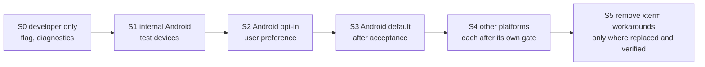

# Terminal migration plan

Status: **in progress; no rollout stage has started.** The xterm.js backend is the default and the only backend a user can run: the native backend is not registered, so no slice released so far changes terminal behaviour. Step 1 (measurement) and step 2 (contract, no behaviour change) are done, step 3 (shared Rust core) is under way. See [Release progress](#release-progress). The gate review of 2026-11-14 found no gate met, so no default changes and nothing is removed: see [Acceptance gates and evidence](#acceptance-gates-and-evidence). Tracking: [epic #1302](https://github.com/mihazs/lazysh/issues/1302). Related: [PRD](terminal-performance-prd.md) · [adapter](terminal-adapter.md) · [runtime](terminal-runtime.md) · [ADR 0001](adr-0001-terminal-runtime.md).

## Rules that apply to every slice

- Trunk-based: each slice is a small PR from fresh `main`, never stacked; a dependent slice starts after its prerequisite merges.
- No behaviour change until a slice says so; existing tests are kept and never weakened.
- Native is never the default before its gates pass, and no platform ships a partially working native renderer.
- Nothing is removed until its replacement is verified on every shipping platform that used it.

## Ordered slice plan

Order is by dependency; slices within a step can run in parallel. Issue numbers are children of the epic.

| Step | Slices | Result |
| --- | --- | --- |
| 1. Measure and decide | [#1303](https://github.com/mihazs/lazysh/issues/1303) baseline harness; [#1310](https://github.com/mihazs/lazysh/issues/1310) Android composition PoC; [#1311](https://github.com/mihazs/lazysh/issues/1311) iOS PoC; [#1312](https://github.com/mihazs/lazysh/issues/1312) Ghostty reuse and Android/iOS build (blocked by #384) | Baseline numbers; go or no-go per platform; one Ghostty dependency |
| 2. Contract, no behaviour change | [#1304](https://github.com/mihazs/lazysh/issues/1304) contract; [#1305](https://github.com/mihazs/lazysh/issues/1305) contract tests; [#1306](https://github.com/mihazs/lazysh/issues/1306) xterm adapter; [#1307](https://github.com/mihazs/lazysh/issues/1307) xterm seams isolated; [#1308](https://github.com/mihazs/lazysh/issues/1308) consumers decoupled; [#1309](https://github.com/mihazs/lazysh/issues/1309) registry and override | LiveSession holds an adapter; only the xterm backend imports `@xterm/*` |
| 3. Shared Rust core | [#1313](https://github.com/mihazs/lazysh/issues/1313) core; [#1314](https://github.com/mihazs/lazysh/issues/1314) conformance fixtures; [#1315](https://github.com/mihazs/lazysh/issues/1315) data path and flow control; [#1316](https://github.com/mihazs/lazysh/issues/1316) input encoding; [#1317](https://github.com/mihazs/lazysh/issues/1317) Mosh canonical; [#1318](https://github.com/mihazs/lazysh/issues/1318) Herdr inspection; [#1319](https://github.com/mihazs/lazysh/issues/1319) lifecycle and memory; [#1320](https://github.com/mihazs/lazysh/issues/1320) selection, search, links, OSC 52; [#1321](https://github.com/mihazs/lazysh/issues/1321) NativeTerminalAdapter | A native backend with correct state, still not default |
| 4. Renderer | [#1322](https://github.com/mihazs/lazysh/issues/1322) renderer API; [#1323](https://github.com/mihazs/lazysh/issues/1323) shootout; then if selected [#1324](https://github.com/mihazs/lazysh/issues/1324), [#1325](https://github.com/mihazs/lazysh/issues/1325), [#1326](https://github.com/mihazs/lazysh/issues/1326) | A measured renderer decision per platform |
| 5. Android | [#1327](https://github.com/mihazs/lazysh/issues/1327) surface and lifecycle; [#1328](https://github.com/mihazs/lazysh/issues/1328) input and IME; [#1329](https://github.com/mihazs/lazysh/issues/1329) accessibility | Android opt-in candidate |
| 6. Other platforms | [#1330](https://github.com/mihazs/lazysh/issues/1330) iOS; [#1331](https://github.com/mihazs/lazysh/issues/1331) Linux; [#1332](https://github.com/mihazs/lazysh/issues/1332) Windows; [#1333](https://github.com/mihazs/lazysh/issues/1333) macOS; [#1334](https://github.com/mihazs/lazysh/issues/1334) input parity; [#1335](https://github.com/mihazs/lazysh/issues/1335) accessibility parity; [#1336](https://github.com/mihazs/lazysh/issues/1336) capability probing | Per-platform go or documented fallback |
| 7. Optimize and operate | [#1337](https://github.com/mihazs/lazysh/issues/1337) invalidation and atlas; [#1338](https://github.com/mihazs/lazysh/issues/1338) memory; [#1339](https://github.com/mihazs/lazysh/issues/1339) scheduling; [#1340](https://github.com/mihazs/lazysh/issues/1340) Android energy; [#1341](https://github.com/mihazs/lazysh/issues/1341) CI regression; [#1342](https://github.com/mihazs/lazysh/issues/1342) rollout and recovery; [#1343](https://github.com/mihazs/lazysh/issues/1343) workaround removal | Default decisions and cleanup |

Steps 2 and 3 are valuable even if step 4 selects "keep xterm.js": the contract isolates version-pinned seams, and the core removes the per-chunk bridge cost and the renderer-bound state.

## Release progress

The terminal engine ships slice by slice: every merged slice goes out with the next version, carries a Changeset and a `CHANGELOG.md` entry that says what changed, and keeps xterm.js the default. A native backend becomes reachable only through an explicit opt-in (Settings, Terminal engine: xterm (default) or native (experimental)), the developer override and the kill switch of [#1342](https://github.com/mihazs/lazysh/issues/1342); none of the three exists for native yet, because there is no native backend to select. The rollout gates in [#1342](https://github.com/mihazs/lazysh/issues/1342) and [#1343](https://github.com/mihazs/lazysh/issues/1343) decide a default change or the removal of xterm.js, not the release cadence.

Released so far, with the first release that contains each pull request (from the tags, checked on 2026-11-14). None of these slices was meant to change terminal behaviour for users.

| Slice | Pull request | First release |
| --- | --- | --- |
| Architecture documents | [#1346](https://github.com/mihazs/lazysh/pull/1346) | v1.36.0 |
| xterm.js baseline benchmark | [#1350](https://github.com/mihazs/lazysh/pull/1350) | v1.38.0 |
| Android native surface composition proof of concept (debug only) | [#1355](https://github.com/mihazs/lazysh/pull/1355) | v1.42.0 |
| `TerminalAdapter` contract, xterm backend, backend registry | [#1417](https://github.com/mihazs/lazysh/pull/1417) | v1.50.0 |
| Shared Rust terminal core on libghostty-vt | [#1385](https://github.com/mihazs/lazysh/pull/1385) | v1.50.0 |
| Session service on a fixed VT worker pool | [#1429](https://github.com/mihazs/lazysh/pull/1429) | v1.51.0 |
| Sessions create, feed and dispose their terminal through the adapter | [#1430](https://github.com/mihazs/lazysh/pull/1430) | v1.51.0 |
| Renderer API and CPU reference renderer | [#1437](https://github.com/mihazs/lazysh/pull/1437) | v1.52.0 |
| Key mapping that matches xterm.js encoding | [#1471](https://github.com/mihazs/lazysh/pull/1471) | v1.56.0 |

Also released in v1.61.0: the core lifecycle ([#1501](https://github.com/mihazs/lazysh/pull/1501)) and the renderer shootout ([#1479](https://github.com/mihazs/lazysh/pull/1479)). Released in v1.62.0 (tagged and published on 2026-11-14): every other consumer behind the adapter ([#1500](https://github.com/mihazs/lazysh/pull/1500), closing [#1307](https://github.com/mihazs/lazysh/issues/1307) and [#1308](https://github.com/mihazs/lazysh/issues/1308)). Merged and waiting for the next version: the core's Mosh display frames as a top-anchored resize without reflow ([#1453](https://github.com/mihazs/lazysh/pull/1453)) and the write-path measurement ([#1306](https://github.com/mihazs/lazysh/issues/1306), [benchmarks](terminal-benchmarks.md#write-path-xterm-write-directly-versus-xtermterminaladapterwrite-1306)).

**Release stage reached: step 2 complete, no rollout stage (S0 to S5) entered.** Nothing outside the xterm backend imports `@xterm/*` (an import-graph test enforces it), the adapter's write path costs nothing measurable on the desktop harness, and the first end-to-end native path (core, renderer and input on Linux desktop and Android) is the next thing to ship; it ships behind the opt-in the day it works, not after the other platforms.

**Gate review of 2026-11-14 (origin/main 842454b7): the stage the evidence supports is "none"; S0's entry gate is not met** because no native backend exists on `main`. The next releasable checkpoint is therefore not a default change but the first end-to-end native path behind the opt-in (S0), and the review lists what each later stage still lacks in [Acceptance gates and evidence](#acceptance-gates-and-evidence).

## Rollout stages

| Stage | Entry gate | Exit evidence |
| --- | --- | --- |
| S0 | NativeTerminalAdapter passes the contract suite on a developer flag | Contract suite green; conformance divergences reviewed |
| S1 | Composition gate passed on a physical Android device; input matrix started | Device matrix with Gboard and SwiftKey; lifecycle gates; benchmark vs baseline |
| S2 | Parity checklist passed (input, selection, clipboard, accessibility or refusal); no known data-loss path | Opt-in telemetry-free feedback path via issues; kill switch tested |
| S3 | Provisional targets met on the supported device set or the device keeps xterm.js; no correctness regression | Measured results in [benchmarks](terminal-benchmarks.md); ADR updated |
| S4 | Each platform's own composition, input, accessibility and benchmark gates | Per-platform record; otherwise that platform stays on xterm.js |
| S5 | Replacement verified on every shipping platform that used the workaround | Full terminal suites green |

Every stage is reversible by the user-visible preference and a build-time kill switch; the registry records why a backend was or was not chosen ([adapter](terminal-adapter.md#backend-registry-and-selection)).

## Acceptance gates and evidence

A default may change, and xterm.js may be removed, only when the gates below are met on the platform in question. This is the checklist behind the stage table above, mirrored in [epic #1302](https://github.com/mihazs/lazysh/issues/1302) and re-run at every stage decision. How to read it:

- **Evidence counts only if it is on `main`.** An open pull request or a local branch is listed as where the work is, not as a result.
- **Not measured is not met.** A host microbenchmark does not stand in for a device, and a desktop Chromium baseline does not stand in for an Android WebView.
- A gate is **Met** only when its row says so with evidence; **Partly** means a real, merged part exists; **Not met** and **Not measured** block the stage.

The review below was taken on 2026-11-14 at `origin/main` 842454b7. What was run that day (Linux x86_64, no Android device, no Apple or Windows host): the client Vitest files for the adapter, registry, import boundary, Herdr navigation cells, links, touch selection, palette and the `src/xterm` modules (9 files, 76 tests, all passing), and `git grep` over `apps` and `packages`. The Rust suites run in the `herdr-native` CI job (Zig), which passed on [#1453](https://github.com/mihazs/lazysh/pull/1453) and [#1501](https://github.com/mihazs/lazysh/pull/1501); they were not re-run locally. The Playwright terminal specs exist only for xterm.js (there is no native backend to run them against) and were not re-run for this review.

| Gate | Requirement (source) | Evidence at 842454b7 | Status | Where it is tracked |
| --- | --- | --- | --- | --- |
| G1 | The native backend passes the contract suite, so both backends are held to the same behaviour (S0 entry; [#1305](https://github.com/mihazs/lazysh/issues/1305)) | `terminalAdapter.contract.ts` has 23 cases and one caller, `xtermTerminalAdapter.test.ts`. No `NativeTerminalAdapter` exists on `main`. | **Not met** | [#1321](https://github.com/mihazs/lazysh/issues/1321); PR [#1630](https://github.com/mihazs/lazysh/pull/1630) runs the unchanged suite against a headless xterm stand-in for the core, not the real core |
| G2 | Native code reaches users only through the opt-in, the developer override and the kill switch (S0, [#1342](https://github.com/mihazs/lazysh/issues/1342)) | The registry registers xterm only (`terminalBackends.ts`). The core is built behind the optional `native-terminal` Cargo feature, which no workflow, script or release build enables. There is no setting and no kill switch; the build-time kill switch and the mid-session switch are on a local branch waiting for #1630. | **Not met**: there is nothing a user could select | [#1342](https://github.com/mihazs/lazysh/issues/1342) |
| G3 | VT conformance parity (PRD terminal features; [#1314](https://github.com/mihazs/lazysh/issues/1314)) | The core has 94 Rust tests (conformance 35, keys 6, mosh 20, process 1, renderer 19, session 13), green in `herdr-native`. They pin the core to expectations and to a captured xterm.js column for keys; the cross-engine corpus that replays the same fixtures through both engines and registers every divergence is not on `main`. | **Partly** | PR [#1556](https://github.com/mihazs/lazysh/pull/1556) |
| G4 | Unicode, CJK, emoji, grapheme and font fallback render correctly (PRD; [#1325](https://github.com/mihazs/lazysh/issues/1325)) | The core's cell model has tests for wide cells, combining marks and ZWJ emoji, and the CPU reference renderer has golden images for them. No shipped renderer shapes text or falls back across fonts. | **Not met** | [#1324](https://github.com/mihazs/lazysh/issues/1324) (PR [#1615](https://github.com/mihazs/lazysh/pull/1615)), [#1325](https://github.com/mihazs/lazysh/issues/1325) |
| G5 | Key, mouse, paste and reply encoding equals what xterm.js sends, wired to the transport ([#1316](https://github.com/mihazs/lazysh/issues/1316)) | Key encoding is compared with captured xterm.js 5.5.0 output (`keys.rs`, [#1471](https://github.com/mihazs/lazysh/pull/1471)); mouse encodings are pinned to the specification, not to xterm.js (the test says so); the Rust write path to the transport and platform key parity are open. | **Partly** | PRs [#1607](https://github.com/mihazs/lazysh/pull/1607), [#1653](https://github.com/mihazs/lazysh/pull/1653) |
| G6 | IME composition and Android soft and hardware keyboards, with Gboard and SwiftKey, without duplicated or corrupt commits (PRD input; [#1328](https://github.com/mihazs/lazysh/issues/1328)) | xterm.js has `terminal-ime.spec.ts` and `terminal-swiftkey.spec.ts`. Nothing exists for the native surface; the Android proof of concept lists IME, Gboard and SwiftKey as not covered. | **Not met** | [#1328](https://github.com/mihazs/lazysh/issues/1328) (no code yet) |
| G7 | Selection, search, links and OSC 52 consent match xterm.js (PRD; [#1320](https://github.com/mihazs/lazysh/issues/1320)) | xterm.js has `terminal-selection.spec.ts` and `terminal-clipboard.spec.ts`. The core's selection and link slices are on local branches only. | **Not met** | [#1320](https://github.com/mihazs/lazysh/issues/1320), [#1334](https://github.com/mihazs/lazysh/issues/1334) |
| G8 | Screen-reader access, or a tested refusal of native while a screen reader is active (PRD; [#1329](https://github.com/mihazs/lazysh/issues/1329), [#1335](https://github.com/mihazs/lazysh/issues/1335)) | Nothing on `main`. The Android proof of concept showed that a virtual accessibility node can be found by UiAutomator; TalkBack was never run. | **Not met** | PR [#1648](https://github.com/mihazs/lazysh/pull/1648) (mirror and refusal rule, not mounted by any backend) |
| G9 | Mosh canonical resize works on the native path ([#1317](https://github.com/mihazs/lazysh/issues/1317)) | The core applies display frames as a top-anchored resize without reflow ([#1453](https://github.com/mihazs/lazysh/pull/1453): 20 tests on the `mosh-resize-frames.json` fixture the xterm.js `mosh-resize` spec also uses). No native session is connected to a Mosh transport; the spec runs on xterm.js only. | **Partly** | [#1317](https://github.com/mihazs/lazysh/issues/1317) |
| G10 | Herdr navigation cells and taps work from core state ([#1318](https://github.com/mihazs/lazysh/issues/1318)) | `herdrNavigationCells.test.ts` and the `herdr-switch-tap` spec run on xterm.js only. Row inspection in the core is open. | **Not met** | PR [#1581](https://github.com/mihazs/lazysh/pull/1581) |
| G11 | No silent byte loss, reordering or unbounded buffer on the native data path (PRD reliability; [#1315](https://github.com/mihazs/lazysh/issues/1315), [#1319](https://github.com/mihazs/lazysh/issues/1319)) | The pooled session service, the SSH, Mosh, ET and local PTY bridge with credit after VT processing ([#1447](https://github.com/mihazs/lazysh/pull/1447)) and the core lifecycle ([#1501](https://github.com/mihazs/lazysh/pull/1501)) are merged and tested with synthetic transports. Verification against real OpenSSH, mosh-server and ET servers is open. | **Partly** | PR [#1564](https://github.com/mihazs/lazysh/pull/1564) |
| G12 | A renderer is decided by measurement and a working one exists on a platform surface ([#1323](https://github.com/mihazs/lazysh/issues/1323), [#1327](https://github.com/mihazs/lazysh/issues/1327)) | [ADR 0001](adr-0001-terminal-runtime.md) is still Proposed. The shootout has host and Waydroid microbenchmarks and no native text rendering on a device. The Android surface host and the wgpu renderer crate are open. | **Not met** | PRs [#1628](https://github.com/mihazs/lazysh/pull/1628), [#1615](https://github.com/mihazs/lazysh/pull/1615) |
| G13 | Composition gate passed on a physical Android device (S1 entry; [#1310](https://github.com/mihazs/lazysh/issues/1310), [#1327](https://github.com/mihazs/lazysh/issues/1327)) | [Android proof of concept](android-surface-composition-poc.md): provisionally passed on an emulator with a software GPU only; Waydroid timings are not a device. No physical device has been used. | **Not met** (needs a physical device) | [#1310](https://github.com/mihazs/lazysh/issues/1310) |
| G14 | Performance not worse than the recorded baseline, and the provisional targets met or the device keeps xterm.js (S3; PRD targets; [#1340](https://github.com/mihazs/lazysh/issues/1340)) | The baseline is headless desktop Chromium. Native figures are host and Waydroid microbenchmarks. No Android device or WebView figure exists for either side; the same-workload native-versus-xterm comparison is open. | **Not measured** | [#1303](https://github.com/mihazs/lazysh/issues/1303) (Android runner), [#1337](https://github.com/mihazs/lazysh/issues/1337) to [#1340](https://github.com/mihazs/lazysh/issues/1340), PR [#1678](https://github.com/mihazs/lazysh/pull/1678) |
| G15 | Memory not worse than the baseline across 5 and 10 sessions (S3; [#1338](https://github.com/mihazs/lazysh/issues/1338)) | Baseline: about 0.8 to 1.2 MiB JS heap and 7 to 8 MiB renderer resident memory per background xterm session on desktop. The core has a per-session memory microbenchmark on the host; no end-to-end comparison. | **Not measured** | [#1338](https://github.com/mihazs/lazysh/issues/1338) |
| G16 | Energy at least 20% lower on matched workloads and near-zero idle activity on a device (PRD targets) | Nothing measured for either engine on a device. | **Not measured** | [#1340](https://github.com/mihazs/lazysh/issues/1340) |
| G17 | The performance gates are enforced in CI ([#1341](https://github.com/mihazs/lazysh/issues/1341)) | Not on `main`. | **Not met** | PR [#1672](https://github.com/mihazs/lazysh/pull/1672) (held) |
| G18 | Rollback tested: the preference or kill switch returns new sessions to xterm.js, and a mid-session switch restores screen, cursor and modes (S2 exit; [#1342](https://github.com/mihazs/lazysh/issues/1342)) | The rollback is documented below; neither the preference nor the kill switch exists on `main`, so nothing could be tested. | **Not met** | [#1342](https://github.com/mihazs/lazysh/issues/1342) |
| G19 | Each other platform passes its own composition, input, accessibility and benchmark gates (S4; [#1330](https://github.com/mihazs/lazysh/issues/1330) to [#1336](https://github.com/mihazs/lazysh/issues/1336)) | iOS has no proof of concept ([#1311](https://github.com/mihazs/lazysh/issues/1311)); Linux has an open composition proof of concept; Windows and macOS have nothing. No Apple or Windows hardware is available to the authors, so those two can be validated by CI only, and CI cannot show a composition result or an accessibility behaviour. | **Not met** | PR [#1674](https://github.com/mihazs/lazysh/pull/1674); the rest of the list |
| G20 | xterm.js is replaced on every shipping platform that used it (S5; [#1343](https://github.com/mihazs/lazysh/issues/1343)) | Every platform still uses xterm.js; it is the only backend. | **Not met** | [#1343](https://github.com/mihazs/lazysh/issues/1343) |

**Verdict.** G1, G2, G6, G7, G8, G10, G12, G13, G17, G18, G19 and G20 are not met; G14, G15 and G16 are not measured; G3, G5, G9 and G11 are partly met in the core only. No stage is entered. Consequently the Android default stays xterm.js, no platform's default changes, and neither the xterm.js backend nor its workarounds may be removed. The first stage reachable is S0, and it needs G1 and G2: the native adapter registered behind the opt-in, the developer override and the kill switch.

### What each stage still needs

| Stage | Blocked by |
| --- | --- |
| S0 developer only | G1, G2 (and the conformance divergences of G3 reviewed) |
| S1 internal Android | G13 on a physical device, G6 started with Gboard and SwiftKey, G12 on a device, G14 first figures |
| S2 Android opt-in | G5 to G11 and G18 |
| S3 Android default | G14, G15, G16 on the supported device set, or that device keeps xterm.js; ADR 0001 moved to Accepted |
| S4 other platforms | G19 per platform |
| S5 removal | G20, and the inventory below |

### What removing xterm.js would touch ([#1343](https://github.com/mihazs/lazysh/issues/1343))

Counted at 842454b7, so the removal is a defined change and not a surprise:

- **Runtime dependencies:** `@xterm/xterm` 5.5.0 and `@xterm/addon-fit`.
- **Modules:** `apps/client/src/xterm/` (links, Mosh resize, renderer candidates, selection, styles, terminal, bold colour, fit, IME), `xtermTerminalAdapter.ts`, `xtermOptions.ts` and their tests. `xtermImportBoundary.test.ts` then asserts that nothing imports `@xterm/*` at all.
- **Tests that read xterm.js's DOM:** 43 files under `apps/client/e2e` match `.xterm` or `xterm-` (counted with `git grep -l -E '\.xterm|xterm-' -- e2e`). Each needs a native-surface equivalent or an adapter-level probe before the backend goes, otherwise the removal deletes the coverage it relies on.
- **The recorded baseline and the xterm.js comparisons.** The baseline harness (`apps/client/bench/terminalBench.ts`) and several test fixtures under `e2e/fixtures` import `src/xterm/terminal` and the adapter, and the cross-engine comparisons use xterm.js 5.5.0 as their oracle. The dev-only dependencies `@xterm/headless` (`bench/wasmVt.mjs`), `@xterm/addon-webgl` and `@xterm/addon-canvas` (`src/xterm/rendererCandidates.ts`) serve the shootout. Removing the backend from the product must not silently remove the means to reproduce the baseline that [Acceptance of a candidate](terminal-benchmarks.md#acceptance-of-a-candidate) compares against: either keep xterm.js as a dev-only oracle, or archive the harness at a pinned commit with its procedure before the removal.
- **Bundle size** (the one measurement #1343 asks for) has not been taken; it needs a before and after build.

## Switching implementations

xterm and Ghostty state are not losslessly transferable. Therefore:

- The backend is chosen when a session is created.
- A mid-session switch (for example after a native failure the user chooses to leave) builds the new backend from a snapshot of the visible screen and cursor (`read_ansi_screen` exists in the ghostty-vt binding), declares that scrollback is not carried over, and is covered by tests for screen, cursor and mode restoration ([#1342](https://github.com/mihazs/lazysh/issues/1342)).
- A renderer or surface failure inside the native backend does not change backend: the surface is recreated from core state and the session continues.

## Rollback

Switching the preference to xterm.js (or the kill switch) returns to the unchanged backend for new sessions. Steps 2 and 3 add code paths but do not alter the xterm path, so reverting a native slice does not affect users who never enabled it. User data and host state are untouched by any slice.

The preference and the kill switch are not built yet ([gate G18](#acceptance-gates-and-evidence)); until they are, the rollback is that no build lets anyone select native. After a default flip (S3), the rollback is the preference and the kill switch, both of which must have been exercised before the flip. After the xterm.js backend is removed (S5) neither can return users to it, so the removal is one revertable pull request merged only after at least one release has shipped native as the default on every platform it covers, and the previous release (which still contains xterm.js) stays installable as the documented way back.

## Release policy

Docs-only changes have no Changeset. Every other slice of the engine, including the pure refactors of steps 2 and 3, carries a real patch or minor Changeset and a `CHANGELOG.md` entry that says what changed (and that nothing changes for users, where that is the case), so it ships with the next version rather than waiting for a user-visible one; see [Release progress](#release-progress). A slice that changes user-visible behaviour also follows the milestone release policy in `CONTRIBUTING.md`.

## Rejected alternatives

| Alternative | Reason |
| --- | --- |
| Big-bang replacement of xterm.js | No measurement supports it; input and accessibility risk |
| Optimize xterm.js only, skip the core | Does not address renderer-bound state; kept as a candidate to measure, not rejected |
| Port Alacritty or WezTerm terminal as a second engine | Second VT dependency without evidence that ghostty-vt fails a requirement |
| Thread per session | No profiling justification |
| Native on all platforms simultaneously | Gates differ per platform |

## Unresolved questions

- Whether renderer replacement may preserve sessions (security review, [runtime](terminal-runtime.md#lifecycle)).
- Minimum device set for S3 (decided from step 1 data).
- How to collect opt-in feedback without adding telemetry (this plan introduces none).
