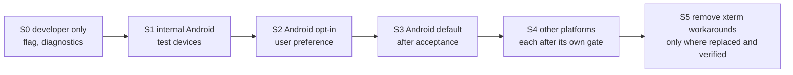

# Terminal migration plan

Status: **proposed**. The xterm.js backend remains the working default throughout. No stage below has started; the first deliverable is the documentation and issue map. Tracking: [epic #1302](https://github.com/mihazs/lazysh/issues/1302). Related: [PRD](terminal-performance-prd.md) · [adapter](terminal-adapter.md) · [runtime](terminal-runtime.md) · [ADR 0001](adr-0001-terminal-runtime.md).

## Rules that apply to every slice

- Trunk-based: each slice is a small PR from fresh `main`, never stacked; a dependent slice starts after its prerequisite merges.
- No behaviour change until a slice says so; existing tests are kept and never weakened.
- Native is never the default before its gates pass, and no platform ships a partially working native renderer.
- Nothing is removed until its replacement is verified on every shipping platform that used it.

## Ordered slice plan

Order is by dependency; slices within a step can run in parallel. Issue numbers are children of the epic.

| Step | Slices | Result |
| --- | --- | --- |
| 1. Measure and decide | [#1303](https://github.com/mihazs/lazysh/issues/1303) baseline harness; [#1310](https://github.com/mihazs/lazysh/issues/1310) Android composition PoC; [#1311](https://github.com/mihazs/lazysh/issues/1311) iOS PoC; [#1312](https://github.com/mihazs/lazysh/issues/1312) Ghostty reuse and Android/iOS build (blocked by #384) | Baseline numbers; go or no-go per platform; one Ghostty dependency |
| 2. Contract, no behaviour change | [#1304](https://github.com/mihazs/lazysh/issues/1304) contract; [#1305](https://github.com/mihazs/lazysh/issues/1305) contract tests; [#1306](https://github.com/mihazs/lazysh/issues/1306) xterm adapter; [#1307](https://github.com/mihazs/lazysh/issues/1307) xterm seams isolated; [#1308](https://github.com/mihazs/lazysh/issues/1308) consumers decoupled; [#1309](https://github.com/mihazs/lazysh/issues/1309) registry and override | LiveSession holds an adapter; only the xterm backend imports `@xterm/*` |
| 3. Shared Rust core | [#1313](https://github.com/mihazs/lazysh/issues/1313) core; [#1314](https://github.com/mihazs/lazysh/issues/1314) conformance fixtures; [#1315](https://github.com/mihazs/lazysh/issues/1315) data path and flow control; [#1316](https://github.com/mihazs/lazysh/issues/1316) input encoding; [#1317](https://github.com/mihazs/lazysh/issues/1317) Mosh canonical; [#1318](https://github.com/mihazs/lazysh/issues/1318) Herdr inspection; [#1319](https://github.com/mihazs/lazysh/issues/1319) lifecycle and memory; [#1320](https://github.com/mihazs/lazysh/issues/1320) selection, search, links, OSC 52; [#1321](https://github.com/mihazs/lazysh/issues/1321) NativeTerminalAdapter | A native backend with correct state, still not default |
| 4. Renderer | [#1322](https://github.com/mihazs/lazysh/issues/1322) renderer API; [#1323](https://github.com/mihazs/lazysh/issues/1323) shootout; then if selected [#1324](https://github.com/mihazs/lazysh/issues/1324), [#1325](https://github.com/mihazs/lazysh/issues/1325), [#1326](https://github.com/mihazs/lazysh/issues/1326) | A measured renderer decision per platform |
| 5. Android | [#1327](https://github.com/mihazs/lazysh/issues/1327) surface and lifecycle; [#1328](https://github.com/mihazs/lazysh/issues/1328) input and IME; [#1329](https://github.com/mihazs/lazysh/issues/1329) accessibility | Android opt-in candidate |
| 6. Other platforms | [#1330](https://github.com/mihazs/lazysh/issues/1330) iOS; [#1331](https://github.com/mihazs/lazysh/issues/1331) Linux; [#1332](https://github.com/mihazs/lazysh/issues/1332) Windows; [#1333](https://github.com/mihazs/lazysh/issues/1333) macOS; [#1334](https://github.com/mihazs/lazysh/issues/1334) input parity; [#1335](https://github.com/mihazs/lazysh/issues/1335) accessibility parity; [#1336](https://github.com/mihazs/lazysh/issues/1336) capability probing | Per-platform go or documented fallback |
| 7. Optimize and operate | [#1337](https://github.com/mihazs/lazysh/issues/1337) invalidation and atlas; [#1338](https://github.com/mihazs/lazysh/issues/1338) memory; [#1339](https://github.com/mihazs/lazysh/issues/1339) scheduling; [#1340](https://github.com/mihazs/lazysh/issues/1340) Android energy; [#1341](https://github.com/mihazs/lazysh/issues/1341) CI regression; [#1342](https://github.com/mihazs/lazysh/issues/1342) rollout and recovery; [#1343](https://github.com/mihazs/lazysh/issues/1343) workaround removal | Default decisions and cleanup |

Steps 2 and 3 are valuable even if step 4 selects "keep xterm.js": the contract isolates version-pinned seams, and the core removes the per-chunk bridge cost and the renderer-bound state.

## Rollout stages

| Stage | Entry gate | Exit evidence |
| --- | --- | --- |
| S0 | NativeTerminalAdapter passes the contract suite on a developer flag | Contract suite green; conformance divergences reviewed |
| S1 | Composition gate passed on a physical Android device; input matrix started | Device matrix with Gboard and SwiftKey; lifecycle gates; benchmark vs baseline |
| S2 | Parity checklist passed (input, selection, clipboard, accessibility or refusal); no known data-loss path | Opt-in telemetry-free feedback path via issues; kill switch tested |
| S3 | Provisional targets met on the supported device set or the device keeps xterm.js; no correctness regression | Measured results in [benchmarks](terminal-benchmarks.md); ADR updated |
| S4 | Each platform's own composition, input, accessibility and benchmark gates | Per-platform record; otherwise that platform stays on xterm.js |
| S5 | Replacement verified on every shipping platform that used the workaround | Full terminal suites green |

Every stage is reversible by the user-visible preference and a build-time kill switch; the registry records why a backend was or was not chosen ([adapter](terminal-adapter.md#backend-registry-and-selection)).

## Switching implementations

xterm and Ghostty state are not losslessly transferable. Therefore:

- The backend is chosen when a session is created.
- A mid-session switch (for example after a native failure the user chooses to leave) builds the new backend from a snapshot of the visible screen and cursor (`read_ansi_screen` exists in the ghostty-vt binding), declares that scrollback is not carried over, and is covered by tests for screen, cursor and mode restoration ([#1342](https://github.com/mihazs/lazysh/issues/1342)).
- A renderer or surface failure inside the native backend does not change backend: the surface is recreated from core state and the session continues.

## Rollback

Switching the preference to xterm.js (or the kill switch) returns to the unchanged backend for new sessions. Steps 2 and 3 add code paths but do not alter the xterm path, so reverting a native slice does not affect users who never enabled it. User data and host state are untouched by any slice.

## Release policy

The terminal engine is released incrementally: every merged slice is a releasable checkpoint that ships in the next version PR, so each carries a real patch or minor Changeset for `@lazysh/client` or `@lazysh/agent` (never an empty fragment) and a `CHANGELOG.md` entry that says what users can now do or what changed, including "no setting or default changes" when that is the whole effect. The xterm.js backend stays the default and the native engine stays behind the explicit opt-in (Settings > Terminal > Terminal engine, the developer override and the kill switch of [#1342](https://github.com/mihazs/lazysh/issues/1342)), so shipping a slice cannot change behaviour for a user who did not opt in. The first end-to-end native path on one platform ships its opt-in setting in that release instead of waiting for the other platforms. The rollout gates of #1342 and [#1343](https://github.com/mihazs/lazysh/issues/1343) decide default changes and the removal of xterm.js, not the release cadence. Each slice follows the milestone release policy in `CONTRIBUTING.md`.

### Release log

Newest first. "Stage" is the rollout stage reached by what shipped, not by the code that merged.

| Slice | What changed for users | Stage reached |
| --- | --- | --- |
| Where the WebGL addon's first-burst cost goes: a cold-pass CPU profile ([#1323](https://github.com/mihazs/lazysh/issues/1323)) | Nothing visible: a profiling option of the benchmark harness, raw results and ADR 0001 amendment 4. xterm.js DOM renderer stays the default; no setting exists yet. | None: the native engine is not user-selectable. |
| WebGL addon at the phone grid, under context loss and in an Android System WebView ([#1323](https://github.com/mihazs/lazysh/issues/1323)) | Nothing visible: measurement harness, raw results and ADR 0001 amendment 3. xterm.js DOM renderer stays the default; no setting exists yet. | None: the native engine is not user-selectable. |

## Rejected alternatives

| Alternative | Reason |
| --- | --- |
| Big-bang replacement of xterm.js | No measurement supports it; input and accessibility risk |
| Optimize xterm.js only, skip the core | Does not address renderer-bound state; kept as a candidate to measure, not rejected |
| Port Alacritty or WezTerm terminal as a second engine | Second VT dependency without evidence that ghostty-vt fails a requirement |
| Thread per session | No profiling justification |
| Native on all platforms simultaneously | Gates differ per platform |

## Unresolved questions

- Whether renderer replacement may preserve sessions (security review, [runtime](terminal-runtime.md#lifecycle)).
- Minimum device set for S3 (decided from step 1 data).
- How to collect opt-in feedback without adding telemetry (this plan introduces none).
