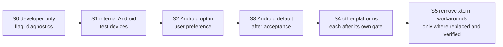

# Terminal migration plan

Status: **in progress; no rollout stage has started.** The xterm.js backend is the default and the only backend a user can run: the native backend is not registered, so no slice released so far changes terminal behaviour. Step 1 (measurement) and step 2 (contract, no behaviour change) are done, step 3 (shared Rust core) is under way. See [Release progress](#release-progress). Tracking: [epic #1302](https://github.com/mihazs/lazysh/issues/1302). Related: [PRD](terminal-performance-prd.md) · [adapter](terminal-adapter.md) · [runtime](terminal-runtime.md) · [ADR 0001](adr-0001-terminal-runtime.md).

## Rules that apply to every slice

- Trunk-based: each slice is a small PR from fresh `main`, never stacked; a dependent slice starts after its prerequisite merges.
- No behaviour change until a slice says so; existing tests are kept and never weakened.
- Native is never the default before its gates pass, and no platform ships a partially working native renderer.
- Nothing is removed until its replacement is verified on every shipping platform that used it.

## Ordered slice plan

Order is by dependency; slices within a step can run in parallel. Issue numbers are children of the epic.

| Step | Slices | Result |
| --- | --- | --- |
| 1. Measure and decide | [#1303](https://github.com/mihazs/lazysh/issues/1303) baseline harness; [#1310](https://github.com/mihazs/lazysh/issues/1310) Android composition PoC; [#1311](https://github.com/mihazs/lazysh/issues/1311) iOS PoC; [#1312](https://github.com/mihazs/lazysh/issues/1312) Ghostty reuse and Android/iOS build (blocked by #384) | Baseline numbers; go or no-go per platform; one Ghostty dependency |
| 2. Contract, no behaviour change | [#1304](https://github.com/mihazs/lazysh/issues/1304) contract; [#1305](https://github.com/mihazs/lazysh/issues/1305) contract tests; [#1306](https://github.com/mihazs/lazysh/issues/1306) xterm adapter; [#1307](https://github.com/mihazs/lazysh/issues/1307) xterm seams isolated; [#1308](https://github.com/mihazs/lazysh/issues/1308) consumers decoupled; [#1309](https://github.com/mihazs/lazysh/issues/1309) registry and override | LiveSession holds an adapter; only the xterm backend imports `@xterm/*` |
| 3. Shared Rust core | [#1313](https://github.com/mihazs/lazysh/issues/1313) core; [#1314](https://github.com/mihazs/lazysh/issues/1314) conformance fixtures; [#1315](https://github.com/mihazs/lazysh/issues/1315) data path and flow control; [#1316](https://github.com/mihazs/lazysh/issues/1316) input encoding; [#1317](https://github.com/mihazs/lazysh/issues/1317) Mosh canonical; [#1318](https://github.com/mihazs/lazysh/issues/1318) Herdr inspection; [#1319](https://github.com/mihazs/lazysh/issues/1319) lifecycle and memory; [#1320](https://github.com/mihazs/lazysh/issues/1320) selection, search, links, OSC 52; [#1321](https://github.com/mihazs/lazysh/issues/1321) NativeTerminalAdapter | A native backend with correct state, still not default |
| 4. Renderer | [#1322](https://github.com/mihazs/lazysh/issues/1322) renderer API; [#1323](https://github.com/mihazs/lazysh/issues/1323) shootout; then if selected [#1324](https://github.com/mihazs/lazysh/issues/1324), [#1325](https://github.com/mihazs/lazysh/issues/1325), [#1326](https://github.com/mihazs/lazysh/issues/1326) | A measured renderer decision per platform |
| 5. Android | [#1327](https://github.com/mihazs/lazysh/issues/1327) surface and lifecycle; [#1328](https://github.com/mihazs/lazysh/issues/1328) input and IME; [#1329](https://github.com/mihazs/lazysh/issues/1329) accessibility | Android opt-in candidate |
| 6. Other platforms | [#1330](https://github.com/mihazs/lazysh/issues/1330) iOS; [#1331](https://github.com/mihazs/lazysh/issues/1331) Linux; [#1332](https://github.com/mihazs/lazysh/issues/1332) Windows; [#1333](https://github.com/mihazs/lazysh/issues/1333) macOS; [#1334](https://github.com/mihazs/lazysh/issues/1334) input parity; [#1335](https://github.com/mihazs/lazysh/issues/1335) accessibility parity; [#1336](https://github.com/mihazs/lazysh/issues/1336) capability probing | Per-platform go or documented fallback |
| 7. Optimize and operate | [#1337](https://github.com/mihazs/lazysh/issues/1337) invalidation and atlas; [#1338](https://github.com/mihazs/lazysh/issues/1338) memory; [#1339](https://github.com/mihazs/lazysh/issues/1339) scheduling; [#1340](https://github.com/mihazs/lazysh/issues/1340) Android energy; [#1341](https://github.com/mihazs/lazysh/issues/1341) CI regression; [#1342](https://github.com/mihazs/lazysh/issues/1342) rollout and recovery; [#1343](https://github.com/mihazs/lazysh/issues/1343) workaround removal | Default decisions and cleanup |

Steps 2 and 3 are valuable even if step 4 selects "keep xterm.js": the contract isolates version-pinned seams, and the core removes the per-chunk bridge cost and the renderer-bound state.

## Release progress

The terminal engine ships slice by slice: every merged slice goes out with the next version, carries a Changeset and a `CHANGELOG.md` entry that says what changed, and keeps xterm.js the default. A native backend becomes reachable only through an explicit opt-in (Settings, Terminal engine: xterm (default) or native (experimental)), the developer override and the kill switch of [#1342](https://github.com/mihazs/lazysh/issues/1342); none of the three exists for native yet, because there is no native backend to select. The rollout gates in [#1342](https://github.com/mihazs/lazysh/issues/1342) and [#1343](https://github.com/mihazs/lazysh/issues/1343) decide a default change or the removal of xterm.js, not the release cadence.

Released so far, with the first release that contains each pull request (from the tags, checked on 2026-11-14). None of these slices was meant to change terminal behaviour for users.

| Slice | Pull request | First release |
| --- | --- | --- |
| Architecture documents | [#1346](https://github.com/mihazs/lazysh/pull/1346) | v1.36.0 |
| xterm.js baseline benchmark | [#1350](https://github.com/mihazs/lazysh/pull/1350) | v1.38.0 |
| Android native surface composition proof of concept (debug only) | [#1355](https://github.com/mihazs/lazysh/pull/1355) | v1.42.0 |
| `TerminalAdapter` contract, xterm backend, backend registry | [#1417](https://github.com/mihazs/lazysh/pull/1417) | v1.50.0 |
| Shared Rust terminal core on libghostty-vt | [#1385](https://github.com/mihazs/lazysh/pull/1385) | v1.50.0 |
| Session service on a fixed VT worker pool | [#1429](https://github.com/mihazs/lazysh/pull/1429) | v1.51.0 |
| Sessions create, feed and dispose their terminal through the adapter | [#1430](https://github.com/mihazs/lazysh/pull/1430) | v1.51.0 |
| Renderer API and CPU reference renderer | [#1437](https://github.com/mihazs/lazysh/pull/1437) | v1.52.0 |
| Key mapping that matches xterm.js encoding | [#1471](https://github.com/mihazs/lazysh/pull/1471) | v1.56.0 |

Also released in v1.61.0: the core lifecycle ([#1501](https://github.com/mihazs/lazysh/pull/1501)) and the renderer shootout ([#1479](https://github.com/mihazs/lazysh/pull/1479)). Released in v1.62.0 (tagged and published on 2026-11-14): every other consumer behind the adapter ([#1500](https://github.com/mihazs/lazysh/pull/1500), closing [#1307](https://github.com/mihazs/lazysh/issues/1307) and [#1308](https://github.com/mihazs/lazysh/issues/1308)). Merged and waiting for the next version: the core's Mosh display frames as a top-anchored resize without reflow ([#1453](https://github.com/mihazs/lazysh/pull/1453)) and the write-path measurement ([#1306](https://github.com/mihazs/lazysh/issues/1306), [benchmarks](terminal-benchmarks.md#write-path-xterm-write-directly-versus-xtermterminaladapterwrite-1306)).

**Release stage reached: step 2 complete, no rollout stage (S0 to S5) entered.** Nothing outside the xterm backend imports `@xterm/*` (an import-graph test enforces it), the adapter's write path costs nothing measurable on the desktop harness, and the first end-to-end native path (core, renderer and input on Linux desktop and Android) is the next thing to ship; it ships behind the opt-in the day it works, not after the other platforms. The first Android piece of that path, the native surface host ([#1327](https://github.com/mihazs/lazysh/issues/1327), [host](android-native-surface-host.md)), is groundwork in developer builds only: a release build refuses it and no opt-in preference exists yet.

## Rollout stages

| Stage | Entry gate | Exit evidence |
| --- | --- | --- |
| S0 | NativeTerminalAdapter passes the contract suite on a developer flag | Contract suite green; conformance divergences reviewed |
| S1 | Composition gate passed on a physical Android device; input matrix started | Device matrix with Gboard and SwiftKey; lifecycle gates; benchmark vs baseline |
| S2 | Parity checklist passed (input, selection, clipboard, accessibility or refusal); no known data-loss path | Opt-in telemetry-free feedback path via issues; kill switch tested |
| S3 | Provisional targets met on the supported device set or the device keeps xterm.js; no correctness regression | Measured results in [benchmarks](terminal-benchmarks.md); ADR updated |
| S4 | Each platform's own composition, input, accessibility and benchmark gates | Per-platform record; otherwise that platform stays on xterm.js |
| S5 | Replacement verified on every shipping platform that used the workaround | Full terminal suites green |

Every stage is reversible by the user-visible preference and a build-time kill switch; the registry records why a backend was or was not chosen ([adapter](terminal-adapter.md#backend-registry-and-selection)).

## Switching implementations

xterm and Ghostty state are not losslessly transferable. Therefore:

- The backend is chosen when a session is created.
- A mid-session switch (for example after a native failure the user chooses to leave) builds the new backend from a snapshot of the visible screen and cursor (`read_ansi_screen` exists in the ghostty-vt binding), declares that scrollback is not carried over, and is covered by tests for screen, cursor and mode restoration ([#1342](https://github.com/mihazs/lazysh/issues/1342)).
- A renderer or surface failure inside the native backend does not change backend: the surface is recreated from core state and the session continues.

## Rollback

Switching the preference to xterm.js (or the kill switch) returns to the unchanged backend for new sessions. Steps 2 and 3 add code paths but do not alter the xterm path, so reverting a native slice does not affect users who never enabled it. User data and host state are untouched by any slice.

## Release policy

Docs-only changes have no Changeset. Every other slice of the engine, including the pure refactors of steps 2 and 3, carries a real patch or minor Changeset and a `CHANGELOG.md` entry that says what changed (and that nothing changes for users, where that is the case), so it ships with the next version rather than waiting for a user-visible one; see [Release progress](#release-progress). A slice that changes user-visible behaviour also follows the milestone release policy in `CONTRIBUTING.md`.

## Rejected alternatives

| Alternative | Reason |
| --- | --- |
| Big-bang replacement of xterm.js | No measurement supports it; input and accessibility risk |
| Optimize xterm.js only, skip the core | Does not address renderer-bound state; kept as a candidate to measure, not rejected |
| Port Alacritty or WezTerm terminal as a second engine | Second VT dependency without evidence that ghostty-vt fails a requirement |
| Thread per session | No profiling justification |
| Native on all platforms simultaneously | Gates differ per platform |

## Unresolved questions

- Whether renderer replacement may preserve sessions (security review, [runtime](terminal-runtime.md#lifecycle)).
- Minimum device set for S3 (decided from step 1 data).
- How to collect opt-in feedback without adding telemetry (this plan introduces none).
