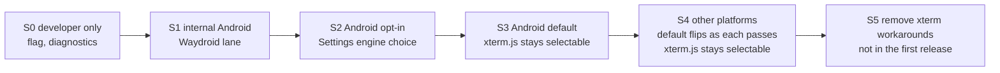

# Terminal migration plan

Status: **in progress; no rollout stage has started.** The xterm.js backend is the default and the only backend a user can run: the native adapter is registered behind a probe that no release build passes, the Settings engine choice exists but shows Native disabled with the registry's reason, the build-time kill switch exists and only ever turns native off, and the Android surface host exists in developer builds only, so no slice released so far changes terminal behaviour. Step 2 (contract, no behaviour change) is done; step 3 (shared Rust core) is largely merged; the first pieces of steps 4 and 5 (the wgpu renderer crate, the Android surface host) are groundwork that nothing reaches yet. The maintainer decided on 2026-11-18 that Waydroid is the Android acceptance environment ([the first decision](#decision-of-2026-11-18-waydroid-is-the-android-acceptance-environment)) and, later that day, that the new terminal engine is enabled by default: Auto, the default of the Settings engine choice every platform gets, resolves to native wherever a native surface exists and passes the registry's probe and to xterm.js where it does not, with xterm.js always selectable, Android flipping first and the other platforms as each passes ([the second decision](#second-decision-of-2026-11-18-the-native-engine-is-the-default-wherever-its-surface-passes), [ADR 0001, Amendment 7](adr-0001-terminal-runtime.md#amendment-7-2026-11-18-the-native-engine-is-the-default-wherever-its-surface-passes)). The gate review was re-run on 2026-11-18 at `origin/main` a35dbb56 and no gate is met, so no default changes yet and nothing is removed: see [Release progress](#release-progress) and [Acceptance gates and evidence](#acceptance-gates-and-evidence). Tracking: [epic #1302](https://github.com/mihazs/lazysh/issues/1302). Related: [PRD](terminal-performance-prd.md) · [adapter](terminal-adapter.md) · [runtime](terminal-runtime.md) · [ADR 0001](adr-0001-terminal-runtime.md).

## Rules that apply to every slice

- Trunk-based: each slice is a small PR from fresh `main`, never stacked; a dependent slice starts after its prerequisite merges.
- No behaviour change until a slice says so; existing tests are kept and never weakened.
- Native is never the default on a platform before every agent-doable gate passes for that platform, and no platform ships a partially working native renderer. The default is Auto: native wherever a native surface exists and passes the registry's probe, xterm.js where it does not; each platform's default flips in its own gated pull request, Android first, and xterm.js stays selectable everywhere ([second decision of 2026-11-18](#second-decision-of-2026-11-18-the-native-engine-is-the-default-wherever-its-surface-passes)).
- Nothing is removed until its replacement is verified on every shipping platform that used it.

## Decision of 2026-11-18: Waydroid is the Android acceptance environment

The maintainer decided on 2026-11-18 ([#2091](https://github.com/mihazs/lazysh/issues/2091); [ADR 0001, Amendment 6](adr-0001-terminal-runtime.md#amendment-6-2026-11-18-waydroid-is-the-android-acceptance-environment)) that the physical-device requirement is waived for the Android native-engine release, because no physical Android device has been used or is available to the authors, and a release that makes the native engine the Android default has to be possible without one while xterm.js stays selectable. Slices that implement it: [#2092](https://github.com/mihazs/lazysh/issues/2092) (the engine choice in Settings), [#2093](https://github.com/mihazs/lazysh/issues/2093) (the Waydroid lane and its recorded evidence) and [#2094](https://github.com/mihazs/lazysh/issues/2094) (the Android default).

- **Android evidence comes from Waydroid.** The lane of #2093 runs the journeys and benchmarks of G6 and G13 to G16 and writes evidence into `benchmarks/`. The harness and its [runbook](waydroid-lane.md) are on `main`; the journeys and recorded evidence are the remaining slices of #2093. Gates G6 and G13 to G16 and stages S1 to S3 below are rewritten to name it.
- **What Waydroid cannot show is "accepted risk, not measured".** That is battery energy (the energy target of G16), vendor keyboards such as Gboard and SwiftKey unless they can be installed in the guest, real GPU drivers, and real touch hardware; thermal behaviour, vendor WebView or ROM variation and the aarch64 build that ships (Waydroid's guest is x86_64) are recorded the same way. The status is never "Met", the lane's results say so, and the pull request of the default flip repeats it. Waydroid timings are not a device result.
- **The default and the engine choice are in the [second decision](#second-decision-of-2026-11-18-the-native-engine-is-the-default-wherever-its-surface-passes).** It was made later the same day and supersedes what this decision first said about them: that Android was the only default to flip and that native was an experimental opt-in on the other platforms (ADR 0001, Amendment 6, points 3 and 4). This section keeps the rule about Android's evidence.
- **Removing xterm.js is not part of the Android release, nor of any other default flip.** [#1343](https://github.com/mihazs/lazysh/issues/1343) (S5) stays gated by G20 and the inventory below.
- **Unchanged:** native is never the default before every agent-doable gate passes, a Waydroid pass waives no other gate, existing tests are never weakened, evidence counts only when it is on `main`, and not measured is not met.

## Second decision of 2026-11-18: the native engine is the default wherever its surface passes

The maintainer decided later on 2026-11-18 ([#2119](https://github.com/mihazs/lazysh/issues/2119); [ADR 0001, Amendment 7](adr-0001-terminal-runtime.md#amendment-7-2026-11-18-the-native-engine-is-the-default-wherever-its-surface-passes)) that the new terminal engine must be enabled by default, not only on Android. This supersedes the rule of the first decision that Android is the only default that flips and that native is an experimental opt-in on iOS, macOS, Windows and Linux (Amendment 6, points 3 and 4); the Waydroid evidence rule and the accepted-risk list of the first decision stand. Slices that implement it: [#2092](https://github.com/mihazs/lazysh/issues/2092) (the engine choice and its default), [#2094](https://github.com/mihazs/lazysh/issues/2094) (Android first, which files one child issue per other platform) and [#1330](https://github.com/mihazs/lazysh/issues/1330) to [#1333](https://github.com/mihazs/lazysh/issues/1333) with [#1334](https://github.com/mihazs/lazysh/issues/1334) to [#1336](https://github.com/mihazs/lazysh/issues/1336).

- **The default is Auto: native wherever it works, xterm.js where it does not.** Settings, Terminal engine offers Native, xterm.js or Auto on every platform (Android, iOS, macOS, Windows and Linux; [#2092](https://github.com/mihazs/lazysh/issues/2092)), and Auto is the default. Auto resolves to Native on every platform where a native surface exists and passes the registry's capability probe ([#1336](https://github.com/mihazs/lazysh/issues/1336)); in the registry that is a native backend registered `autoEligible`, which only that platform's flip sets, so before its flip Auto resolves to xterm.js there even where a surface exists for opt-in. A session uses xterm.js where no such surface exists or the probe fails, when the user chose xterm.js, when a screen reader is active and native lacks the `accessibility` capability (G8), and after a recorded native failure. An explicit Native choice meets the same probe and screen-reader rules.
- **The reason is always recorded and visible.** The registry records why a backend was or was not chosen, and Settings and the terminal's overflow menu show it. Where no usable native surface exists yet, the Native option is shown disabled with the reason ("not available on this platform yet"), never hidden, and Auto resolves to xterm.js with that reason. A platform may offer Native before it flips (Android does, at S2); a surface that has only just landed may be labelled experimental in Settings and is still the default there once its platform has flipped.
- **Android flips first** ([#2094](https://github.com/mihazs/lazysh/issues/2094)), in a release of its own, after the Waydroid lane and every other agent-doable gate pass: "native is the Android default, xterm.js one setting away".
- **iOS, macOS, Windows and Linux flip as each passes.** Each platform's default flips in its own default-flip pull request and release, a gated change with a child issue of #2094, once its native surface ([#1330](https://github.com/mihazs/lazysh/issues/1330) iOS, [#1331](https://github.com/mihazs/lazysh/issues/1331) Linux, [#1332](https://github.com/mihazs/lazysh/issues/1332) Windows, [#1333](https://github.com/mihazs/lazysh/issues/1333) macOS, with [#1334](https://github.com/mihazs/lazysh/issues/1334) input and selection parity, [#1335](https://github.com/mihazs/lazysh/issues/1335) screen-reader parity or a tested refusal and [#1336](https://github.com/mihazs/lazysh/issues/1336) capability probing) has passed its own composition, input, accessibility-or-refusal and benchmark acceptance (G19, S4) on the CI hosts the project has (the iOS simulator, the macOS and Windows runners, Linux under Xvfb and Wayland), with its kill switch tested. Until then Auto resolves to xterm.js on that platform. A platform that has not passed does not hold back one that has.
- **Every flip is a changed default and says so.** Its `CHANGELOG.md` `[Unreleased]` entry and release notes call the changed default out, name the accepted risks of that platform and name the behaviour differences approved in the divergence review ([#1314](https://github.com/mihazs/lazysh/issues/1314)): emoji, ZWJ and skin-tone sequences take two cells, Alt+arrow sends the standard `CSI 1;3` form instead of the Ctrl form xterm.js sent, resizing reflows long lines instead of cutting them, an OSC 52 write that names only the primary selection is dropped, and so are the three OSC 52 target differences accepted on 2026-11-22 (`osc52-target-letters`: a write to a repeated target such as `ccc` is dropped, an unknown target letter is offered for consent, an empty write is not queued). The first launch after the update shows a one-time, dismissible notice: "The terminal engine changed on this platform. Switch back in Settings, Terminal engine." A preference the user already set is not reset. A flip is a minor release at least, and the on-disk format does not change.
- **No new device requirement.** The physical-device waiver of the first decision stands, Waydroid is the Android environment and the CI hosts above are the others. What they cannot establish (real devices, battery energy, vendor keyboards, real GPU drivers, real touch hardware) is recorded as accepted risk, not measured, and repeated in the pull request of each flip. An item a host cannot exercise at all is not passed, so that platform does not flip and its Native option stays disabled with the reason.

The last two bullets of the first decision apply to every flip: removing xterm.js is no part of it, and a pass on a CI host, like a pass on Waydroid, waives no other gate.

## Ordered slice plan

Order is by dependency; slices within a step can run in parallel. Issue numbers are children of the epic.

| Step | Slices | Result |
| --- | --- | --- |
| 1. Measure and decide | [#1303](https://github.com/mihazs/lazysh/issues/1303) baseline harness; [#1310](https://github.com/mihazs/lazysh/issues/1310) Android composition PoC; [#1311](https://github.com/mihazs/lazysh/issues/1311) iOS PoC; [#1312](https://github.com/mihazs/lazysh/issues/1312) Ghostty reuse and Android/iOS build (blocked by #384) | Baseline numbers; go or no-go per platform; one Ghostty dependency |
| 2. Contract, no behaviour change | [#1304](https://github.com/mihazs/lazysh/issues/1304) contract; [#1305](https://github.com/mihazs/lazysh/issues/1305) contract tests; [#1306](https://github.com/mihazs/lazysh/issues/1306) xterm adapter; [#1307](https://github.com/mihazs/lazysh/issues/1307) xterm seams isolated; [#1308](https://github.com/mihazs/lazysh/issues/1308) consumers decoupled; [#1309](https://github.com/mihazs/lazysh/issues/1309) registry and override | LiveSession holds an adapter; only the xterm backend imports `@xterm/*` |
| 3. Shared Rust core | [#1313](https://github.com/mihazs/lazysh/issues/1313) core; [#1314](https://github.com/mihazs/lazysh/issues/1314) conformance fixtures; [#1315](https://github.com/mihazs/lazysh/issues/1315) data path and flow control; [#1316](https://github.com/mihazs/lazysh/issues/1316) input encoding; [#1317](https://github.com/mihazs/lazysh/issues/1317) Mosh canonical; [#1318](https://github.com/mihazs/lazysh/issues/1318) Herdr inspection; [#1319](https://github.com/mihazs/lazysh/issues/1319) lifecycle and memory; [#1320](https://github.com/mihazs/lazysh/issues/1320) selection, search, links, OSC 52; [#1321](https://github.com/mihazs/lazysh/issues/1321) NativeTerminalAdapter | A native backend with correct state, still not default |
| 4. Renderer | [#1322](https://github.com/mihazs/lazysh/issues/1322) renderer API; [#1323](https://github.com/mihazs/lazysh/issues/1323) shootout; then if selected [#1324](https://github.com/mihazs/lazysh/issues/1324), [#1325](https://github.com/mihazs/lazysh/issues/1325), [#1326](https://github.com/mihazs/lazysh/issues/1326) | A measured renderer decision per platform |
| 5. Android | [#1327](https://github.com/mihazs/lazysh/issues/1327) surface and lifecycle; [#1328](https://github.com/mihazs/lazysh/issues/1328) input and IME; [#1329](https://github.com/mihazs/lazysh/issues/1329) accessibility | Android opt-in candidate |
| 6. Other platforms | [#1330](https://github.com/mihazs/lazysh/issues/1330) iOS; [#1331](https://github.com/mihazs/lazysh/issues/1331) Linux; [#1332](https://github.com/mihazs/lazysh/issues/1332) Windows; [#1333](https://github.com/mihazs/lazysh/issues/1333) macOS; [#1334](https://github.com/mihazs/lazysh/issues/1334) input parity; [#1335](https://github.com/mihazs/lazysh/issues/1335) accessibility parity; [#1336](https://github.com/mihazs/lazysh/issues/1336) capability probing | Per-platform go (that platform's default flip, once its acceptance passes) or documented fallback |
| 7. Optimize and operate | [#1337](https://github.com/mihazs/lazysh/issues/1337) invalidation and atlas; [#1338](https://github.com/mihazs/lazysh/issues/1338) memory; [#1339](https://github.com/mihazs/lazysh/issues/1339) scheduling; [#1340](https://github.com/mihazs/lazysh/issues/1340) Android energy; [#1341](https://github.com/mihazs/lazysh/issues/1341) CI regression; [#1342](https://github.com/mihazs/lazysh/issues/1342) rollout and recovery; [#1343](https://github.com/mihazs/lazysh/issues/1343) workaround removal | Default decisions and cleanup |
| 8. Engine choice and the default flips | [#2091](https://github.com/mihazs/lazysh/issues/2091) Waydroid decision; [#2119](https://github.com/mihazs/lazysh/issues/2119) default-wherever-it-passes decision; [#2092](https://github.com/mihazs/lazysh/issues/2092) Settings engine choice on every platform, default Auto; [#2093](https://github.com/mihazs/lazysh/issues/2093) Waydroid acceptance lane; [#2094](https://github.com/mihazs/lazysh/issues/2094) Android default, then one flip per other platform | Auto resolves to native wherever its surface passes, Android first; xterm.js stays selectable everywhere |

Steps 2 and 3 are valuable even if step 4 selects "keep xterm.js": the contract isolates version-pinned seams, and the core removes the per-chunk bridge cost and the renderer-bound state.

## Release progress

The terminal engine ships slice by slice: every merged slice goes out with the next version, carries a Changeset and a `CHANGELOG.md` entry that says what changed, and keeps xterm.js the default until a platform's own default-flip release. A native backend becomes reachable only through the Settings engine choice ([#2092](https://github.com/mihazs/lazysh/issues/2092)), the developer override and the kill switch of [#1342](https://github.com/mihazs/lazysh/issues/1342). None of the three reaches native today: the registry registers native behind a probe that no release build passes (the developer override `native` and a Native choice fall back to xterm.js with the probe's reason recorded, and Auto never picks it), Settings, Terminal and accessibility, Terminal engine offers Auto, Native and xterm.js on every platform and shows Native disabled with the registry's reason while it refuses it ([#2092](https://github.com/mihazs/lazysh/issues/2092)), and the build-time kill switch ([#1342](https://github.com/mihazs/lazysh/issues/1342)) exists and only ever turns native off. The rollout gates in [#1342](https://github.com/mihazs/lazysh/issues/1342) and [#1343](https://github.com/mihazs/lazysh/issues/1343) decide a default flip or the removal of xterm.js, not the release cadence.

Released so far, with the first release that contains each pull request (from the tags, checked on 2026-11-18, when the latest tag was v1.77.1). None of these slices was meant to change terminal behaviour for users.

| Slice | Pull request | First release |
| --- | --- | --- |
| Architecture documents | [#1346](https://github.com/mihazs/lazysh/pull/1346) | v1.36.0 |
| xterm.js baseline benchmark | [#1350](https://github.com/mihazs/lazysh/pull/1350) | v1.38.0 |
| Android native surface composition proof of concept (debug only) | [#1355](https://github.com/mihazs/lazysh/pull/1355) | v1.42.0 |
| `TerminalAdapter` contract, xterm backend, backend registry | [#1417](https://github.com/mihazs/lazysh/pull/1417) | v1.50.0 |
| Shared Rust terminal core on libghostty-vt | [#1385](https://github.com/mihazs/lazysh/pull/1385) | v1.50.0 |
| Session service on a fixed VT worker pool | [#1429](https://github.com/mihazs/lazysh/pull/1429) | v1.51.0 |
| Sessions create, feed and dispose their terminal through the adapter | [#1430](https://github.com/mihazs/lazysh/pull/1430) | v1.51.0 |
| Renderer API and CPU reference renderer | [#1437](https://github.com/mihazs/lazysh/pull/1437) | v1.52.0 |
| Key mapping that matches xterm.js encoding | [#1471](https://github.com/mihazs/lazysh/pull/1471) | v1.56.0 |
| SSH, Mosh, ET and local PTY output fed to the core with credit returned after VT processing | [#1447](https://github.com/mihazs/lazysh/pull/1447) | v1.56.0 |
| Core lifecycle | [#1501](https://github.com/mihazs/lazysh/pull/1501) | v1.61.0 |
| Renderer shootout | [#1479](https://github.com/mihazs/lazysh/pull/1479) | v1.61.0 |
| Every other consumer behind the adapter (closes [#1307](https://github.com/mihazs/lazysh/issues/1307), [#1308](https://github.com/mihazs/lazysh/issues/1308)) | [#1500](https://github.com/mihazs/lazysh/pull/1500) | v1.62.0 |
| Core display frames from Mosh as a top-anchored resize without reflow | [#1453](https://github.com/mihazs/lazysh/pull/1453) | v1.64.2 |
| Platform key rules and their xterm.js-recorded matrix ([#1334](https://github.com/mihazs/lazysh/issues/1334), first slice; nothing calls the mapping until the native input bridge exists) | [#1653](https://github.com/mihazs/lazysh/pull/1653) | v1.64.2 |
| Core input and replies sent to the transport under the access lease (`terminal_core_input`; nothing in the app calls it yet) | [#1607](https://github.com/mihazs/lazysh/pull/1607) | v1.64.2 |
| Row text and viewport position read from the core | [#1581](https://github.com/mihazs/lazysh/pull/1581) | v1.64.2 |
| wgpu renderer crate with a bounded glyph atlas, dirty-row batching and no idle frames (not wired into the app) | [#1615](https://github.com/mihazs/lazysh/pull/1615) | v1.64.2 |
| Attached-first worker queue of the session service | [#1673](https://github.com/mihazs/lazysh/pull/1673) | v1.64.2 |
| Write-path measurement ([#1306](https://github.com/mihazs/lazysh/issues/1306), [benchmarks](terminal-benchmarks.md#write-path-xterm-write-directly-versus-xtermterminaladapterwrite-1306)) | [#1552](https://github.com/mihazs/lazysh/pull/1552) | v1.64.2 |
| Native core against xterm.js on the baseline's own workloads (parse stage, host) | [#1678](https://github.com/mihazs/lazysh/pull/1678) | v1.66.1 |
| Linux composition proof of concept ([results](linux-surface-composition-poc.md); a prototype outside the app) | [#1674](https://github.com/mihazs/lazysh/pull/1674) | v1.66.1 |
| Cross-engine VT conformance fixtures, core against xterm.js 5.5.0 | [#1556](https://github.com/mihazs/lazysh/pull/1556) | v1.70.0 |
| Core data path verified against real OpenSSH, mosh-server and ET servers | [#1564](https://github.com/mihazs/lazysh/pull/1564) | v1.71.0 |
| History lines setting mapped to the core's scrollback budget (taken by `terminal_core_open`) | [#1618](https://github.com/mihazs/lazysh/pull/1618) | v1.72.0 |
| Android native surface host, developer builds only ([host](android-native-surface-host.md)) | [#1628](https://github.com/mihazs/lazysh/pull/1628) | v1.72.0 |
| Native terminal adapter over a control-plane core bridge (the TypeScript half of [#1321](https://github.com/mihazs/lazysh/issues/1321); not registered, nothing a user can run selects it) | [#1630](https://github.com/mihazs/lazysh/pull/1630) | v1.73.1 |
| Cold start of the WebAssembly terminal core measured against xterm.js ([benchmarks](terminal-benchmarks.md#wasm-terminal-cold-start-node-fresh-process-per-sample)) | [#1629](https://github.com/mihazs/lazysh/pull/1629) | v1.74.0 |
| Screen-reader mirror of a native surface's rows and the rule that a screen-reader session never gets a backend without the `accessibility` capability ([#1329](https://github.com/mihazs/lazysh/issues/1329), first slice; nothing mounts the mirror until a native backend is registered) | [#1648](https://github.com/mihazs/lazysh/pull/1648) | v1.75.0 |
| `terminal-perf` regression gate over the core's counts and in-process ratios ([#1341](https://github.com/mihazs/lazysh/issues/1341); a report-only CI job, nothing a user can run) | [#1672](https://github.com/mihazs/lazysh/pull/1672) | v1.75.0 |
| Android native input bridge for the soft keyboard and hardware keys ([#1328](https://github.com/mihazs/lazysh/issues/1328), first slice; developer builds, [Android native input](android-native-input.md)) | [#1794](https://github.com/mihazs/lazysh/pull/1794) | v1.77.0 |
| libghostty-vt and the terminal runtime crate compiled and linked for Android arm64 and x86_64 ([#2098](https://github.com/mihazs/lazysh/issues/2098); never run on Android) | [#2100](https://github.com/mihazs/lazysh/pull/2100) | v1.77.1 |

**Release stage reached: step 2 complete, no rollout stage (S0 to S5) entered.** The adapter passes the contract suite (the 23 cases the xterm backend also passes) over the real core, through the runtime crate's stdio harness in the `herdr-native` CI job ([#1305](https://github.com/mihazs/lazysh/issues/1305)), and over a stand-in core on headless xterm.js, which is not evidence about the Rust core. The Rust control-plane commands it needs for state, resize, scroll and rows exist as Tauri commands with an event stream (`terminal_core_snapshot`, `_scroll`, `_resize` and `_set_active`; the selected text and the find box's search are asked of the core, [#1320](https://github.com/mihazs/lazysh/issues/1320)), and the client has a bridge over them (`tauriNativeCoreBridge.ts`, tested over a mocked `invoke`, called by nothing), and the backend is registered behind a probe (`terminal_core_available`: the core compiled in and a platform host, which only an Android build with the `native-terminal` feature has) that no release build passes, so Auto, the developer override and a Native choice all fall back to xterm.js there with the reason recorded; the Settings choice exists (Auto, Native and xterm.js; Native is disabled with the registry's reason where the probe fails) but no release build passes the probe, the build-time kill switch exists, so no user can select native. The core reads and writes the transport, replays 96 screens, 75 key presses and 130 mouse events with xterm.js, and a wgpu renderer exists, but no renderer draws on the Android surface host (a `SurfaceView` below the page, refused by release builds), no input, IME or accessibility reaches it (the Android input bridge and the screen-reader mirror exist and are connected to neither the core nor a surface), and the core is built and tested in CI on Linux x86_64, and compiled and linked for Android arm64 and x86_64 ([#2100](https://github.com/mihazs/lazysh/pull/2100)); the `native-android-terminal-core` job ([#2145](https://github.com/mihazs/lazysh/issues/2145)) builds the app with it for both ABIs and runs it inside the app on the CI emulator, which counts as evidence once that job has passed on `main` (not on Waydroid, and never on arm64), and linked for iOS devices and run in full inside an iOS simulator by the report-only `terminal-ios` job ([#1330](https://github.com/mihazs/lazysh/issues/1330); a pull-request run, [run 44418618069](https://github.com/mihazs/lazysh/actions/runs/44418618069), the first run on `main` still to come: its Windows x86_64 build and tests run on a hosted Windows runner (`terminal-windows`, [#1332](https://github.com/mihazs/lazysh/issues/1332): debug profile, the renderer on Direct3D 12 with the WARP software adapter; no Windows surface, no GPU) ([target status](../../packages/terminal-runtime/README.md#target-status)). Nothing outside the xterm backend imports `@xterm/*` (an import-graph test enforces it; the stand-in core is part of the xterm backend). The first end-to-end native path (core, renderer and input on Linux desktop and Android) is the next thing to ship; it ships behind the opt-in the day it works, not after the other platforms.

**Gate review of 2026-11-18 (origin/main a35dbb56): the stage the evidence supports is still "none"; S0's entry gate is partly met.** The review of 2026-11-14 (842454b7) found no native backend on `main`. The adapter, the cross-engine corpus, the real-server data-path checks, the row inspection and input paths of the core, the wgpu crate, the Android surface host, the screen-reader mirror, the Android input bridge and the performance gate job have merged since; they move G1, G6, G8, G10 and G17 from not met to partly met, extend G3, G5, G9 and G11 (already partly met), and leave the others where they were. Since the review at 9254cea2 earlier the same day, three merged slices touched an acceptance row without moving any gate between statuses: the text a keyboard committed reaches the core's input command ([#1964](https://github.com/mihazs/lazysh/pull/1964), G5), the core answers the colour queries from the theme ([#2112](https://github.com/mihazs/lazysh/pull/2112), G3) and six named e2e specs read terminal state through the adapter ([#2107](https://github.com/mihazs/lazysh/pull/2107), the inventory below). What stops S0 is G1 against the real core and G2 (registration behind the opt-in, the developer override and the kill switch). The decisions of 2026-11-18 change what the later stages need, not what is met; the next releasable checkpoint is still not a default flip but the first end-to-end native path behind the opt-in (S0), and [Acceptance gates and evidence](#acceptance-gates-and-evidence) lists what each later stage still lacks.

## Rollout stages

| Stage | Entry gate | Exit evidence |
| --- | --- | --- |
| S0 | NativeTerminalAdapter passes the contract suite on a developer flag | Contract suite green; conformance divergences reviewed |
| S1 | Composition gate (G13) passed on the Waydroid lane ([#2093](https://github.com/mihazs/lazysh/issues/2093)), the physical-device requirement being waived; input matrix started | Waydroid input matrix with the input methods the guest has (Gboard and SwiftKey: accepted risk, not measured, unless installable there); lifecycle gates; benchmark against xterm.js in the same Waydroid run |
| S2 | Parity checklist passed (input, selection, clipboard, accessibility or refusal); no known data-loss path; the Settings engine choice exists ([#2092](https://github.com/mihazs/lazysh/issues/2092)) | Opt-in telemetry-free feedback path via issues; kill switch tested; Settings journey on the Waydroid lane |
| S3 | Provisional targets met on the Waydroid lane against xterm.js in the same run, or Android keeps xterm.js; no correctness regression; every agent-doable gate met ([#2094](https://github.com/mihazs/lazysh/issues/2094)) | Measured results in [benchmarks](terminal-benchmarks.md); ADR updated; energy, vendor keyboards, real GPU drivers and touch hardware recorded as accepted risk, not measured; changed default called out in the changelog and the one-time notice ([wording](#second-decision-of-2026-11-18-the-native-engine-is-the-default-wherever-its-surface-passes)); rollback exercised |
| S4 | Each other platform (iOS, macOS, Windows, Linux), taken one at a time: its own composition, input, accessibility-or-refusal and benchmark gates on the CI hosts the project has, kill switch tested, and every other agent-doable gate that applies to it | Per-platform record; that platform's default flips to native in a pull request and release of its own, with the changed default called out in the changelog and the one-time notice, the accepted risks named and the rollback exercised; until then Auto resolves to xterm.js there with the reason shown and the Native option is disabled with the reason |
| S5 | Replacement verified on every shipping platform that used the workaround; not part of the first native release | Full terminal suites green |

Every stage is reversible by the user-visible preference and a build-time kill switch; the registry records why a backend was or was not chosen ([adapter](terminal-adapter.md#backend-registry-and-selection)).

## Acceptance gates and evidence

A default may change, and xterm.js may be removed, only when the gates below are met on the platform in question. This is the checklist behind the stage table above, mirrored in [epic #1302](https://github.com/mihazs/lazysh/issues/1302) and re-run at every stage decision. How to read it:

- **Evidence counts only if it is on `main`.** An open pull request or a local branch is listed as where the work is, not as a result.
- **Not measured is not met.** A host microbenchmark does not stand in for the Waydroid lane, a desktop Chromium baseline does not stand in for an Android WebView, and a Waydroid result is not a device result.
- **Accepted risk, not measured** is a status of its own for what the Waydroid lane cannot establish ([decision of 2026-11-18](#decision-of-2026-11-18-waydroid-is-the-android-acceptance-environment)): it lets a default flip proceed without the item (on the other platforms, for what their CI hosts cannot establish, [second decision](#second-decision-of-2026-11-18-the-native-engine-is-the-default-wherever-its-surface-passes)), it never counts as Met, and the release repeats it.
- A gate is **Met** only when its row says so with evidence; **Partly** means a real, merged part exists; **Not met** and **Not measured** block the stage.

The review below was taken on 2026-11-18 at `origin/main` a35dbb56, replacing the review at 9254cea2 earlier the same day, which had replaced the review of 2026-11-14 (842454b7). What was run on that day (Linux x86_64, no Android device, no Apple or Windows host, no Zig toolchain): the client Vitest files for the native adapter, the xterm adapter, the registry, the import boundary and everything under `src/xterm` (11 files, 317 tests, all passing; they include the contract suite for both adapters and the xterm.js side of the cross-engine corpus; `terminalBackends.test.ts` and `terminalScreenReader.test.ts`, the files behind G8, add 26 more, also passing), and `git grep` over `apps` and `packages`. The Rust suites run in the `herdr-native` CI job (Zig) and were not run locally: it passed on main at 2355d62c ([run 44314581112](https://github.com/mihazs/lazysh/actions/runs/44314581112), which contains #1556, #1564, #1964 and #2112) and failed at a35dbb56, the release commit on top of it ([run 44349131865](https://github.com/mihazs/lazysh/actions/runs/44349131865)), in the step "Exercise owned real Herdr servers, client, PTYs and both cutoffs", before the terminal runtime steps ran, as it did at d4373009 ([run 44232350818](https://github.com/mihazs/lazysh/actions/runs/44232350818)); the `terminal-perf` job passed in both main runs. The Waydroid lane of [#2093](https://github.com/mihazs/lazysh/issues/2093) does not exist yet, so no row below rests on a Waydroid run of the native engine; the Waydroid evidence on `main` is the earlier measurement of xterm.js and of Android `Canvas` drawing, and the in-process run of the Android input bridge's instrumentation tests, which involves neither the core nor a renderer. The Playwright terminal specs exist only for xterm.js (there is no registered native backend to run them against) and were not re-run for this review.

| Gate | Requirement (source) | Evidence at a35dbb56 | Status | Where it is tracked |
| --- | --- | --- | --- | --- |
| G1 | The native backend passes the contract suite, so both backends are held to the same behaviour (S0 entry; [#1305](https://github.com/mihazs/lazysh/issues/1305)) | `terminalAdapter.contract.ts` has 23 cases and runs unchanged over the real core: `nativeTerminalAdapter.realCore.test.ts` drives `NativeTerminalAdapter` over the runtime crate's stdio harness (`examples/control_stdio.rs`, JSON-RPC lines over a `Hub` session, the `Doorbell` and the `control_*` functions the app's `terminal_core_*` commands call, on libghostty-vt) in the `herdr-native` job, which has Zig and Bun and fails when the file skipped. The same suite still runs over the stand-in core on headless xterm.js (`nativeTerminalAdapter.test.ts`, the adapter's own semantics) and over xterm.js. The Rust commands answer the 21 answers of `fixtures/control-plane.json` as xterm.js does, a real PTY test runs them, and the client's Tauri bridge over them (`tauriNativeCoreBridge.ts`, over a mocked `invoke`) exists but nothing calls it. The guard (`terminalCapabilityTests.ts`) fails a backend that claims a capability no passing case verifies (`nativeRendering` has no case, so none may claim it; a renamed or failing case takes its capability with it), and `terminalBackends.contract.test.ts` runs the suite and the capability cases for each registration in `terminalBackends.ts` (xterm.js, and native over the stand-in core since [#1309](https://github.com/mihazs/lazysh/issues/1309) slice b), failing a registration with no harness or a declared capability without a passing case; the mutations that claim an untested capability, rename a case, break a case's behaviour or register a backend with no harness fail it. Not covered: the Tauri `invoke` round trip from a WebView, and the capabilities native declares false (mouse reports, IME, accessibility, a custom bold colour, canonical Mosh resize and a renderer), which the suite cannot test for it until it claims them. | **Met**: the native adapter passes the suite over the real core in CI, and no registered backend can declare a capability without a passing case (what the commands call, not the `invoke` round trip) | [#1305](https://github.com/mihazs/lazysh/issues/1305), [#1321](https://github.com/mihazs/lazysh/issues/1321) |
| G2 | Native code reaches users only through the opt-in, the developer override and the kill switch (S0, [#1342](https://github.com/mihazs/lazysh/issues/1342); the opt-in is the Settings choice of [#2092](https://github.com/mihazs/lazysh/issues/2092)) | The registry registers xterm.js and, since [#1309](https://github.com/mihazs/lazysh/issues/1309) slice b, native (`terminalBackends.ts`, `autoEligible` false) behind the probe `terminal_core_available` (the core compiled in and a platform host, Android only) and, since [#1336](https://github.com/mihazs/lazysh/issues/1336), the device probe `native_terminal_probe` (an adapter under the renderer's shipping policy, which refuses software rasterizers, with a device created; once per process, bounded to 2 s; no surface is created and no frame drawn yet): a developer override of `native` or a Native choice is honoured only when the probe passes, else the selection records the probe's reason and uses xterm.js, and Auto still picks xterm.js. No release build passes the probe, and a native session is not yet attached to a transport (the session start does not pass the core's Channel on), so a passing probe in a developer build selects an engine that cannot yet run a session. The core is built behind the optional `native-terminal` Cargo feature, which only the `native-terminal-bridge` CI job ([#1620](https://github.com/mihazs/lazysh/issues/1620)) enables, to compile the app bridge and run its real-core tests; no release build or user-facing path does. The Android surface host is refused by release builds (`TerminalSurfaces.enabled` is `BuildConfig.DEBUG`). The Settings choice (Settings, Terminal and accessibility, Terminal engine, `TerminalEngineChoice.tsx`) writes the device-local `terminalEngine` preference and shows Native disabled, with the registry's reason, while the registry refuses it; `terminal-engine-setting.spec.ts` drives it in Playwright on the desktop and phone projects. The kill switch exists ([#1342](https://github.com/mihazs/lazysh/issues/1342), first slice): a build made with `LAZYSH_NATIVE_TERMINAL=off` never selects, probes or creates the native backend whatever the preference or the developer override says, records `disabled in this build`, shows Native disabled with that reason in the Settings choice and builds no native core in the app (`build.rs`); it is covered by Vitest and by Playwright on a built bundle. | **Not met**: a user can see Native but no release build passes the probe, so none could select it,  [#2092](https://github.com/mihazs/lazysh/issues/2092), [#1342](https://github.com/mihazs/lazysh/issues/1342) | **Update ([#2306](https://github.com/mihazs/lazysh/issues/2306)):** the Google release APK now compiles the engine in and the Android surface host no longer refuses release builds; only an explicit Native choice reaches it (Auto stays xterm.js), and the kill switch still refuses. No device has run it in a release build, so the status above is unchanged.
| G3 | VT conformance parity (PRD terminal features; [#1314](https://github.com/mihazs/lazysh/issues/1314)) | The cross-engine corpus of [#1556](https://github.com/mihazs/lazysh/pull/1556) is on `main`: 96 replayable screens (including captures of vim, less, tmux, Claude Code, Codex, OpenCode, Zellij and Herdr), 75 key presses and 130 mouse events in 18 protocol setups, replayed through xterm.js 5.5.0 (`apps/client/src/xterm/vtConformance.test.ts`, in the client run) and through the core (`tests/vt_fixtures.rs`, in `herdr-native`, which fails on an unlisted, unused or xterm-equal divergence). The core has 151 integration tests in 15 files (clipboard 2, compaction memory 1, conformance 41, control 11, keys 7, mosh 20, platform keys 1, process 1, programs 11, read rows 4, renderer 23, scrollback 1, selection 5, session 19, fixtures 4), counted by `#[test]`. `fixtures/divergences.json` registers 29 divergences: 28 were reviewed on 2026-11-18 ([#1314](https://github.com/mihazs/lazysh/issues/1314), slice 1314b), 27 of them accepted with a recorded decision and the test that pins it, and one, `shift-pageup-handled-by-host`, was closed on 2026-11-19 by [#1334](https://github.com/mihazs/lazysh/issues/1334) slice 1334a (the native input editor scrolls on Shift+PageUp and Shift+PageDown and never sends them, `e2e/terminal-native-input.spec.ts`); the 29th, `osc52-target-letters` ([#1320](https://github.com/mihazs/lazysh/issues/1320)), was accepted on 2026-11-22 ([#1314](https://github.com/mihazs/lazysh/issues/1314)): the VT cannot see the target letters, no program lazysh targets sends a repeated or an unknown one, and what differs is only what is offered for consent, so no divergence is open. The review ran tmux, vim, bash, Herdr, Claude Code, Codex and OpenCode on a pty with the core as their terminal, its replies going back to them and its keys reaching them (`tests/programs`, Linux x86_64 only; tmux, vim, bash and Herdr are required in CI, the agent TUIs skip where they are not installed), and approved the core's Unicode 11 and later widths, the standard Alt+arrow encodings, the Kitty keyboard reports for Codex and Herdr, libghostty-vt's device attributes, the OSC 52 selection filter, the terminator of colour replies and reflow on resize; the release notes of the Android default must call out the widths, the Alt+arrow form, reflow, the dropped primary-selection writes and the three OSC 52 target differences (a repeated target dropped, an unknown letter offered, an empty write not queued). Explicit zero counts, parameterless tab clears and DECXCPR are accepted because no program sends them; reporting them to Ghostty is not done. The core answers the colour queries (OSC 4, 10, 11, 12) from `Config::theme` ([#1314](https://github.com/mihazs/lazysh/issues/1314)), and the app's own theme now reaches it: `terminal_core_open` takes an optional `config` (`theme`, the client's `TerminalTheme`, and `canonicalFrames` for a Mosh session) and `terminal_core_theme` changes the colours of a running session ([#2158](https://github.com/mihazs/lazysh/issues/2158)). The `native-terminal-bridge` job runs real-core cases for an `OSC 11` query answered with the app's theme, a theme change changing the next answer and a Mosh session following its frames' sizes; a colour the theme leaves out is xterm.js's own (the sixteen Tango ANSI colours, a white cursor). A session the app starts now runs on the native data path when the registry selects native (Settings set to Native or the developer override, with the probe passing; Auto never picks it): its transport starts on the core's Channel, tested over mocked IPC in the client run, not against a real core in the app yet. The renderer draws with the same theme: the page sends the app's theme and the other look preferences to it (`native_terminal_surface_look`, [#2380](https://github.com/mihazs/lazysh/issues/2380), [the look](android-native-surface-host.md#the-look)), tested against the reference renderer's pixels; the renderer's colours are not yet checked against xterm.js's. | **Partly**: the corpus exists and the divergences are reviewed, but the native path is not wired, so nothing here is parity of the shipped app | [#1334](https://github.com/mihazs/lazysh/issues/1334), [#1314](https://github.com/mihazs/lazysh/issues/1314) |
| G4 | Unicode, CJK, emoji, grapheme and font fallback render correctly (PRD; [#1325](https://github.com/mihazs/lazysh/issues/1325)) | The core's cell model has tests for wide cells, combining marks and ZWJ emoji, the corpus replays Unicode, CJK, emoji and combining screens, and the CPU reference renderer has golden images for them. Since [#1325](https://github.com/mihazs/lazysh/issues/1325) the wgpu renderer draws text from fonts ([text](native-rendering.md#wgpu-renderer)): a cluster is shaped alone with `swash`, takes the first family of the font list that covers it (a color face for emoji) and is fitted to the one or two cells the core gave it. `packages/terminal-renderer-wgpu/tests/text.rs` (16 tests, in the `herdr-native` job on Mesa's software Vulkan) draws Latin, Japanese, Hangul, combining marks, a ZWJ family, a flag, a skin tone and a keycap through the real core and checks that every cluster's ink stays in its cells, that a mark sits over its base, fallback and the missing-glyph box, the font list order, bold and italic, and four golden images; `a_glyph_does_not_depend_on_what_was_rasterized_before_it` fails when the rasterizer's `image.clear()` is removed (checked by removing it). The renderer host draws with the machine's fonts for the Preferences font list and size plus a bundled fallback font (`FontLibrary::system`; the host test `with_system_fonts_text_is_drawn_from_a_font_and_follows_the_family_list` in `native-terminal-bridge`). **Not established:** the fixtures are subsets of three fonts, not whole CJK and emoji fonts; the Android font directories have never been read on Android (no surface attaches the host before [#1327](https://github.com/mihazs/lazysh/issues/1327), whose Waydroid run is the first text on Android); fonts imported in Preferences are not drawn ([#2223](https://github.com/mihazs/lazysh/issues/2223)). Vendor fonts and real GPU drivers: accepted risk, not measured. | **Met** in the renderer on the CI host; text on Android is first shown, and checked, with the surface (G13) | [#1325](https://github.com/mihazs/lazysh/issues/1325), [#1327](https://github.com/mihazs/lazysh/issues/1327) (first text on Android), [#2223](https://github.com/mihazs/lazysh/issues/2223) (imported fonts) |
| G5 | Key, mouse, paste and reply encoding equals what xterm.js sends, wired to the transport ([#1316](https://github.com/mihazs/lazysh/issues/1316)) | Key encoding is compared with captured xterm.js 5.5.0 output (`keys.rs`, [#1471](https://github.com/mihazs/lazysh/pull/1471), and the 75 key presses of the corpus); the corpus's mouse events come from xterm.js's own `CoreMouseService`; the platform rules for Option and AltGr are on `main` ([#1653](https://github.com/mihazs/lazysh/pull/1653), a recorded matrix per platform). The core's input and replies reach the transport under the access lease ([#1607](https://github.com/mihazs/lazysh/pull/1607), `terminal_core_input`). The input editor of a native adapter on desktop and iOS ([#1334](https://github.com/mihazs/lazysh/issues/1334) slice 1334a, `nativeInputCapture.ts`) now sends keys, committed text and pastes to it through the Tauri bridge, and `e2e/terminal-native-input.spec.ts` holds it over the headless stand-in on Chromium: every key of the recorded matrix of mac, Windows and other reaches the core as the matrix's `input`, Shift+PageUp and Shift+PageDown scroll and are not sent, one composition is one commit in Chromium's and WebKit's event orders, a paste goes once, bracketed when the program asked. The Tauri round trip from a WebView, a real input method on any platform and the keyboards of iOS are not exercised, and no release build passes the native backend's probe, so no user reaches it. The Android input bridge that would send keys to it is on `main` ([#1794](https://github.com/mihazs/lazysh/pull/1794), [Android native input](android-native-input.md)), connected to neither the core nor a surface. The text a keyboard commits has its own variant of `terminal_core_input` ([#1964](https://github.com/mihazs/lazysh/pull/1964)): it reaches the program verbatim whatever Kitty flags, `modifyOtherKeys` or bracketed paste the program enabled, covered by a Rust test of the encoding; the native input editor sends it for the text an input method committed, and the Android bridge's keys and text now reach it: the surface host creates one `TerminalInputView` per native session, the shell hands what it delivered to the page once and in order (`native_terminal_surface_input`, a long poll), and `nativeSurfaceInput.ts` sends it through the adapter to `terminal_core_input` (Vitest over the headless core and `InputRelayTest` on the JVM; no emulator, device or real keyboard has run the path, and a physical hardware keyboard and a paste from the keyboard's own clipboard strip were not covered; they now are in code: the strip's paste action and Shift+Insert / Ctrl+Shift+V read the clipboard and reach the core as a paste, bracketed when the program asked, covered by JVM tests of the editor and the relay and a Vitest of the page, not by an instrumented run). The adapter now sends wheel notches to a program that tracks the mouse (Vitest over the headless core, no surface has run it; `mouseReporting` stays `false` because the capability contract defines it as xterm.js' DOM wheel dispatch). | **Partly** | [#1328](https://github.com/mihazs/lazysh/issues/1328), [#1316](https://github.com/mihazs/lazysh/issues/1316) |
| G6 | IME composition and Android soft and hardware keyboards on the Waydroid lane ([#2093](https://github.com/mihazs/lazysh/issues/2093)), with the input method the guest has, without duplicated or corrupt commits (PRD input; [#1328](https://github.com/mihazs/lazysh/issues/1328)). **Gboard and SwiftKey: accepted risk, not measured** unless they can be installed in the guest, in which case they are run and recorded | xterm.js has `terminal-ime.spec.ts` and `terminal-swiftkey.spec.ts`. The native adapter declares `ime: false`. Nothing on `main` types into a native surface. The Android bridge ([#1794](https://github.com/mihazs/lazysh/pull/1794): `TerminalImeEditor`, `TerminalInputView`, `TerminalKeys`) turns keyboard edits and hardware keys into core input, with JVM tests and `NativeTerminalInputTest`, which replays the fixed `OwnedImeService` transactions through the real `InputConnection` and which its page records as run on Waydroid (8 tests). It is now connected to the core and a surface host through the page (see G5), the composing text is drawn at the cursor by the page, and `ime` stays `false` because that capability means xterm.js' input observation; nothing has run it on the CI emulator or Waydroid with a keyboard, and no keyboard process drives it: the guest's input method is not exercised, touch and the clipboard are not started. | **Partly** for the guest's input method (the bridge and its in-process tests); **accepted risk, not measured** for vendor keyboards | [#1328](https://github.com/mihazs/lazysh/issues/1328); lane [#2093](https://github.com/mihazs/lazysh/issues/2093) |
| G7 | Selection, search, links and OSC 52 consent match xterm.js (PRD; [#1320](https://github.com/mihazs/lazysh/issues/1320)) | xterm.js has `terminal-selection.spec.ts` and `terminal-clipboard.spec.ts`. The app serves the core's queries as commands (`terminal_core_selection_text`, `_search`, `_word_at`, `_line_at`, `_buffer_range`, `_copy_screen`) and the native adapter asks them ([#1320](https://github.com/mihazs/lazysh/issues/1320), slice b): the selected text is the core's once it answers (the window of rows stands in until then, because the contract's readers are synchronous) and the find box searches every row through `searchBuffer`; the word under a touch and select all are the core's too once it answers (`wordAt` and `bufferRange`; the window's guess is returned at once and replaced if still selected, [#1334](https://github.com/mihazs/lazysh/issues/1334)), and `readRows` is still read from the window, whose rows always include the visible ones. The adapter's anchor now takes the pointer itself (`nativePointerSelection.ts`, [#1334](https://github.com/mihazs/lazysh/issues/1334); the surface hosts leave the surface an empty input region, so the page owns every gesture): a mouse drag selects, a double click takes the word, a triple click the line (`lineAt`), shift-click extends from the far end, and a finger held still then lifted selects the word and a later hold extends it, as the xterm.js pane does, in Vitest over jsdom only; the pane's selection handles and Copy / Select all actions run over the native adapter (`TerminalPane.test.tsx`: a long press selects the word, a dragged handle extends it through the core, Copy sends the core's text to the clipboard, and typing clears the selection as xterm.js does); edge auto-scroll while dragging uses the pane's tools and is untested on native, and mouse reporting is not done, and no surface has run it, so the gate stays **Not met** for the platforms. `terminal_core_select` hands the selection to the session, where the renderer host draws its visible part with each frame. The adapter's unchanged contract suite, every selection, word and search of `selection.json` and the 27 requests of `osc52.json` pass through the stdio harness over the real core in the `herdr-native` job (`nativeTerminalAdapter.realCore.test.ts`), and `tests/control.rs` pins the same answers in the client's JSON; the event stream's clipboard writes go through `clipboard_consent_text`. The core's selection text, word, line, select all, copy screen, find, URL and path detection, OSC 8 lookup and OSC 52 consent policy are on `main` ([#1320](https://github.com/mihazs/lazysh/issues/1320); `selection.json`, `links.json` and `osc52.json` are replayed through xterm.js and the lazysh code that wraps it and through the core, and each fails when the other's answer drifts): the core matches xterm.js on every selection fixture, including wide, combining and wrapped text, and on 22 of the 27 OSC 52 requests (64 KiB and 87,384-character bounds, strict base64 and UTF-8, queries never answered). The five that differ concern what is offered to the user: a write to `s` or `cs` is no longer offered (accepted in the review of [#1314](https://github.com/mihazs/lazysh/issues/1314), 2026-11-18, with the primary-only and mixed writes of `osc52-selection-filter`, which lazysh's policy rejects or which no program lazysh targets sends), and `ccc` is no longer offered, `x` is offered and an empty write is not queued (`osc52-target-letters`, accepted on 2026-11-22). The core finds the same URLs (soft-wrapped, broken at a box border, at the full width or under list indentation, in the scrollback, beyond the 256-row window the adapter reads), the same host paths with their `:line:column` and the same cell ranges as `terminalLinks.ts` on all 33 buffers of `links.json`, with no recorded divergence (the one known difference is outside the fixtures: xterm.js 5.5.0 without the Unicode 11 addon gives an emoji one cell and the core two, the open divergence of [#1314](https://github.com/mihazs/lazysh/issues/1314)); `hyperlink_at` answers an application's OSC 8 link on the screen only. The adapter asks the text queries above and, for a tap or a click, `linkAt` (`terminal_core_link_at`: the OSC 8 hyperlink, else the URL, else the host path under the cell; `tests/links.rs` and, over the real core in `herdr-native`, the first and last cell of every URL and path of `links.json`), which `registerLinks` hands to the pane's consent flow (`nativeLinkTap.ts`: a quick tap or click, not a hold, a drag, a double click or a program that tracks the mouse; a host path only when the host confirms the file), in Vitest over jsdom only. Android, iOS, Windows, macOS and Linux have not run it on a surface, and the Playwright link specs run on xterm.js. | **Partly**: the core's text and link queries match on the fixtures and a tap reaches the consent flow; the Playwright parity specs and a device are open | [#1320](https://github.com/mihazs/lazysh/issues/1320), [#1334](https://github.com/mihazs/lazysh/issues/1334) |
| G8 | Screen-reader access, or a tested refusal of native while a screen reader is active (PRD; [#1329](https://github.com/mihazs/lazysh/issues/1329), [#1335](https://github.com/mihazs/lazysh/issues/1335)). On Android the refusal is exercised on the Waydroid lane; TalkBack's own behaviour is **accepted risk, not measured** unless the guest provides a screen reader | `terminalScreenReader.ts` mirrors the visible rows (`readRows`) into a hidden list and a bounded polite log, and `createTerminalAdapter` requires the `accessibility` capability while the screen-reader preference is on, so a native backend without it is refused and xterm.js is used (`terminalBackends.test.ts`, [#1648](https://github.com/mihazs/lazysh/pull/1648)). `TerminalPane` mounts the mirror for a native session while the screen-reader preference is on, and the native adapter reports `accessibility` only while it is mounted (`nativeTerminalAdapter.test.ts`, `TerminalPane.test.tsx`); the native registration still declares `accessibility: false`, so a session that starts with the preference on is refused native. **Android detection ([#1329](https://github.com/mihazs/lazysh/issues/1329)):** the refusal no longer keys only on that manual preference. `screen_reader_active` (`ScreenReaderPlugin.kt`, answered even while the app is locked) reports whether Android's touch exploration is on or an accessibility service that speaks or brailles the screen is enabled, and `terminalBackends.ts` adds the `accessibility` requirement for a new session, for Auto's default engine and for Settings' answer on the Native choice when it says yes (asked again when the user returns to the app); an Android app that cannot answer counts as having one. The shipped policy is the refusal, not the mirror. `androidScreenReader.test.ts`, `terminalBackends.test.ts` and `TerminalEngineChoice.screenReader.test.tsx` (Vitest) cover the client, `ScreenReaderStateTest` (JVM) the state source and `NativeScreenReaderTest` (instrumentation, `native-android-runtime`) that the command reaches the plugin on the emulator. Limits: an emulator has no screen reader and a test that turned touch exploration on would change how the later cases' touches are delivered, so the positive path on Android is not run; a native session that is already open when TalkBack is turned on stays native (Workspace tools has "Switch this session to xterm.js", [#2386](https://github.com/mihazs/lazysh/pull/2386)). No screen reader was run: the unit tests prove the DOM and the announcement bounds, not what TalkBack or any other reader says. Not measured on Android: no instrumentation test reads the mirror in the UiAutomator tree or exercises the refusal with a screen reader on a device or the Waydroid lane (`main` has no on-device native session harness yet).  | **Partly** | [#1329](https://github.com/mihazs/lazysh/issues/1329), [#1335](https://github.com/mihazs/lazysh/issues/1335) |
| G9 | Mosh canonical resize works on the native path ([#1317](https://github.com/mihazs/lazysh/issues/1317)) | The core applies display frames as a top-anchored resize without reflow ([#1453](https://github.com/mihazs/lazysh/pull/1453): 20 tests on the `mosh-resize-frames.json` fixture the xterm.js `mosh-resize` spec also uses), and three captured Mosh frames are in the corpus. The data path was checked against a real mosh-server ([#1564](https://github.com/mihazs/lazysh/pull/1564): the final screen reaches the core). The native adapter declares `canonicalMoshResize: true` and implements `enableCanonicalResize` ([#1317](https://github.com/mihazs/lazysh/issues/1317)): a Mosh session on native opens its core for Mosh frames, a size asked for is an intent for the transport, a frame the core refuses (or a transport that ends inside one) is told to the client as a `failure` event and ends the session, and the contract suite's two canonical cases run over the stand-in and the real core. The `native-terminal-bridge` job's real mosh-server case now also resizes a real Mosh session into the real core. Still open: a pane size does not reach the server until the renderer's grid fit exists, the `mosh-resize` spec runs on xterm.js only, and `native-android-mosh` runs xterm.js (nothing has run a native Mosh session on Android). | **Partly** | [#1317](https://github.com/mihazs/lazysh/issues/1317) |
| G10 | Herdr navigation cells and taps work from core state ([#1318](https://github.com/mihazs/lazysh/issues/1318)) | The core reads row text and the viewport position, held to xterm.js's rows by a shared fixture ([#1581](https://github.com/mihazs/lazysh/pull/1581)), and the adapter's `readRows` is served from the native window. `herdrNavigationCells.test.ts` runs each case over both backends on the same bytes, the real xterm.js adapter and `NativeTerminalAdapter` over the stand-in core (a bounded window of right-trimmed rows): the switch button at the right edge, the open switcher, an agent that prints the word, the reader scrolled up, wide characters before the button and a reader scrolled 200 rows up; narrowing the window, or serving rows that are not right-trimmed, fails it. What it does not show: the real core under it (the `herdr-native` job has Zig, this was run on the stand-in only), and a reader scrolled further back than the window reaches (256 rows at the default), where the native adapter reads the live screen as empty and `herdrOnScreen` says no, as xterm.js does not; real Herdr 0.9.5 draws on the alternate screen, which has no history, so its navigation is always inside the window, and a Herdr on the main screen would be missed only that far back. The `herdr-switch-tap` spec still runs on xterm.js only: no native session runs a tap before the Waydroid lane ([#2093](https://github.com/mihazs/lazysh/issues/2093)) runs the spec on the native arm. | **Partly** | [#1318](https://github.com/mihazs/lazysh/issues/1318) |
| G11 | No silent byte loss, reordering or unbounded buffer on the native data path (PRD reliability; [#1315](https://github.com/mihazs/lazysh/issues/1315), [#1319](https://github.com/mihazs/lazysh/issues/1319)) | The pooled session service, the SSH, Mosh, ET and local PTY bridge with credit after VT processing ([#1447](https://github.com/mihazs/lazysh/pull/1447)) and the core lifecycle ([#1501](https://github.com/mihazs/lazysh/pull/1501)) are merged. [#1564](https://github.com/mihazs/lazysh/pull/1564) checks the path against real OpenSSH (a 5.62 MiB workload delivered byte-identical, in order, with at most one credit window queued), the official mosh-server and the official ET server (in CI only). The History lines setting maps to the core's byte budget ([#1618](https://github.com/mihazs/lazysh/pull/1618)). Surface recreation and the Android activity lifecycle against a live core are open. | **Partly** | [#1319](https://github.com/mihazs/lazysh/issues/1319) |
| G12 | A renderer is decided by measurement and a working one exists on a platform surface ([#1323](https://github.com/mihazs/lazysh/issues/1323), [#1327](https://github.com/mihazs/lazysh/issues/1327)) | [ADR 0001](adr-0001-terminal-runtime.md) is still Proposed. The shootout has host and Waydroid microbenchmarks. The wgpu renderer crate ([#1615](https://github.com/mihazs/lazysh/pull/1615)) is correct against the reference renderer on a GPU adapter, and the app's renderer host ([#2215](https://github.com/mihazs/lazysh/issues/2215), [host](native-rendering.md#renderer-host)) draws a session's frames with it on an offscreen target in the `native-terminal-bridge` job (event-driven, suspend, surface and device loss, selection, composing text, theme and font size), with the code that presents on a window covered by no test: no platform surface calls the host; the Android surface host ([#1628](https://github.com/mihazs/lazysh/pull/1628)) is a `SurfaceView` whose default client now hands each surface to the renderer host through JNI (`JniSurface.kt`, `native_terminal_surface/android.rs`; [#1327](https://github.com/mihazs/lazysh/issues/1327), [surface host](android-native-surface-host.md#the-renderer-client)), with instrumentation tests on the CI emulator for the fallback and unit tests for the Kotlin client and the Rust bookkeeping; **no run has drawn a core on an Android GPU yet** (it needs the core running in the app, [#2147](https://github.com/mihazs/lazysh/pull/2147), and the Waydroid run). No native text rendering exists on any Android environment. The core compiles and links for Android arm64 and x86_64 in `herdr-native` ([#2100](https://github.com/mihazs/lazysh/pull/2100), [target status](../../packages/terminal-runtime/README.md#target-status)); the `native-android-terminal-core` job ([#2145](https://github.com/mihazs/lazysh/issues/2145)) builds the app with the core for both ABIs ([sizes](terminal-runtime.md#size-of-the-app-library-on-android)) and, on the CI emulator, opens a core through the renderer's IPC and reads back the output of an owned OpenSSH shell with `terminal_core_text`: that is evidence once the job has passed on `main`, and it involves no renderer or surface. No run on Waydroid, whose session cannot start without root. | **Not met** | [#1327](https://github.com/mihazs/lazysh/issues/1327), [#1324](https://github.com/mihazs/lazysh/issues/1324), [#1323](https://github.com/mihazs/lazysh/issues/1323) | **Update ([#2306](https://github.com/mihazs/lazysh/issues/2306)):** the Google release APK now compiles the engine in and the Android surface host no longer refuses release builds; only an explicit Native choice reaches it (Auto stays xterm.js), and the kill switch still refuses. No device has run it in a release build, so the status above is unchanged.
| G13 | Composition gate passed for the Android native surface beside the web view on the Waydroid lane ([#2093](https://github.com/mihazs/lazysh/issues/2093); S1 entry; [#1310](https://github.com/mihazs/lazysh/issues/1310), [#1327](https://github.com/mihazs/lazysh/issues/1327)): placement, z-order with DOM overlays, lifecycle (background, foreground, rotation, surface recreation, process restart). A real GPU driver and a real digitizer: **accepted risk, not measured** | [Android proof of concept](android-surface-composition-poc.md): passed on the CI emulator with a software GPU, with a solid colour. The surface host's lifecycle and placement have instrumentation tests on the same emulator (`NativeTerminalSurfaceTest`, the `native-android-runtime` job). Since 2026-11-22 the real WebView is transparent while a surface is placed (`NativeTerminalCompositionTest`, composited screen: passes on the CI emulator and, case by case, on Waydroid, [evidence](benchmarks/terminal-lane-composition-waydroid.json); the class run as one crashed the process on Waydroid after an Activity recreation, cause unknown) and the Waydroid guest passes the shipping GPU policy with the host's RADV Vulkan ([probe](benchmarks/terminal-probe-waydroid.json)). No terminal core drawn on the surface on Waydroid yet, and no lifecycle journey (background, rotation, process restart) beyond stop and start and Activity recreation. | **Not met** (the composition cases and the probe ran on Waydroid; no native session, rotation or process-restart journey did); real GPU drivers and touch hardware: **accepted risk, not measured** | [#2093](https://github.com/mihazs/lazysh/issues/2093), [#1327](https://github.com/mihazs/lazysh/issues/1327), [#1310](https://github.com/mihazs/lazysh/issues/1310) |
| G14 | Performance not worse than xterm.js, measured by the Waydroid lane on the same workloads in the same run (S3; PRD targets; [#1340](https://github.com/mihazs/lazysh/issues/1340)): frame time, input latency, throughput. The provisional targets are met or Android keeps xterm.js. A phone GPU, thermal throttling and refresh pacing: **accepted risk, not measured** | The baseline is headless desktop Chromium; the xterm.js WebGL addon's first-burst and context-loss runs also ran in the Android System WebView on Waydroid. Native figures are host microbenchmarks: the core against xterm.js's parser on the baseline's own bytes ([#1678](https://github.com/mihazs/lazysh/pull/1678): the core parses 1.6 to 7.7 times as many MiB/s, ANSI-heavy W3 the least), the wgpu prototype and an Android Canvas replay on Waydroid. No same-workload native-versus-xterm run on Waydroid or any Android WebView exists, so the stage the figures do not reach (draw, present, input to pixels) is open. The same-run harness and its pre-registered rules are on `main` ([benchmarks](terminal-benchmarks.md#same-run-comparison-on-the-waydroid-lane-g14-g15-g16-idle), [#2407](https://github.com/mihazs/lazysh/issues/2407)); **no figure from it is recorded yet for either engine**, so nothing compares the two. | **Not measured** | [#2093](https://github.com/mihazs/lazysh/issues/2093), [#1303](https://github.com/mihazs/lazysh/issues/1303), [#1337](https://github.com/mihazs/lazysh/issues/1337) to [#1340](https://github.com/mihazs/lazysh/issues/1340) |
| G15 | Memory not worse than xterm.js across 5 and 10 sessions, measured on the Waydroid lane in the same run (S3; [#1338](https://github.com/mihazs/lazysh/issues/1338)) | Baseline: about 0.8 to 1.2 MiB JS heap and 7 to 8 MiB renderer resident memory per background xterm session on desktop. The core has a per-session memory microbenchmark on the host, and the wgpu prototype's first GPU context added about 61 to 65 MiB resident on the host. Host half ([#1338](https://github.com/mihazs/lazysh/issues/1338)): a detached session idle for 2 s has its scrollback compacted, about 4 MiB to about 0.5 MiB resident per full session at 5 and 10 sessions with the history unchanged, gated in `perf_gate` ([measurements](terminal-benchmarks.md#scrollback-compaction-of-idle-sessions-host-microbenchmark-not-a-device-baseline)); whether the reclamation works on Android is the Waydroid half. No end-to-end comparison. The same-run harness reads total PSS and growth at 5 and 10 sessions and across churn from the guest ([benchmarks](terminal-benchmarks.md#same-run-comparison-on-the-waydroid-lane-g14-g15-g16-idle), [#2407](https://github.com/mihazs/lazysh/issues/2407)); no run is recorded yet. | **Not measured** | [#2093](https://github.com/mihazs/lazysh/issues/2093), [#1338](https://github.com/mihazs/lazysh/issues/1338) |
| G16 | Near-zero idle activity on the Waydroid lane; **battery energy (at least 20% lower on matched workloads): accepted risk, not measured**, because Waydroid has no phone battery to read (PRD targets) | Nothing measured for either engine on Android: idle activity of the wgpu renderer is covered by no-idle-frame tests and by the blink tests on the host (a steady or hidden cursor arms no timer and submits nothing, [#1326](https://github.com/mihazs/lazysh/issues/1326); host GPU, not an Android device), and the xterm.js idle activity was measured on desktop Chromium. The same-run harness reads idle CPU, thread wakeups and presented frames (cursor blink on and off) from the guest ([benchmarks](terminal-benchmarks.md#same-run-comparison-on-the-waydroid-lane-g14-g15-g16-idle), [#2407](https://github.com/mihazs/lazysh/issues/2407)); no run is recorded yet. | **Not measured** (idle activity); **accepted risk, not measured** (energy) | [#2093](https://github.com/mihazs/lazysh/issues/2093), [#1340](https://github.com/mihazs/lazysh/issues/1340) |
| G17 | The performance gates are enforced in CI ([#1341](https://github.com/mihazs/lazysh/issues/1341)) | The `terminal-perf` job of `checks.yml` ([#1672](https://github.com/mihazs/lazysh/pull/1672)) runs `perf_gate` over the core's counts (rows kept, memory per session, allocations, bytes uploaded) and in-process ratios, and fails unless it also fails on an injected slowdown and injected allocations. It runs on every push to `main` and on every pull request that selects the terminal runtime area (`packages/terminal-runtime`, `packages/terminal-renderer-wgpu`, the vendored ghostty-vt binding and its library: [#2141](https://github.com/mihazs/lazysh/issues/2141), `.github/scripts/native-changes.sh`), so a regression shows on the pull request that causes it. It is still not a required check: that is a repository ruleset change only the maintainer can make, and until it is made a red `terminal-perf` does not stop a merge. It passed on five `main` runs, at 7514d761 ([run 44253982821](https://github.com/mihazs/lazysh/actions/runs/44253982821)), 2355d62c ([run 44314581112](https://github.com/mihazs/lazysh/actions/runs/44314581112)), a35dbb56 ([run 44349131865](https://github.com/mihazs/lazysh/actions/runs/44349131865)), e3066598 ([run 44382581544](https://github.com/mihazs/lazysh/actions/runs/44382581544)) and 02c6e90d ([run 44403226387](https://github.com/mihazs/lazysh/actions/runs/44403226387)), each in under four minutes, which is the evidence that its limits hold on a hosted runner; the benchmarks page records the pre-merge hosted run beside them. It covers neither the xterm.js comparison, nor the wgpu renderer, nor any device. | **Partly** | [#1341](https://github.com/mihazs/lazysh/issues/1341) |
| G18 | Rollback tested: the Settings choice or kill switch returns new sessions to xterm.js, and a mid-session switch restores screen, cursor and modes (S2 exit; [#1342](https://github.com/mihazs/lazysh/issues/1342), [#2092](https://github.com/mihazs/lazysh/issues/2092)) | The rollback is documented below. The Settings choice exists on `main` and `terminal-engine-setting.spec.ts` shows each choice, Auto, Native and xterm.js, surviving a reload and deciding the engine of the next session (a developer-build probe stands in for Android); the kill switch half is tested ([#1342](https://github.com/mihazs/lazysh/issues/1342), first slice): `terminalBackendRegistry.test.ts` and `App.terminalEngine.test.tsx` (Vitest, the switch on and off), `e2e-kill-switch/native-terminal-kill-switch.spec.ts` (Playwright on a production bundle built with `LAZYSH_NATIVE_TERMINAL=off`: a new session runs xterm.js whatever the stored preference or the developer override, with the reason recorded) and the Rust cases `without_the_real_core_the_commands_say_why` and `the_surface_is_refused_disabled_in_this_build` run with the switch on in the native-terminal-bridge job. The Rust half of the mid-session switch exists ([#1342](https://github.com/mihazs/lazysh/issues/1342), slice 1342b): `terminal_core_release` re-routes a native session's transport output to a new WebView Channel at a chunk boundary and answers with the core's ANSI snapshot (`terminal_core_ansi_snapshot` reads it without releasing). Tests on the real core (`native-terminal-bridge`, and `tests/control.rs` in `herdr-native`) replay the snapshot in a fresh core and compare the visible text, cursor, alternate screen, bracketed paste, cursor keys and mouse modes, and release a session while its transport is delivering: every byte arrives once and in order, in the snapshot or on the new Channel. A fixture (`packages/terminal-runtime/fixtures/ansi-snapshot.json`: history and modes, the alternate screen, wide and wrapped text) pins the snapshot bytes: the core and headless xterm.js (`ansiSnapshotFixture.test.ts`, `client` job) show the same rows, cursor and modes after the program and after the snapshot alone. The client half exists ([#2379](https://github.com/mihazs/lazysh/issues/2379)): a native session that fails to start begins on xterm.js and the failure is recorded on the device, so Auto keeps away from native until the app is updated or the user starts a native session by choosing Native (`terminalBackendRegistry.test.ts`, `App.nativeSession.test.tsx`); and a live native session can be moved to xterm.js, by the Workspace tools action "Switch this session to xterm.js" or when the shell cannot place its surface (`handBackToXterm`: a fresh xterm.js terminal of the same size shows the ANSI snapshot, then the Channel `terminal_core_release` was given, every byte once and in order; `nativeHandback.test.ts` replays the pinned fixture bytes over the stand-in core and the real adapters, and `terminal-engine-diagnostic.spec.ts` drives the menu in a browser). Not shown: a real core, with the Rust commands, returned to xterm.js through the client, and any of it on Android (the instrumentation case that forces a native failure needs a debug hook that does not exist yet). The kill switch also reaches a release without a code edit ([#1342](https://github.com/mihazs/lazysh/issues/1342)): `release-artifacts.yml` takes the input `native-terminal` (`default`, `on`, `off`) and the repository variable `LAZYSH_NATIVE_TERMINAL`, resolves them with `native-terminal-switch.sh` (any other value stops the release before it builds), builds every platform with the result and holds each Android APK to what its flavor and the switch call for (`apk-engine.ts`: the arm64 library of the Google APK carries the surface host's JNI entry points and the renderer's wgpu strings only with the switch on, the FOSS APK never does; a mismatch fails the release before upload). Rehearsal: the checker is exercised over synthetic APKs for every flavor and switch value, and over the workflow's own build step with a stand-in build; on the published v1.97.3 APKs it reads the Google one as carrying the engine (4 entry points, 188 wgpu strings) and the FOSS one as without (0 and 0); and the pull request job `native-android-release-core` builds the Google release APK with the switch on and off and runs the same check whenever the release build configuration changes. The maintainers' procedure (set the variable, release, verify, undo) is in [install-and-update.md](../install-and-update.md#maintainers-a-release-without-the-native-terminal-engine). No APK built with the switch off has run on a device. | **Partly**: the Settings choice and the kill switch, not a real native session | [#2092](https://github.com/mihazs/lazysh/issues/2092), [#1342](https://github.com/mihazs/lazysh/issues/1342) | **Update ([#2306](https://github.com/mihazs/lazysh/issues/2306)):** the Google release APK now compiles the engine in and the Android surface host no longer refuses release builds; only an explicit Native choice reaches it (Auto stays xterm.js), and the kill switch still refuses. No device has run it in a release build, so the status above is unchanged.
| G19 | Each other platform passes its own composition, input, accessibility-or-refusal and benchmark gates on the CI hosts the project has, with the kill switch tested (S4; [#1330](https://github.com/mihazs/lazysh/issues/1330) to [#1336](https://github.com/mihazs/lazysh/issues/1336)). Passing it, with every other agent-doable gate that applies, is what lets that platform's default flip to native in a pull request of its own ([second decision](#second-decision-of-2026-11-18-the-native-engine-is-the-default-wherever-its-surface-passes)); until then Auto resolves to xterm.js there with the reason shown and the Native option is disabled with the reason | iOS has a composition proof of concept ([#1311](https://github.com/mihazs/lazysh/issues/1311), [results](ios-surface-composition-poc.md): an `MTKView` below a transparent `WKWebView` passes placement, overlap, touch routing, keyboard resize once, safe areas, rotation and lifecycle on the hosted simulator; a standalone host, not the app, no device, the real page not transparent); the iOS simulator job builds the app, runs native lifecycle tests and that proof, none of them about the terminal. The shared core has also run on iOS: the report-only `terminal-ios` job builds libghostty-vt against the iPhoneOS and iPhoneSimulator SDKs on a hosted `macos-latest` runner, links the runtime's tests for devices and passes all 114 that run on iOS inside a booted iOS 26.5 simulator ([#1330](https://github.com/mihazs/lazysh/issues/1330); a pull-request run, [run 44418618069](https://github.com/mihazs/lazysh/actions/runs/44418618069), the first run on `main` still to come). That is a build and a host-side test of the core, not a surface, input, accessibility or frame-time result: no renderer, view or key path runs on iOS, no device was used, and the simulator's CPU and the runner's virtual GPU say nothing about a real iPhone. Linux has a composition proof of concept on `main` ([#1674](https://github.com/mihazs/lazysh/pull/1674); Wayland passes on two compositors and one GPU, X11 fails the overlap check) and, in builds with the `native-terminal` feature only, a surface host in the app ([host](linux-native-surface-host.md); the `native-terminal-bridge` job places a `wl_subsurface` through the real app's commands under a headless sway and reads exact pixels back at scale 1 and 2, with a DOM box drawn over it, and on Xvfb the probe and the host refuse; a fixture page; a real local terminal with a native core is then drawn on the surface by the renderer host's wgpu swapchain (lavapipe on the runner) and its coloured cells are read back at exact pixels at scale 1 and 2; no input, no screen reader, no GPU, no Mutter or KWin in CI). Windows has a composition probe ([results](windows-surface-composition-poc.md); a prototype outside the app): on a hosted runner (WARP, one WebView2 runtime, one run per window mode, the pull request's, none on `main` yet) a Direct3D 12 child window below a transparent WebView2 shows through exactly with an opaque or a transparent tao window, with the page's overlay drawn over it, and a child above with the overlay cut out by `SetWindowRgn` passes too; a child created with `WS_CLIPSIBLINGS` or painted by GDI fails, and DPI changes, IME, device reset, the app's own window and a real GPU are not measured. macOS has a composition proof of concept ([results](macos-surface-composition-poc.md): an `NSView` hosting a `CAMetalLayer` below the transparent `WKWebView` passes placement, overlap, resize and recreate with 0 px error on the hosted runner at 1x, reading the app's own window back from the window server; scale 2 is not measured because the runner has no 2x display, so it is accepted risk, not measured and macOS does not flip; it needs wry's private `drawsBackground` key, acceptable for source builds and Developer ID distribution and not for the Mac App Store; a standalone host, not the app, no input, IME or VoiceOver). Besides the probe, the shared core and the wgpu renderer have run on macOS: the report-only `terminal-macos` job builds libghostty-vt against the Apple SDK and passes their tests on a hosted `macos-latest` runner, the renderer on Metal on the VM's `Apple Paravirtual device` ([#1333](https://github.com/mihazs/lazysh/issues/1333); a pull-request run, [run 44387474497](https://github.com/mihazs/lazysh/actions/runs/44387474497), the first run on `main` still to come). That is not an input, accessibility or frame-time result, and it found one host difference in key encoding that the runtime now handles (Alt on a macOS build of libghostty-vt). What those hosts cannot establish (real devices, energy, vendor keyboards, real GPUs) is **accepted risk, not measured**; an item a host cannot exercise at all is not passed, so that platform does not flip and its Native option stays disabled with the reason. | **Not met** on every platform | [#1330](https://github.com/mihazs/lazysh/issues/1330) to [#1336](https://github.com/mihazs/lazysh/issues/1336) |
| G20 | xterm.js is replaced on every shipping platform that used it (S5; [#1343](https://github.com/mihazs/lazysh/issues/1343)). **Not part of any default flip** | Every platform still uses xterm.js; it is the only registered backend. No default flip meets this gate: xterm.js stays selectable in Settings on every platform. | **Not met** | [#1343](https://github.com/mihazs/lazysh/issues/1343) |

**Verdict.** G2, G4, G7, G12, G13, G19 and G20 are not met; G14, G15 and G16 are not measured; G1, G3, G5, G6, G8, G9, G10, G11, G17 and G18 are partly met. Compared with 2026-11-14: G1 (the adapter), G6 (the Android input bridge), G8 (the mirror and the refusal rule), G10 (row inspection in the core) and G17 (the CI job) moved from not met to partly, and G3, G5, G9 and G11 stay partly with more behind them (the corpus, the transport writes and the real-server checks are on `main`). G13 to G16 are redefined on the Waydroid lane and move only when that lane's evidence is on `main`. Since 9254cea2 one gate has changed status: G18 moved from not met to partly (the build-time kill switch, [#1342](https://github.com/mihazs/lazysh/issues/1342)). No stage is entered. Consequently the Android default stays xterm.js, no platform's default changes, and neither the xterm.js backend nor its workarounds may be removed. The first stage reachable is S0, and it needs G1 against the real core and G2: the native adapter registered behind the opt-in, the developer override and the kill switch. **Since that review**, [#1305](https://github.com/mihazs/lazysh/issues/1305) moved G1 to met (its row): the contract suite runs over the real core in CI and a capability cannot be declared without a passing case, so S0 now needs G2 alone. [#1325](https://github.com/mihazs/lazysh/issues/1325) moved G4 to met in the renderer (its row says what is not established).

### What each stage still needs

| Stage | Blocked by |
| --- | --- |
| S0 developer only | G2 (registration, developer override, kill switch); G1 is met ([#1305](https://github.com/mihazs/lazysh/issues/1305)) and the divergences of G3 are reviewed (2026-11-18) |
| S1 internal Android | The core run on Android (it compiles and links for x86_64 and aarch64 since [#2100](https://github.com/mihazs/lazysh/pull/2100) and runs inside the app on the CI emulator in `native-android-terminal-core`, [#2145](https://github.com/mihazs/lazysh/issues/2145), once that job has passed on `main`; not yet on Waydroid or arm64) and a renderer built for it (x86_64 for the Waydroid guest, aarch64 for the shipped app), G13 on the Waydroid lane, G6 started with the guest's input method, G12 on Waydroid, G14 first same-run figures; the physical-device requirement is waived |
| S2 Android opt-in | G5 to G11 and G18, the Settings choice ([#2092](https://github.com/mihazs/lazysh/issues/2092)) |
| S3 Android default | G14, G15 and G16's idle activity on the Waydroid lane, or that device keeps xterm.js; every agent-doable gate; ADR 0001 moved to Accepted for Android; the accepted risks (energy, vendor keyboards, real GPU drivers, touch hardware) named in the release; [#2094](https://github.com/mihazs/lazysh/issues/2094) |
| S4 other platforms | G19 per platform and every other agent-doable gate that applies to it, then that platform's default-flip pull request; until then Auto resolves to xterm.js there |
| S5 removal | G20, and the inventory below; not part of the first native release |

### What removing xterm.js would touch ([#1343](https://github.com/mihazs/lazysh/issues/1343))

Counted at a35dbb56 (recounted on 2026-11-18), so the removal is a defined change and not a surprise. It is **not part of any default flip**: every flip keeps xterm.js shipped and selectable on every platform, and this inventory only grows while native is not the default everywhere.

- **Runtime dependencies:** `@xterm/xterm` 5.5.0 and `@xterm/addon-fit`.
- **Modules:** `apps/client/src/xterm/` (links, Mosh resize, renderer candidates, selection, styles, terminal, bold colour, fit, IME, the platform key matrix, the cross-engine corpus replay and the headless stand-in core `nativeCoreHeadless.ts` that the native adapter's tests use), `xtermTerminalAdapter.ts`, `xtermOptions.ts` and their tests. `xtermImportBoundary.test.ts` then asserts that nothing imports `@xterm/*` at all.
- **Tests that read xterm.js's DOM:** 37 files under `apps/client/e2e` match `.xterm` or `xterm-` (counted with `git grep -l -E '\.xterm|xterm-' -- e2e`). Each needs a native-surface equivalent or an adapter-level probe before the backend goes, otherwise the removal deletes the coverage it relies on.
- **The backend-parametrised run** ([#1703](https://github.com/mihazs/lazysh/issues/1703)). `LAZYSH_E2E_TERMINAL_BACKEND=xterm|native bun run test:e2e:terminal` runs the six named specs on one backend: `e2e/fixtures/terminalBackend.ts` sets the developer override before the page loads, and `onAdapter` fails the spec when the adapter on screen is another backend, so a silent fallback cannot pass as the requested engine. CI runs the xterm arm inside the full e2e job and a native arm that is reported skipped, with the backend registry's own reason (today `not registered`), until the native backend is registered; from then on it runs. Limit: `terminal-ime`, `terminal-selection`, `terminal-swiftkey` and `herdr-switch-tap` mount `TerminalImeHarness`, `TerminalHistoryHarness` or `GestureHarness`, which build the xterm backend directly, so once the native backend is registered the native arm fails them with the mismatch error (it does not hide it) until those harnesses build the requested backend through the registry. That is the open part of [#1703](https://github.com/mihazs/lazysh/issues/1703); `terminal-clipboard` and the app-driven `mosh-resize` cases already go through the registry.
- **The recorded baseline and the xterm.js comparisons.** The baseline harness (`apps/client/bench/terminalBench.ts`) and several test fixtures under `e2e/fixtures` import `src/xterm/terminal` and the adapter, and the cross-engine comparisons (the corpus of [#1556](https://github.com/mihazs/lazysh/pull/1556) and the row-text fixture of [#1581](https://github.com/mihazs/lazysh/pull/1581)) use xterm.js 5.5.0 as their oracle. The dev-only dependencies `@xterm/headless` (`bench/wasmVt.mjs` and `bench/wasmStartup.mjs`), `@xterm/addon-webgl` and `@xterm/addon-canvas` (`src/xterm/rendererCandidates.ts`) serve the shootout. Removing the backend from the product must not silently remove the means to reproduce the baseline that [Acceptance of a candidate](terminal-benchmarks.md#acceptance-of-a-candidate) compares against: either keep xterm.js as a dev-only oracle, or archive the harness at a pinned commit with its procedure before the removal.
- **Bundle size** (the one measurement #1343 asks for) has not been taken; it needs a before and after build.

### Retention decision for the xterm oracle and baseline harness

Decided on 2026-11-18 for [#1703](https://github.com/mihazs/lazysh/issues/1703) and recorded on [#1343](https://github.com/mihazs/lazysh/issues/1343): **keep xterm.js as a dev-only oracle and keep the baseline harness in the repository. Do not archive it.** This settles the "keep or archive" choice named under "The recorded baseline and the xterm.js comparisons" above. It takes effect in the S5 removal pull request. Until then nothing changes: xterm.js is still a shipped, selectable backend, this record moves no code, dependency or gate, and G20 stays not met.

**What stays after the product drops the backend.** All of it is dev-only: no product module imports it and the production bundle does not contain it.

| Kept | Why |
| --- | --- |
| `@xterm/xterm` 5.5.0, `@xterm/addon-fit`, `@xterm/headless` 5.5.0, `@xterm/addon-webgl` 0.18.0 and `@xterm/addon-canvas` 0.7.0, all in `devDependencies` at exact versions (`@xterm/xterm` and `@xterm/addon-fit` move there from `dependencies`; `@xterm/addon-fit` is pinned to the version `bun.lock` resolves at the removal) | Every recorded baseline and shootout figure was taken with these versions. Changing one is a re-baseline of the figures it affects, not a dependency bump |
| The baseline harness: `bench/terminalBench.ts`, `glyphPairs.ts`, `vtBench.mjs`, `wasmVt.mjs`, `wasmStartup.mjs`, `harnessParse.mjs`, `compare.ts` and the workload generators, `bun run bench:terminal`, and the `terminal-bench`, `terminal-first-burst` and `terminal-webgl-context-loss` specs | [Acceptance of a candidate](terminal-benchmarks.md#acceptance-of-a-candidate) compares a native candidate with this baseline on the same device. Those specs run in the normal Playwright suite (smoke mode, or skipped where the browser has no WebGL2), so a harness that stops working fails a check and is not found out when a candidate needs it |
| The xterm backend code the harness imports (`xtermTerminalAdapter.ts`, `xtermOptions.ts` and `src/xterm/`), moved unchanged to a dev-only directory outside the product source tree | The baseline measures `createTerminal()` and `XtermTerminalAdapter` as shipped. Trimming a workaround (IME, Mosh resize, bold colour) changes what is measured, so a trim is allowed only with a recorded re-baseline |
| The fixtures that mount the oracle adapter (`e2e/fixtures/xtermFixture.ts`, `GestureHarness.tsx`, `TerminalHistoryHarness.tsx`, `TerminalImeHarness.ts`, `ThemeRenderingHarness.ts`) | They are the xterm.js arm of the backend-parametrised run that [#1703](https://github.com/mihazs/lazysh/issues/1703) asks for, so one spec runs on the reference engine and on native |
| The cross-engine comparisons: the VT conformance corpus replay (`vtConformance`), the platform key matrix, the row-text fixture (`readRowsFixture`) and the headless stand-in core `nativeCoreHeadless.ts` | xterm.js 5.5.0 is the reference engine of these comparisons ([gate G3](#acceptance-gates-and-evidence) among them), and the stand-in lets the adapter contract run where the real core, built with Zig, cannot. It is evidence about the adapter and the bridge, never about the Rust core |

**What goes.** The xterm.js backend as a product backend: its registration (`terminalBackends.ts`), the xterm.js choice in the backend preference, the `@xterm/xterm` and `@xterm/addon-fit` entries in `dependencies`, and the e2e specs that read xterm.js's DOM and have no oracle fixture to run on. The "Modules" bullet of the inventory above is therefore a move for everything the table keeps, not a deletion, and #1343 deletes a workaround the oracle imports only together with a recorded re-baseline. The recorded results in [`benchmarks/`](benchmarks/) are data and stay unchanged.

**Why not archive.** An archive at a pinned commit reproduces a baseline only by checking out an old tree and rebuilding it with its own toolchain. The harness mounts the app's own `TerminalPane`, preferences and fonts, so the pinned commit measures an old app and cannot put the oracle and a current candidate on one device in one run. That matters because two full runs drifted by more than the effect being measured, which is why the harness has [paired streams](terminal-benchmarks.md#write-path-xterm-write-directly-versus-xtermterminaladapterwrite-1306). Nothing would exercise the archive, so it would rot silently; it would also take the conformance reference and the stand-in core with it. Keeping costs five dev-only packages in the lockfile and the upkeep of code that is type-checked and tested like the rest and ships to nobody.

**What the removal pull request must show** (checked in #1343 before it merges):

1. `bun run bench:terminal` and its three specs, the unit tests under `bench/` and the conformance, key matrix and `readRowsFixture` tests pass after the move, unchanged and not weakened.
2. `xtermImportBoundary.test.ts` allows `@xterm/*` imports only from the dev-only oracle directory and the standalone benchmarks, and asserts that no module under `apps/client/src` imports `@xterm/*` or the oracle directory. Its comment that the benchmarks are removed with the baseline in #1343 and the header of `nativeCoreHeadless.ts` ("goes when xterm.js does") are rewritten, because they say the opposite of this decision; [terminal-adapter.md](terminal-adapter.md) already states it.
3. A production build contains no xterm.js code, and its size before and after is recorded (the measurement #1343 already asks for).
4. The dependency versions above are unchanged, or the removal records the re-baseline.

**Revisiting.** The oracle can be retired later only by a decision that archives the harness first: it records the pinned commit, the exact commands, the toolchain and device environment, and keeps the recorded results in `benchmarks/`.

## Switching implementations

xterm and Ghostty state are not losslessly transferable. Therefore:

- The backend is chosen when a session is created.
- A mid-session switch (for example after a native failure the user chooses to leave) builds the new backend from a snapshot of the visible screen and cursor (`read_ansi_screen` exists in the ghostty-vt binding), declares that scrollback is not carried over, and is covered by tests for screen, cursor and mode restoration ([#1342](https://github.com/mihazs/lazysh/issues/1342)). The Rust side is `terminal_core_release`: the snapshot holds the visible screen of the screen the program is on, the cursor, and the cursor-key, wraparound, cursor-visibility, mouse, focus and bracketed-paste modes; scrollback, the other screen, which rows were soft-wrapped, margins, tab stops, the Kitty keyboard flags and an escape sequence cut by the handover's chunk boundary are not carried over.
- A renderer or surface failure inside the native backend does not change backend: the surface is recreated from core state and the session continues.

## Rollback

Switching the preference to xterm.js (or the kill switch) returns to the unchanged backend for new sessions. Steps 2 and 3 add code paths but do not alter the xterm path, so reverting a native slice does not affect users who never enabled it. User data and host state are untouched by any slice.

The Settings choice ([#2092](https://github.com/mihazs/lazysh/issues/2092)) and the kill switch (`LAZYSH_NATIVE_TERMINAL=off` at build time, read by the client build and by `src-tauri/build.rs`, so one environment variable sets both: the registry ignores a native preference and the developer override, records `disabled in this build`, the Settings choice shows Native disabled with that reason and the native core is left out of the app) are built ([gate G18](#acceptance-gates-and-evidence)); until a build passes the probe, the rollback is that no build lets anyone select native. After each default flip (S3 for Android, [#2094](https://github.com/mihazs/lazysh/issues/2094); S4 for each other platform), the rollback is the Settings choice and the kill switch, both of which must have been exercised on that platform before its flip: a user returns to xterm.js by choosing it in Settings, and a regression found after release is undone for everyone by shipping the kill switch on (the repository variable `LAZYSH_NATIVE_TERMINAL=off` and a release, procedure in [install-and-update.md](../install-and-update.md#maintainers-a-release-without-the-native-terminal-engine)). A flip changes the default of one platform only, so rolling one back does not touch another. After the xterm.js backend is removed (S5) neither can return users to it, so the removal is one revertable pull request merged only after at least one release has shipped native as the default on every platform it covers, and the previous release (which still contains xterm.js) stays installable as the documented way back.

## Release policy

Docs-only changes have no Changeset. Every other slice of the engine, including the pure refactors of steps 2 and 3, carries a real patch or minor Changeset and a `CHANGELOG.md` entry that says what changed (and that nothing changes for users, where that is the case), so it ships with the next version rather than waiting for a user-visible one; see [Release progress](#release-progress). A slice that changes user-visible behaviour, and every default flip, also follows the milestone release policy in `CONTRIBUTING.md`.

## Rejected alternatives

| Alternative | Reason |
| --- | --- |
| Big-bang replacement of xterm.js | No measurement supports it; input and accessibility risk |
| Optimize xterm.js only, skip the core | Does not address renderer-bound state; kept as a candidate to measure, not rejected |
| Port Alacritty or WezTerm terminal as a second engine | Second VT dependency without evidence that ghostty-vt fails a requirement |
| Thread per session | No profiling justification |
| Native on all platforms simultaneously | Gates differ per platform |
| Native the default on Android only, xterm.js the default elsewhere (Amendment 6, points 3 and 4) | Superseded on 2026-11-18: it leaves users of a platform on the old engine after that platform's surface passes; each platform's own gate decides its flip instead |

## Unresolved questions

- Whether renderer replacement may preserve sessions (security review, [runtime](terminal-runtime.md#lifecycle)).
- Minimum device set for S3: decided on 2026-11-18, the Waydroid lane is the acceptance environment and no physical device is required; what it cannot show is recorded as accepted risk, not measured ([decision](#decision-of-2026-11-18-waydroid-is-the-android-acceptance-environment)).
- When iOS, macOS, Windows and Linux each flip: that they flip is decided ([second decision](#second-decision-of-2026-11-18-the-native-engine-is-the-default-wherever-its-surface-passes)); the date is not. Each follows its own gate ([#1330](https://github.com/mihazs/lazysh/issues/1330) to [#1336](https://github.com/mihazs/lazysh/issues/1336)) in a default-flip issue of its own.
- How long a recorded native failure keeps Auto on xterm.js for that device: **decided in [#2379](https://github.com/mihazs/lazysh/issues/2379), until the app is updated (a fix may have shipped) or a native start works again.** Choosing Native in Settings is how a user retries it sooner: an explicit choice is never blocked by the record, and a start that works clears it. The reason is shown in Settings and in the engine line either way.
- How to collect opt-in feedback without adding telemetry (this plan introduces none): **decided in [#2387](https://github.com/mihazs/lazysh/issues/2387).** "Report a terminal problem" (Settings, Terminal engine, beside the Native option; the Workspace tools engine line; the one-time notice) opens the repository's issue form in the user's browser, prefilled with the engine, the Settings choice, the recorded reasons and the app version. lazysh makes no request itself and the user decides whether to submit.
