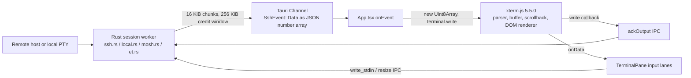
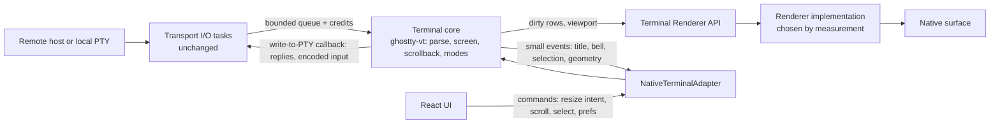
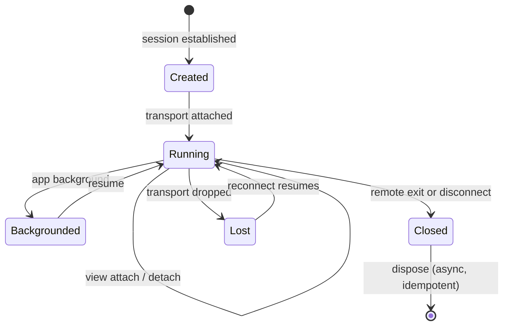

# Terminal runtime: current and proposed

Status: **proposed**. Facts about the current system were read from the checked-out source. The proposed runtime is a design to be validated by the [benchmarks](terminal-benchmarks.md) and the [composition gate](native-rendering.md#composition-gate); only the core crate and its transport-independent session service exist (see [Implementation status](#implementation-status)); nothing in the app uses them yet. Related: [PRD](terminal-performance-prd.md) · [adapter](terminal-adapter.md) · [ADR 0001](adr-0001-terminal-runtime.md).

## Current architecture

Ownership today:

| Concern | Owner | Where |
| --- | --- | --- |
| Transport I/O (SSH, Mosh, ET, local PTY) | Rust | `ssh.rs`, `mosh.rs`, `et.rs`, `local.rs`, `packages/mosh-transport`, `packages/et-transport` |
| Output flow control | Rust credits, returned by JS | `OUTPUT_WINDOW` (`ssh.rs`), `WINDOW` (`local.rs`), `ack_output`/`local_ack` |
| VT parsing, screen, cursor, scrollback, alternate screen | xterm.js, in the WebView | `terminal.ts`, `App.tsx` `prepareSession` |
| Terminal-generated replies (DA, DSR and similar) | xterm.js, forwarded as `terminal-nonuser` input | `TerminalPane.tsx` `observeTerminalInput` callback |
| Key and mouse encoding, bracketed paste | xterm.js | same |
| Selection, search, URL detection | xterm.js APIs plus lazysh code | `terminalTouchSelection.ts`, `TerminalSelectionTools.tsx`, `TerminalPane.tsx` |
| Mosh canonical resize | lazysh patch of xterm private buffers | `moshResize.ts` |
| Herdr switch-button detection | lazysh reads xterm buffer rows | `herdrNavigationCells.ts` |
| Rendering | xterm DOM renderer | WebView |

Not traced: the individual Mosh and ET output paths (only SSH and local were read to the chunk level), and any idle-time behaviour of the DOM renderer.

### Where the cost may be (hypotheses)

The data path performs these steps per chunk regardless of what is visible: serialize bytes to JSON text, parse it into a JavaScript array, copy it into a `Uint8Array`, parse VT in JavaScript, then issue one acknowledgement IPC. The encoding itself writes up to four characters per byte (for example `255,`). The cost of each step on target devices is **unmeasured**. See [benchmarks](terminal-benchmarks.md) for the stage-separated plan.

## Proposed architecture

Principles, each of which must hold in the implementation:

- **One authoritative state per session.** The core's screen is the only display state; xterm.js is a separate backend with its own state and is never mirrored.
- **Raw bytes are separate from display state.** The transport delivers bytes in order; the core consumes them; nothing re-derives bytes from cells.
- **No cells over the bridge.** React receives sizes, ranges, row text on request and events, never cell grids.
- **Transports are renderer-independent.** A session keeps running when no surface is attached.

## I/O ownership and flow control

The existing mechanism is kept in spirit and moved inside Rust for the native backend:

- Transport tasks keep the access-lease, background-epoch and renderer-replacement checks already in `deliver_output` (`ssh.rs`).
- The sink changes from a Tauri `Channel` to a bounded queue into the core's worker. Credits are returned after the core has parsed the bytes, so the window still bounds memory and overflow still blocks the producer. This removes the per-chunk IPC acknowledgement for the native path.
- The xterm path keeps the Channel and the write-callback acknowledgement exactly as today.
- Ordering and loss: a checksum workload across every transport is an acceptance criterion of the data-path issue ([#1315](https://github.com/mihazs/lazysh/issues/1315)).

**Bridge (implemented behind a feature, not reachable from the UI).** `apps/client/src-tauri/src/terminal_core.rs` generalises the one place every transport already passes through: `ssh::deliver_output` (SSH, ET and Mosh via `send_output`; the local PTY calls it directly) now hands admitted bytes to an `OutputSink`, which is the WebView `Channel` (unchanged) or, once a core is attached to the session, `Core::feed`. The access-lease, background-epoch and renderer-replacement checks run before the sink, byte for byte as before. A renderer asks for a core with `terminal_core_open(events, cols, rows, scrollback_lines, config)` (the History lines setting, 100 to 20000; absent means the core's default history; `config` is optional: `{theme, canonicalFrames}`, the app's `TerminalTheme` as CSS hex colours that the core reports to programs asking for its colours, and `true` for a Mosh session so the core follows the Mosh frames' sizes from the first byte; an invalid theme is refused at open and leaves no offer) and then starts the terminal with the same `events` Channel: the transport finds the offer by the Channel's id, so no connect command changed. The credit a chunk consumed returns through the core's own `Hooks::credit` into the session's existing semaphore after VT processing, `ack_output`/`local_ack` are refused for a core-fed session (a renderer cannot forge credit a core owns), a core whose session fails or is cancelled before the renderer learns its id is freed by that failure path, and a renderer replacement closes every core with its sessions. `terminal_core_text` reads the visible rows on request and `terminal_core_close` frees a core; every command has an ACL entry, and close alone is allowed while locked (like `disconnect`). The control plane of the native adapter ([#1321](https://github.com/mihazs/lazysh/issues/1321)) adds `terminal_core_snapshot`, `terminal_core_scroll`, `terminal_core_resize` and `terminal_core_set_active`, which answer with sizes, the cursor, modes, the viewport and the text of a bounded window of rows (256 by default, at most 1,024) and never a cell, plus an event stream on the `events` Channel that opened the core: `changed` (a doorbell: the screen differs, pull a snapshot), `title`, `bell`, `cwd` and `clipboard`. They belong to the current renderer's access lease like `terminal_core_text`, so a locked app or a replaced renderer is refused, and the stream leaves only while the renderer's latest lease is valid (a locked app is told nothing, not even a title or a clipboard write). The logic is in the runtime crate (`control_snapshot`, `control_scroll`, `control_resize`, `take_control_events`, `Doorbell`, `Session::set_active`), which the stdio harness of [#1305](https://github.com/mihazs/lazysh/issues/1305) shares; the app wires it to the lease and the Channel. The real core links only with the `native-terminal` cargo feature (Zig 0.16.0); without it the commands report that the core is not built, so no default build changed. A resize the renderer sends through `resize` or `local_resize` goes to the transport first and then to the core (`request_size`), so the core's grid follows the PTY's; the core applies it at once, not in stream order with output still queued for the old size, the same ordering xterm has today, and the canonical size of Mosh is [#1317](https://github.com/mihazs/lazysh/issues/1317). Replies and encoded input go back through the same bridge ([#1316](https://github.com/mihazs/lazysh/issues/1316)): the core's one `PtyWriter` queues the bytes on the session's own input queue (`Input::Data` with the lease, the queue `write_stdin` and `local_write` use), so SSH, ET, Mosh and the local PTY re-check the lease before every write exactly as for the renderer's own input, and the bytes go out as bytes (`InputSequence::from(Vec<u8>)`; an X10 mouse report above column 95 is not UTF-8). Replies come from a VT worker and carry no command lease, so the writer uses the **latest lease of the renderer**: the one that opened the core, replaced by each `terminal_core_input` call. It refuses (a reply is dropped and counted, an input command fails) before the transport is attached, once that lease is no longer valid (locked, backgrounded, renderer replaced), above 64 KiB plus bracket markers, and when the queue is full; the origin tag changes nothing, both are gated alike. A reply produced after an unlock and before the renderer's next input command is dropped rather than sent under a stale lease. `terminal_core_input(session_id, input)` takes a DOM-shaped event (`{"type":"key","code","key","mods":{shift,ctrl,alt,meta},"repeat","release","composing"}`, `{"type":"mouse","action":"press|release|motion","button":"left|middle|right|wheelUp|wheelDown"|null,"mods","x","y"}`, `{"type":"paste","text"}`, `{"type":"text","text"}`, `{"type":"focus","focused"}`), encodes it for the program's current modes and returns the bytes queued; it has an ACL entry, is refused while locked and caps a paste or a text at 64 KiB like `write_stdin`. `text` is what a soft keyboard or an IME committed (a word, DEL for an erase, CR for Enter): it becomes a key input that names no key and carries only the text, so it is sent verbatim whatever Kitty flags, modifyOtherKeys or bracketed paste the program enabled (the native keyboard bridge of [#1328](https://github.com/mihazs/lazysh/issues/1328) is its sender, [#1791](https://github.com/mihazs/lazysh/issues/1791)). Mouse `x` and `y` are in the core's pixels, which are cells for the bridge's grid today (`resize` carries no pixel size), until the renderer reports its metrics (#1321). The native adapter's bridge (`tauriNativeCoreBridge.ts`, [#1321](https://github.com/mihazs/lazysh/issues/1321)) is its first caller: it sends typed text and pastes as `text`; the bridge is not registered, so no session reaches it.

## Threading

- Transport I/O stays on the existing async runtime tasks. No new thread per session.
- `ghostty_vt::Terminal` is `Send` but not `Sync` (`unsafe impl Send for Terminal`). A core can therefore move between workers but must be driven by one worker at a time.
- Implemented in the crate (`Hub`): a fixed VT worker pool; each session is assigned to the least-loaded worker, a worker serves one 16 KiB slice per turn and requeues a session that still has bytes, so one flooded session cannot starve the rest and a key press waits for at most one slice. A session with an attached view queues ahead of detached ones on its worker, and after four such turns in a row a detached session gets one (`PRIORITY_BURST`), so the visible session's screen update waits for at most the turn in progress while background sessions keep parsing, bounded by their credit window, and never draw (`Hooks::changed` fires only while attached); the measured effect is in [terminal benchmarks](terminal-benchmarks.md#active-session-screen-update-latency-with-nine-sessions-flooding-host-microbenchmark-not-a-device-baseline) ([#1339](https://github.com/mihazs/lazysh/issues/1339)). The pool size is still set from benchmark data, which exists for one host only; the default of two workers is a placeholder. A thread per session is rejected unless profiling justifies it; a test pins that 100 sessions add no threads beyond the pool.
- Rendering is scheduled by the renderer per surface, event-driven (see [native rendering](native-rendering.md#frame-scheduling)).

## Lifecycle

Requirements: attach and detach of a view never touch the transport; surface destruction and recreation rebuild the renderer from core state; switching the active session is serialized so no frame is drawn for an inactive session; dispose releases core, queues and GPU resources deterministically.

**Decision: renderer replacement does not preserve sessions.** Activity/WebView replacement closes renderer-owned sessions by design (`cancel_for_renderer_rebind`, [session lifetime](../explanation/session-lifetime.md), [credentials](../credentials.md)), and a Rust-resident core does not change that. The native core is freed together with the sessions it belongs to: `cancel_for_renderer_rebind` closes every core before it cancels the transports, so a renderer that never passed the lock or biometric gate cannot read the screen of the one it replaced through `terminal_core_text`, which also refuses a replaced renderer's lease like the other terminal commands (`a_replaced_renderer_cannot_read_a_core`), and the core cannot be re-attached to a transport that no longer exists. Keeping sessions alive would first have to move transports out of renderer ownership, which is a credentials decision of its own; it is not taken here, and the registry stays free of any code that would make it by accident. The tests: `renderer_rebind_without_biometric_policy_retires_all_old_transports_and_allows_fresh_session` (a core attached to a native terminal is closed and no longer registered), `renderer_replacement_frees_attached_cores`.

Other lifecycle rules, each with a test in `apps/client/src-tauri`:

| Event | Native core |
| --- | --- |
| App lock | Kept. Delivery is held back exactly like the Channel (`core_output_respects_the_lock_and_background_gates_like_the_channel`), so unreturned credit bounds memory at the transport window; `terminal_core_open`, `_input`, `_text` and the four control commands are refused, `terminal_core_close` is allowed (`a_locked_app_can_free_a_core_but_not_open_or_read_one`, `a_locked_app_can_not_ask_the_control_plane_a_question`); what the core would say about its screen (title, bell, directory, clipboard, the change doorbell) is not sent while the lease is invalid (`a_locked_app_is_told_nothing_and_the_next_reader_brings_the_core_back_to_life`). The core of an adopted session is not freed by a lock or the unlock after it (`an_unadopted_local_terminal_frees_its_core_but_an_adopted_one_keeps_it_through_a_lock`), and held output is delivered after unlock (same gate test). |
| Lock before the renderer acknowledges a new terminal | Freed with the unadopted session (`native_adoption_revokes_unknown_ids_after_response_serialization_but_keeps_owned_sessions`). |
| Connect fails or is cancelled after the core was attached | Freed, since the renderer never learns the session id (`a_native_terminal_that_fails_to_start_frees_the_core_the_renderer_offered`). |
| Session ends (exit, disconnect, lost transport) | Kept until `terminal_core_close` or a renderer replacement, so the final screen stays readable; bounded by the hub's scrollback budget. |
| Renderer replacement | Freed (above). |
| Two terminals at once | Isolated: each core receives only its own session's bytes (`concurrent_local_terminals_feed_only_their_own_core`). |

A view attaching and detaching never touches the transport or the screen (`a_view_can_detach_and_reattach_without_losing_screen_or_scrollback` in the crate); the crate's `Session::set_active` is the control plane's version of it (a reader of text, no frame built), and `terminal_core_set_active` its command; attaching a frame consumer is for the renderer of [#1322](https://github.com/mihazs/lazysh/issues/1322).

## Mosh canonical framebuffer

The Mosh client emits display updates wrapped in private OSC 7777 envelopes `lazysh-mosh;1;begin;<id>;<cols>;<rows>` and `end;<id>` (`packages/mosh-transport/src/native.rs`, README "Runtime contract"). The server owns the screen size; UI geometry is only an intent. Today `moshResize.ts` replaces xterm's buffer resize to apply the envelope size top-anchored without reflowing history, and fails the display on an invalid or partial frame.

Implemented in the crate ([#1317](https://github.com/mihazs/lazysh/issues/1317), `src/mosh.rs`, `Config::canonical_frames`; the call must precede the first byte, like `enableCanonicalResize`):

- **Envelope scanner.** A byte-level state machine over the raw transport stream, so an envelope split at any byte by the chunking is still found. It withholds nothing: the VT parses the same bytes (it ignores OSC 7777) and the runtime applies the geometry right after the envelope's ST, between the bytes before it and the bytes after it, exactly where xterm's ordered write queue runs its OSC handler. It accepts what `moshResize.ts` accepts: version `1`, ids `[1-9][0-9]{0,15}` that increase and stay below 2^53, one open frame at a time, 2 to 512 columns, 1 to 256 rows, at most 32768 cells, at most 128 bytes of text. Any other `lazysh-mosh;` text, an envelope broken off by another escape, a stale or nested `begin` or an `end` with the wrong id fails the display with `invalid-frame`; OSC 7777 with another tag is left to the VT. The scanner only runs on sessions created with `canonical_frames`.
- **Failure.** `DisplayFailure::InvalidFrame` or `PartialFrame` is sticky, is reported once in `Events::display_failure`, stops the core from following the transport (later frames are ignored, UI sizes are `SizeOutcome::Dropped`), and does not stop the VT from parsing the bytes. `finish_canonical()` ends the stream: an open frame becomes `partial-frame`, and the final geometry stays; the pending UI intent is not applied (the xterm backend's `close()` does the same), the UI owns the size again.
- **Geometry.** `Events::geometry` carries the latest applied size and who decided it (`Transport` for a frame, `Local` for a UI request), only when the grid really changed.
- **UI geometry is intent.** With `canonical_frames` the runtime starts under transport authority: `request_size` records the intent, validates it against the same limits and returns `Deferred` for the caller to send to the transport. The existing `apply_transport_size` stays the entry for other transports and is a plain, reflowing resize: the top-anchored one writes VT sequences, which is only safe at a sequence boundary, and only the envelope path knows it is at one (a host call can land between two chunks of one escape sequence; a test pins that).

**The no-reflow, top-anchored resize** is the decision the first draft left open. libghostty-vt resizes with `reflow = wraparound-mode` (`Terminal.resize` in the vendored `Terminal.zig`), keeps the bottom of the grid when it shrinks (rows above the cursor become scrollback, unless trailing rows are blank), and pulls history down when it grows. All three are wrong for Mosh and the first one is the duplication the xterm patch exists to avoid. The core therefore does not call the binding's resize bare. It erases the rows that no longer fit (Ghostty trims blank trailing rows without making history), moves the cursor to the first cell so no row has a reason to move, resizes with wraparound off (the only no-reflow switch the C API exposes; mode 6 is cleared around the cursor moves because CUP is margin-relative under it), restores both modes, puts the cursor back clamped into the new grid, and returns a scrolled-up reader to the same row. The erase and the moves are ordinary VT input at a sequence boundary. No patch to the vendored Ghostty was needed, so the integrity checks of [#384](https://github.com/mihazs/lazysh/issues/384) are untouched.

Known differences from the xterm backend, each recorded rather than hidden:

| Case | xterm backend (`moshResize.ts`) | Core |
| --- | --- | --- |
| Narrower grid, history rows | History keeps its original width; a narrower view hides the right edge until it is widened again | Ghostty clears the cells beyond the new width in every page, so widening does not bring them back. Rows are neither reflowed, dropped nor duplicated |
| Pending wrap at the right edge when the cursor is restored | Kept (`x === cols`) | Lost; the cursor lands in the last column. Mosh repaints with an absolute cursor move, so only a bare envelope with no repaint could show it |
| Primary screen while the alternate screen is active and the grid shrinks | Both buffers are cut from the bottom | The alternate screen is cut from the bottom; the primary screen follows Ghostty (non-blank bottom rows become scrollback). Mosh's display never enters the alternate screen |
| Selection, markers | Cleared when a resize clips them | Selection is not in the core yet ([#1320](https://github.com/mihazs/lazysh/issues/1320)) |

The Mosh C++ framebuffer remains transport state; the core holds display state. Fixtures: `apps/client/e2e/fixtures/mosh-resize-frames.json`, replayed by `tests/mosh.rs` from the same file the Playwright suite reads. The acceptance criterion "existing mosh-resize and mosh-keyboard scenarios pass on the native backend" needs the native adapter ([#1321](https://github.com/mihazs/lazysh/issues/1321)) and is not met by this slice; the core scenarios that mirror them are in `tests/mosh.rs`.

## Herdr screen inspection

`herdrNavigationCell` reads viewport rows 0 and 1 as text to recognise Herdr's phone-layout switch button, so a tap there does not open the soft keyboard. The adapter exposes `readRows` (text only) under the explicit capability `screenInspection`; the detection becomes a pure function over strings shared by both backends. Herdr API navigation (`useHerdrNavigation.ts`) is unaffected.

Implemented in the crate ([#1318](https://github.com/mihazs/lazysh/issues/1318)): `TerminalRuntime::read_rows(first, count, columns)` returns the text of absolute rows (scrollback first), trimmed on the right, optionally of a column span `[start, end)`, and `viewport()` returns where the visible rows sit (`top`, `rows`, `length`, `following`), which is all `herdrNavigationCells.ts` and `herdrOnScreen` ask of the screen. Text only: no cells cross the API. The result matches the xterm backend's (`translateToString(true, start, end)` then `trimEnd`) on `fixtures/read-rows.json`: a blank cell reads as a space, a wide character's second cell as nothing (except at the start of a span, where xterm reads it as a blank and so does the core), a combining mark or ZWJ cluster whole, every Unicode space `trimEnd` knows is trimmed, and rows past the end are empty. At most 4096 rows are returned per call so a text query over the bridge stays bounded. The same bytes are replayed through xterm.js 5.5.0 by `apps/client/src/xterm/readRowsFixture.test.ts`, which fails if the recorded rows drift from what xterm reads. One case is real Herdr 0.9.5 output: a client at 46x30 captured for four seconds from a private server (its own `HOME` and socket, stopped through that socket afterwards) without answering its terminal queries; the core and xterm read all 30 rows of it identically, and row 1's right edge reads `│ switch`, the button the detection looks for.

The TypeScript side is already shared: `herdrNavigationCells.ts` reads only the adapter's `readRows`, `size` and `viewport` ([#1308](https://github.com/mihazs/lazysh/issues/1308)), so a backend that reports `screenInspection` gets Herdr's detection with no change to it. `herdrNavigationCells.test.ts` runs every case over the xterm.js adapter and the native adapter over the stand-in core, which serves rows from the bounded window the core returned; on native the live screen is read as empty when the reader is scrolled back further than that window reaches, which Herdr's alternate screen (no history) never needs. Not done: the `herdr-switch-tap` Playwright spec on the native backend, which waits for the Waydroid lane ([#2093](https://github.com/mihazs/lazysh/issues/2093)).

## Selection, search and OSC 52

Today these are xterm APIs plus lazysh code: `terminal.select` and `getSelection`, `terminalWordAt` (`terminalTouchSelection.ts`), a row scan for the find box (`TerminalPane.tsx`), the OSC 52 handler with `decodeClipboardRequest` (`preferences.ts`) and its consent panel. [#1320](https://github.com/mihazs/lazysh/issues/1320) moves them into the core so React never needs a cell mirror. The core answers with text and ranges in absolute cell coordinates (scrollback first, end inclusive, like the adapter's `TerminalRange`); the UI stays in React.

Implemented in the crate (`src/selection.rs`, `src/clipboard.rs`):

| Question | Core | Oracle on the shared fixtures |
| --- | --- | --- |
| Text of a range | `selection_text(range)`: first row from its start column, last to its end column, newline between rows unless the next row continues a soft wrap, rows trimmed of cells never written (written spaces stay), wide characters and grapheme clusters whole, non-breaking spaces as spaces, rows past the end as empty lines (at most 4096 of them) | `select` then `getSelection` on xterm.js 5.5.0 |
| Select all, copy screen | `buffer_range()`, `screen_range()`, `copy_screen()` | `selectAll`, `select(0, viewportY, rows * cols)` |
| Word under a cell | `word_at(cell)`: the run of non-blank cells on its row; a blank or off-screen cell is returned alone; a wide character's second cell belongs to its word | `terminalWordAt` itself |
| Logical line | `line_at(row)`: the soft-wrapped chain around a row, bounded at 4096 rows | none (xterm has no equivalent call; covered by a core test) |
| Find | `search(query, direction, from)`: the first row after or before `from` whose text contains the query, ignoring case, wrapping; returns the row, the match's UTF-16 offset and the row text's UTF-16 length | the find box's loop in `TerminalPane.search` |
| URLs and host paths | `find_urls(row)`, `find_paths(row)` (a port of `terminalLinks.ts`: soft-wrapped lines joined, a URL a program broke at a box border, the full screen width or under list indentation joined only when the next line plainly continues it, closing punctuation and unopened brackets dropped, `file:line:col` split off); `hyperlink_at(cell)` for an application's own OSC 8 link | `findUrls` and `findPaths` themselves, on every row of 33 buffers |
| OSC 52 | libghostty-vt decodes and bounds a write (192 KiB), never answers a query, and the runtime queues at most 8; `clipboard_consent_text` applies the consent policy (at most 64 KiB decoded, valid UTF-8, never partial) | `decodeClipboardRequest` |

The fixtures are `packages/terminal-runtime/fixtures/{selection,osc52}.json`: bytes plus the questions, replayed through the core by `tests/selection.rs` and `tests/clipboard.rs`, and through xterm.js (and the lazysh code that wraps it) by `apps/client/src/xterm/selectionFixture.test.ts` and `osc52Fixture.test.ts`, which fail if the recorded answers drift (`UPDATE_SELECTION=1`, `UPDATE_OSC52=1` rewrite them). The selection cases cover wide, combining and wrapped-wide text, hard and soft line breaks, non-breaking spaces, written versus never-written blanks, the empty cells of a gap (a tab or a cursor move) which xterm keeps while text follows them on the row and cuts only at the end of the row's content, a span that opens on the second cell of a wide character (read as a blank), scrollback and a scrolled screen; the core matches xterm on all of them with no recorded divergence.

**Text queries over the bridge.** Every query above runs under `Session::with`, which holds the session lock a VT worker needs for its next slice, so a bridge command that exposes them must keep calls short: `read_rows` returns at most 4096 rows, `word_at`, `line_at` and the viewport read one row or a few, and `selection_text` and `search` are linear in the rows they read (24 ms and 8 ms for 5,000 rows, about 100 ms and 37 ms for 20,000 on the shared host in the [benchmarks](terminal-benchmarks.md#selection-and-search-on-a-large-scrollback-host-microbenchmark-not-a-device-baseline)), so a select-all copy of a very long scrollback stalls that session's parsing for that long. The Tauri commands themselves are not part of this crate or of this slice: the transport bridge is a separate change ([#1315](https://github.com/mihazs/lazysh/issues/1315)).

**Who owns the selection.** The host. The Renderer API already says so (`Overlay::selection` is state "the host owns and changes without the core"), and libghostty-vt exposes no row identity that survives the scrollback limit trimming old rows, so a selection the core held would need its own invalidation rules for resize, trim and screen switches. Every call here takes its range as an argument and the adapter keeps the range it draws; the core answers what text is under it. A native selection that follows output the way xterm's does is therefore the adapter's job ([#1321](https://github.com/mihazs/lazysh/issues/1321)), and needs the binding to expose tracked row references if it must survive a trim.

**OSC 52 differences** (recorded in `fixtures/osc52.json`, each with its reason; 22 of the 27 requests behave exactly as today, including the 64 KiB bound, the 87,384-character base64 bound, strict base64 and UTF-8, queries never answered): the VT delivers writes only for the standard clipboard, so a target of `s`, `cs` or `ccc` (offered today) is dropped, an unknown target letter such as `x` (rejected today) is offered, and an empty write is not queued (today it opens the consent panel with an empty text). Every difference concerns what is offered to the user; nothing is ever applied without the consent flow. The review of [#1314](https://github.com/mihazs/lazysh/issues/1314) (2026-11-18) accepted the dropped `s` and `cs` writes together with the primary-only and mixed ones (`osc52-selection-filter`; a write that names only the primary selection (`p`) is also rejected by lazysh's policy, so neither engine offers it). Whether to keep the rest, `ccc` dropped, an unknown letter offered and an empty write not queued, needs a decision; seeing the target would need a change to the vendored binding. They are registered as `osc52-target-letters` (open, [#1321](https://github.com/mihazs/lazysh/issues/1321)) in `fixtures/divergences.json` and exercised by the `osc52-clipboard-targets` corpus case.

**Links.** `terminalLinks.ts` is the oracle and `fixtures/links.json` the evidence: 33 buffers (soft wraps, boxes, full-width and list-indented hard wraps, three-row URLs, adjacent URLs that must stay apart, prose, bullet and header lines after a URL, closing punctuation and brackets, CJK neighbours, no-break and ideographic spaces, tabs, a box that scrolled into history, combining marks, upper-case schemes, and the path shapes of its tests with glued, dotted and location-carrying ones). The TypeScript code runs on every row of each buffer in xterm.js 5.5.0 (`apps/client/src/xterm/linksFixture.test.ts`, `UPDATE_LINKS=1` rewrites the recorded results); the core must return the same URLs, paths, locations and cell ranges on every row (`tests/links.rs`). All 33 match, with no recorded divergence. The patterns stay regular expressions, so the crate gains one production dependency, `regex` without default features (no Unicode tables; the character classes JavaScript's `\s` and `\w` mean are spelled out). Known limits: a `:line` number past `u64` is dropped where JavaScript keeps a rounded number; a URL with a character outside the BMP is read as intended (one character per glyph) where `terminalLinks.ts` maps UTF-16 units to glyphs one per code point and would misplace its end; and emoji are left out of the fixtures because xterm.js 5.5.0 without the Unicode 11 addon and the core give them different cell widths (the open divergence of [#1314](https://github.com/mihazs/lazysh/issues/1314)), which moves every column after one.

`hyperlink_at` answers only for rows on the screen (libghostty-vt resolves hyperlinks through the viewport), which is where a tap can land.

Not done by this slice: the adapter, `TerminalSelectionTools`, `terminalTouchSelection.ts`, `terminalLinks.ts`'s `installTerminalLinks` and the consent panel keep their xterm implementations until the native adapter ([#1321](https://github.com/mihazs/lazysh/issues/1321)) consumes these queries, and the Playwright parity specs (`terminal-selection`, `terminal-clipboard`) need a native backend to run on. [#1241](https://github.com/mihazs/lazysh/issues/1241) (URLs wrapped over rows) is exercised by the soft-wrap and hard-wrap cases above, in the core.

## VT engine: libghostty-vt assessment

`packages/herdr-upstream` already contains the pieces. Recorded facts:

| Item | Fact |
| --- | --- |
| Herdr source | v0.9.5, commit `2ecf19a92fc3a7fff75b6ce3655ef04f4625ec01` (`PROVENANCE.md`) |
| Ghostty base | commit `44f2a44df7e8c4a0c6df3f7d872ef3d7ead88e51`, `VERSION` `1.3.2-HEAD-+44f2a44df`, MIT (`vendor/libghostty-vt.vendor.json`) |
| Binding crate | `crates/ghostty-vt`, package `ghostty-vt` 0.0.0, Apache-2.0, `publish = false`; deps `base64`, `libc`, `png`, `tracing` |
| Local patches (all active) | 0002 modifyOtherKeys query, 0004 hosted Wuffs builds, 0005 bounded word selection, 0006 clear screen preserving cursor line, 0007 experimental PNG retention (`vendor/libghostty-vt.patches.md`) |
| Toolchain | Zig 0.16.0 and Rust 1.96.1 (`PROVENANCE.md`) |
| Workspace | excluded from the root Cargo workspace; own `Cargo.lock`; no Bun package |
| Build mapping | `build.rs` maps Linux gnu/musl (x86_64, aarch64), Android (aarch64, x86_64; [#2098](https://github.com/mihazs/lazysh/issues/2098), a documented local modification), macOS (x86_64, aarch64), iOS device and simulator (aarch64), Windows MSVC (x86_64, aarch64); any other target panics |
| Upstream Android support | the vendored `src/build/GhosttyLibVt.zig` contains Android NDK and 16 KiB page-size handling; the `build.rs` mapping selects it, with the NDK found through `ANDROID_NDK_HOME`, `ANDROID_HOME` or `ANDROID_SDK_ROOT` |
| CI | the `herdr-native` job (ubuntu-22.04, x86_64) builds and tests the crate itself, and for Android arm64 and x86_64 it checks and links `lazysh-terminal-runtime` against the pinned NDK (compiled and linked, never run on Android); `native-terminal-bridge` builds the app bridge against it with the `native-terminal` feature, which also compiles the wgpu renderer into the app from the root lock file ([#2201](https://github.com/mihazs/lazysh/issues/2201); nothing calls it yet), and runs the real-core bridge tests; `native-android-terminal-core` builds the app with the feature for arm64 and x86_64 and runs the core inside it on the CI emulator ([#2145](https://github.com/mihazs/lazysh/issues/2145); [sizes](#size-of-the-app-library-on-android)); all three admit the source archives (uucode, Highway, pixels) by Zig package hash |
| Open issue | #384: Ghostty source acquisition failures; no integrity check may be relaxed |

API surface relevant to a core (from `crates/ghostty-vt/src/lib.rs`): `Terminal::new(cols, rows, max_scrollback)`, `write`, `resize`, `scroll_viewport_*`, `mode_get`, `active_screen`, `scrollbar`, `read_text_*`/`read_ansi_*`, `set_write_pty_callback`, `take_clipboard_writes`, `take_bell_count`; `RenderState` with `dirty`, row and cell iterators; `KeyEncoder`, `MouseEncoder`; `unicode_grapheme_width`. Scrollback is configured through `SCROLLBACK_MAX_BYTES` (bytes), while lazysh preferences count lines.

Assessment: **reuse, do not add a second engine.** The binding already covers parsing, incremental dirty-row state, input encoding and terminal replies, and Herdr exercises it in production code. Gaps that block reuse today: no iOS or macOS build in CI (Android arm64 and x86_64 build and link in `herdr-native`; Windows x86_64 builds and tests in `terminal-windows`, [#1332](https://github.com/mihazs/lazysh/issues/1332), debug profile and software Direct3D 12 only), workspace placement, and #384. The Herdr-specific patches (0005 to 0007) travel with the vendored base; keeping them is cheaper than diverging, but each rebase of the base must carry them. These gaps are assigned to [#1312](https://github.com/mihazs/lazysh/issues/1312) ("one Ghostty dependency, shared binding crate, Android and iOS targets"). That the library builds and links for both Android ABIs is checked in `herdr-native` ([#2098](https://github.com/mihazs/lazysh/issues/2098)); nothing has run on Android.

## Size of the app library on Android

What the core adds to `liblazysh_lib.so`, the library the app ships for each ABI ([#2145](https://github.com/mihazs/lazysh/issues/2145)). Measured on 2026-11-18 on a Linux x86_64 host with `cargo build --locked --lib --target <triple>` in `apps/client/src-tauri` (stable Rust 1.99.0, Zig 0.16.0, NDK r29.0.14206865, API 24), once with `--features native-terminal` and once without. The debug rows are what `tauri android build --debug` links: "as built" keeps its symbols (the debug APK keeps them too) and "stripped" is `llvm-strip --strip-unneeded`. The release row is `cargo build --release` (LTO, stripped), not an APK. These are sizes of a library, not of a package: Gradle packaging, compression and the other ABIs are not in them, and no figure is a device or Waydroid result. They were taken before the feature also linked the wgpu renderer ([#2201](https://github.com/mihazs/lazysh/issues/2201)), so they are the core alone: the library the feature builds today is larger, and the job summary named below has the current figures.

| Library | Without the core (bytes) | With the core (bytes) | Added |
| --- | --- | --- | --- |
| x86_64, debug, as built | 431,792,760 | 448,506,280 | +16,713,520 (3.9 %) |
| x86_64, debug, stripped | 60,754,664 | 63,238,760 | +2,484,096 (4.1 %) |
| x86_64, debug, `tauri android build --features native-terminal` (the library the APK carries) | not measured | built 442,973,600, stripped 63,377,616 | not measured |
| aarch64, debug, as built | not measured | 440,256,008 | not measured |
| aarch64, debug, stripped | not measured | 53,553,808 | not measured |
| aarch64, release | 20,992,384 | 22,949,624 | +1,957,240 (9.3 %) |

The release row is the one that matters for the size limit of [#1749](https://github.com/mihazs/lazysh/pull/1749) (a release package past 1.5 times its measured size is refused): the core adds about 1.9 MB to the library of the ABI that ships, and the feature is off in every release build today. The `native-android-terminal-core` job prints the same two debug figures for each ABI in its job summary on every run (`.github/scripts/native-lib-size.sh`).

## Memory and scrollback

Today each session's scrollback lives in WebView memory (default 5000 lines, maximum 20000). The core holds it in native memory under a global budget (256 MiB by default) with a per-session cap (`HubConfig::session_scrollback_max`, 64 MiB by default) so one request cannot take the budget from the others; both values are placeholders, not measurements, until the per-device data of [#1338](https://github.com/mihazs/lazysh/issues/1338) and [#1339](https://github.com/mihazs/lazysh/issues/1339) exists; libghostty-vt's incremental scrollback compression is used for inactive sessions: a detached session that received nothing for `HubConfig::compress_after` (2 s by default, `None` disables) is compacted by its worker, one bounded step at a time and only while that worker has nothing to parse; on the measured host this took the resident memory of a full session from about 4 MiB to about 0.5 MiB and cost about 1.1 to 1.7 ms more on the first read of the whole history afterwards ([terminal benchmarks](terminal-benchmarks.md#scrollback-compaction-of-idle-sessions-host-microbenchmark-not-a-device-baseline), [#1338](https://github.com/mihazs/lazysh/issues/1338)). The two budget values above stay placeholders: nothing measured yet says what a device should grant.

**History lines to bytes.** The setting counts lines and libghostty-vt budgets bytes, so `scrollback_bytes_for_lines(lines, cols)` in the crate (`terminal_core_open` calls it with the grid width at open) requests `lines x max(cols, 80) x 10 bytes + 1 MiB`. Measured on this host, a scrollback cell costs 8.9 to 9.2 bytes whatever the width (20 to 279 columns) and whether the output is plain, 16-colour SGR or truecolor syntax highlighting, because styles are shared per page; libghostty-vt frees whole pages (about half a MiB), so the extra MiB covers the one and a half pages a small budget can lose. A real-core test (`tests/scrollback.rs`) pins that plain, coloured and syntax-highlighted output keeps at least the requested rows at 20 to 279 columns and 100 to 20000 lines, and that the rows kept stay within the budget. The mapping does not promise the setting for every content: a different truecolor foreground and background on every cell keeps about a fifth of the rows at 5000 lines, graphemes (ZWJ emoji, wide CJK, combining marks) a third and a distinct hyperlink on every row about 0.4 of them (numbers in [the benchmarks](terminal-benchmarks.md#history-lines-to-scrollback-bytes-1319)); the width is the one at open, so output written after a later widening keeps fewer rows too; and the hub clamps each session to `session_scrollback_max` and the remaining global budget; the largest setting reaches the per-session cap at about 330 columns. The session reports what it was granted (`Session::scrollback_granted`); no command exposes it to the renderer yet.

## Failure handling

| Failure | Required behaviour |
| --- | --- |
| Renderer or surface lost | Rebuild the renderer from core state; session and transport untouched. |
| Core error on malformed input | Bounded, contained to that session; transport keeps running; failure surfaced as an event. |
| Queue full | Producer waits on credits; no byte is dropped or reordered. |
| Native backend unavailable at creation | Fall back to xterm.js with a recorded reason ([migration plan](terminal-migration-plan.md)). |
| Switching backend mid-session | Not lossless: xterm and Ghostty state are not interchangeable. Start the new backend from a visible-screen snapshot (`read_ansi_screen`); scrollback loss is documented. |

## Implementation status

[`packages/terminal-runtime`](../../packages/terminal-runtime/README.md) ([#1313](https://github.com/mihazs/lazysh/issues/1313)) is the first slice of the shared core. It depends on Herdr's vendored `ghostty-vt` binding by path and adds no second VT engine, Ghostty copy or patch. It is a nested workspace like `herdr-upstream` because building it compiles libghostty-vt with Zig 0.16.0; default lazysh builds are unaffected, and its tests run inside the `herdr-native` job against the same admitted archives (nothing about [#384](https://github.com/mihazs/lazysh/issues/384) is relaxed).

| Proposed element | In the crate | Not yet |
| --- | --- | --- |
| Binary-safe, ordered, bounded byte-in with credits after VT processing ([#1315](https://github.com/mihazs/lazysh/issues/1315)) | `Ingress`, `offer`, `pump` (rejected chunks returned intact; credit = bytes processed); `Hub`/`Session::feed` on a fixed worker pool, credit returned through `Hooks::credit` after each slice, queued bytes' credit returned on close | The renderer's use of it ([#1321](https://github.com/mihazs/lazysh/issues/1321)); the wiring to SSH, ET, Mosh and the local PTY is the bridge below, checked against real OpenSSH, the official mosh-server and the official ET server in the interoperability tests (run on Linux; the other platforms are not exercised) |
| Screen and cursor state, incremental dirty rows, snapshot for a recreated surface | `take_frame` (only changed rows, `None` when idle; a frame without rows when only the cursor changed), `snapshot` (all rows); the [Renderer API](native-rendering.md#terminal-renderer-api) and a CPU reference renderer consume them ([#1322](https://github.com/mihazs/lazysh/issues/1322)) | Frames carry per-cell `String`s; a compact format is [#1337](https://github.com/mihazs/lazysh/issues/1337). What "default color" looks like is the renderer's theme: OSC 10 and 11 produced no frame in a probe (OSC 4 produced a full one) |
| UI resize intent versus transport-authoritative size | `request_size`, `apply_transport_size`, `release_transport_authority`, `size_intent`; Mosh frames: `Config::canonical_frames` applies OSC 7777 envelopes as a top-anchored resize without reflow, `Events::geometry` and `display_failure`, `finish_canonical` ([#1317](https://github.com/mihazs/lazysh/issues/1317)); the app opens a Mosh session's core with it through `terminal_core_open`'s `config` ([#2158](https://github.com/mihazs/lazysh/issues/2158); a real-core case feeds frames and asks for sizes through the commands) | The native adapter's use of it ([#1321](https://github.com/mihazs/lazysh/issues/1321)); a plain `request_size` still reflows and a test pins that |
| Terminal-generated replies | `take_replies`, capped at 64 KiB with a dropped-byte count; default colour queries (OSC 10, 11, 12 and 4) are answered from `Config::theme`, the theme the renderer draws with (`TerminalRuntime::set_theme` changes it on a running session: the next query gets the new colours, a palette colour a program set itself stays; the app reaches it with `terminal_core_theme`, [#2158](https://github.com/mihazs/lazysh/issues/2158)): the palette is the VT's default palette, and the runtime itself answers OSC 10, 11 and 12 with a scanner on the byte stream (`src/colors.rs`) because the vendored binding cannot configure those colours ([#1314](https://github.com/mihazs/lazysh/issues/1314)); the pool hands each slice's replies to the session's `PtyWriter` tagged `Origin::Reply`, and a refusal (input gated) drops and counts them, never delays them | Replies reach the transport's input under the access lease (see the bridge above); checked on a real core, on a local PTY and on an SSH session's input queue, not against a real OpenSSH, Mosh or ET server |
| Input encoding | keys, mouse, bracketed paste (end marker stripped, line breaks sent as CR like xterm.js), focus in/out (mode 1004), IME commit versus composition ([#1316](https://github.com/mihazs/lazysh/issues/1316)); `Session::send_*` encodes from the live modes and writes through the `PtyWriter` as `Origin::User`, which may refuse. Ctrl+Enter, Ctrl+Shift+Enter, Ctrl+Tab and Ctrl+[ send CR, HT and ESC (what xterm.js sends) and Shift+Enter sends `CSI 13;2u` (what lazysh sends today, [#805](https://github.com/mihazs/lazysh/issues/805); xterm.js alone would send CR and an agent TUI would submit) until the program enables Kitty keyboard flags or modifyOtherKeys, then the encoder's protocol form; committed text (IME, soft-keyboard Enter) is sent verbatim in every mode, because under Kitty flags the encoder turned it into `CSI 13u` ([#1043](https://github.com/mihazs/lazysh/issues/1043)); the encoder is given each key's unshifted codepoint, without which a Kitty-enabled program received Ctrl+C as plain `c` | Golden comparison with xterm.js output; Android soft keyboard/IME integration ([#1328](https://github.com/mihazs/lazysh/issues/1328)) |
| Screen inspection as text | `viewport_text`, `screen_text`, `read_rows` (rows and column spans, xterm-identical on the fixtures), `viewport` ([#1318](https://github.com/mihazs/lazysh/issues/1318)) | The adapter's `readRows`, the Herdr detection on top of it and the Playwright parity run ([#1308](https://github.com/mihazs/lazysh/issues/1308), [#1321](https://github.com/mihazs/lazysh/issues/1321)) |
| Control plane for the native adapter ([#1321](https://github.com/mihazs/lazysh/issues/1321)) | `control_snapshot`, `control_scroll` and `control_resize`: size, live cursor, modes (with the mouse tracking level), viewport and the text of a bounded window of rows (`control_window`: 256 by default, at most 1,024), never cells; `take_control_events`: the latest title (`OSC 0`/`2`, read from the byte stream by `titles.rs` because the vendored binding does not wrap libghostty-vt's title callback and #384 forbids patching it, so the 7-bit form only and at most 1,024 bytes), at most 8 bells, directories decoded from `OSC 7` and clipboard writes (valid UTF-8, at most 64 KiB), in the order title, bells, directories, clipboard, each kind in the order it happened; `Doorbell`: one `changed` per read of the state however much output arrives, the reports ahead of it, and what arrives while a ring is unanswered at the next read; `Session::set_active`: an inactive session keeps parsing and wakes nobody, and a core starts active. `fixtures/control-plane.json` holds what headless xterm.js answers for 9 byte streams (21 answers: every scroll kind, five mouse levels, the alternate screen, a reader in history), written by `controlPlaneFixture.test.ts` and replayed by `tests/control.rs`, which also serializes the answers to exactly that JSON | The registration of the native backend (the client's Tauri bridge over the commands is `tauriNativeCoreBridge.ts`); width-exact column spans for the window; the history setting in the answer (the client knows what it opened the core with) |
| Selection, search, links, OSC 52 policy | OSC 52 payloads, bells and directory changes surfaced via `take_events`; at most 8 of each kind pending, overflow counted; selection text, word, line, all, copy screen, find, URL and path detection, OSC 8 lookup, the OSC 52 consent policy ([#1320](https://github.com/mihazs/lazysh/issues/1320), [section](#selection-search-and-osc-52)) | the adapter and UI consumers ([#1321](https://github.com/mihazs/lazysh/issues/1321)) |

### Session service (`Hub`, `Session`)

`Hub` owns the worker pool and a registry keyed by session id; it is the one API every transport feeds, so SSH, Mosh, ET and the local PTY differ only in where their bytes come from. The contract, each point pinned by a test in `tests/session.rs` or `tests/process.rs`:

- **Credits after VT processing.** The transport takes credit for a chunk (its existing window, 256 KiB), calls `Session::feed`, and gets the bytes back through `Hooks::credit` only after a worker has run them through the VT. `feed` never parses and never blocks on a worker; a chunk over the queue budget is handed back intact (`Offer::Full`), so nothing is dropped or reordered. A checksum workload from six concurrent producers matches a single-threaded reference byte for byte, and the queue never exceeded the window.
- **Replies and input share one writer.** Terminal replies (DA, DSR) and encoded user input leave through `PtyWriter::write(Origin, bytes)`. The host's writer owns the access policy: while input is gated it refuses, a refused reply is dropped and counted (a stale answer typed into a shell after unlock would be worse than none), and a refused key reaches nobody.
- **Key parity with xterm.js.** `KeyInput::from_dom(DomKey { code, key, mods, repeat, release, composing })` and `dom_mods` map a browser `KeyboardEvent` to the encoder (physical key by `code`, named keys by `key` when a soft keyboard reports no code, a single printable character as text). `tests/keys.rs` compares 104 chords with what xterm.js 5.5.0 sends for the same `keydown` (captured on a mounted `Terminal`, the way #1314's `keys.json` is): 69 are byte-identical and 35 differ, each with a reason in the table. The classes: Shift+printable (xterm.js sends that text from `keypress`, not `keydown`); Ctrl+digit, Ctrl+Shift+digit, Ctrl+/ and Ctrl+Shift+Space (xterm.js sends nothing, the core the conventional byte); Alt+arrow, Alt+PageDown, Alt+Insert, Alt+Tab (xterm.js rewrites Alt to Ctrl on arrows and drops it on the others, the core sends the standard Alt form: check shells, vim, tmux and the agent TUIs before the Android default stage); Shift+PageDown and Shift+Insert (xterm.js leaves them to the host, the core encodes them, so the adapter must route them first); Ctrl+Alt+Shift+letter (xterm.js sends ESC and the control byte, the core nothing); Meta on navigation keys; and Shift+Enter, by design. Without a keyboard protocol the core never sends a `CSI u` or `CSI 27;m;c~` form (a shell prints them as junk, and xterm.js sends nothing for Ctrl+Shift+letter or Ctrl+;), and a printable key with Super (Cmd+C) sends nothing instead of typing its text.
- **Typing follows the live screen.** A key or paste the writer accepted returns a viewport scrolled into history to the live screen and wakes the attached view; `Session::set_scroll_on_user_input(false)` keeps the reader in history, like xterm.js's `scrollOnUserInput`. A refused key, a mouse report and a focus report do not move it. This is the [#1043](https://github.com/mihazs/lazysh/issues/1043) case: the toolbar Enter confirmed the agent's menu but left its answer out of view.
- **Lifecycle.** `create` reserves scrollback from a global budget (clamped to what is left, refused below 64 KiB); `close` is idempotent, frees the VT state immediately, returns the budget and the credit of anything still queued so a blocked producer wakes; `attach` returns a full snapshot and `detach` stops `Hooks::changed` wake-ups without touching the transport or the screen, so a backgrounded session wakes nothing. A panic in the binding or a host hook closes only that session when the build unwinds; the app's release profile sets `panic = "abort"`, where a panic ends the process, so that containment is a test-and-debug property, not a shipped one.
- **Renderer replacement.** Decided in the Lifecycle section: sessions, and with them cores, are not preserved.

Conformance coverage lives in `tests/conformance.rs` (41 cases: wrapping, ANSI and truecolor, CJK, combining marks and ZWJ emoji, alternate screen, cursor modes, bracketed paste, mouse reports (X10, SGR, wheel, motion, modifiers, written from the ctlseqs documentation; the fixtures below compare them with xterm.js's own encoder), key encoding including the Kitty and modifyOtherKeys forms, application keypad, toolbar versus soft-keyboard Enter in eight modes, split-sequence equivalence, binary noise, backpressure, resize authority, scrollback bounds, session isolation, bounded pending events, cursor-only frames, repeated motion in one cell, a zero cell size, moving a live session to another thread, colour queries answered from the theme however the bytes are chunked). libghostty-vt marks no row dirty when only the cursor moves inside a row, changes shape, blinks or is hidden, so `take_frame` used to return `None` for those and a renderer kept a stale cursor; the runtime now compares the cursor and the active screen with the last frame it handed out and emits a frame without rows. The cross-engine fixtures of [#1314](https://github.com/mihazs/lazysh/issues/1314) live in [`packages/terminal-runtime/fixtures`](../../packages/terminal-runtime/fixtures/README.md): 96 screen fixtures (SGR, cursor, editing and edge cases such as charsets, tab stops, wide-glyph overwrites, explicit zero counts, tab clears, REP, the wrap-pending state, origin mode and resize reflow, wrapping, Unicode, alternate screen, modes and queries, paste, events, resize, synthetic TUI streams, real first-run captures of vim, less, tmux, Claude Code, Codex, OpenCode, Zellij and Herdr, and the six captured Mosh frames, three of them alone and all six in order), 75 key presses and 130 mouse events in 18 protocol and encoding setups, replayed through xterm.js 5.5.0 in the `client` vitest run and through the core in `tests/vt_fixtures.rs`. The core matches xterm.js on every screen, key and mouse report except where a recorded divergence says otherwise. `fixtures/divergences.json` lists 28 differences with a reason and a status, and every one was reviewed on 2026-11-18 (#1314, slice 1314b): 27 were accepted with the decision and the test that pins it, and the last, Shift+PageUp, was closed on 2026-11-19 by #1334 (slice 1334a): the native input editor consumes the scroll chords before the core encodes them, pinned by `e2e/terminal-native-input.spec.ts`. The approvals that change what a user sees are Unicode 11 and later widths with grapheme clustering (emoji, ZWJ and skin-tone sequences take two cells; the private-mode queries 2027 and 2031 answer set with them), the standard Alt+arrow encodings, the Kitty keyboard protocol for Codex and Herdr, reflow on resize and the OSC 52 selection filter; the release notes of the Android default must call out the widths, the Alt+arrow form, reflow and the dropped primary-selection writes. Theme colour queries (OSC 10, 11, 12 and 4) are answered from the runtime's theme and match xterm.js's replies when given xterm.js's default theme, except that a query ended with BEL is answered with BEL, where xterm.js always answers with ST; vim and OpenCode send BEL-terminated queries and act on the replies, so that difference is accepted. The comparison found and fixed one core defect (repeated motion reports in one cell, plus a division by a zero cell size in that fix). It also showed that the core's key encoding differed from xterm.js for Ctrl+Enter, Ctrl+Tab, Ctrl+[ and the newline of a bracketed paste, which [#1471](https://github.com/mihazs/lazysh/pull/1471) fixed under [#1316](https://github.com/mihazs/lazysh/issues/1316); those four divergences are gone, and Shift+Enter stays a listed, accepted difference (`CSI 13;2u`, by design for #805). Not covered: signed-in sessions of the agents (the captures stop at their first-run screens), the DOM half of xterm.js's mouse handling, and any platform but Linux. `tests/programs` (Linux x86_64 only) runs tmux, vim, bash, Herdr, Claude Code, Codex and OpenCode on a pty with the core as their terminal, sends the core's replies back to them and the keys it encodes to them, and asserts what each did; it settled the open divergences of the registry. tmux, vim, bash and Herdr are required in CI, and an agent TUI skips its test where it is not installed.

A `TerminalRuntime` is `Send` (not `Sync`), which the VT worker pool needs. The binding marks `Terminal` and `KeyEncoder` `Send` but not `MouseEncoder`, which first made every runtime `!Send`; the crate wraps that one handle in a documented `unsafe impl Send` (no thread-local state in the built libghostty-vt archive, same shape as `KeyEncoder`) instead of editing the vendored binding.

Scrollback is budgeted in bytes by libghostty-vt, while lazysh's setting is lines. The measured mapping and its limits are described in [Memory and scrollback](#memory-and-scrollback); per-device budgets remain part of [#1338](https://github.com/mihazs/lazysh/issues/1338).

The bridge slice is verified with a core stand-in on a worker thread (checksum of 3 MiB of pseudo-random bytes through `send_output`, 1 MiB of text echoed through a real russh channel into the core, 2 MiB from a Mosh/ET-shaped native driver in 16 KiB chunks, 60,000 lines through a real local PTY, peak queued bytes at most the 256 KiB window, zero Channel messages on the core path, lock and background gating, forged acknowledgements refused, renderer replacement) and, with `--features native-terminal` on this Linux host, by one test that runs a local PTY into the real libghostty-vt core and reads the screen text back. The feature build is not exercised by CI.

## Unresolved questions

- History cells beyond a narrower Mosh grid: Ghostty clears them where the xterm backend only hides them (see the table under [Mosh canonical framebuffer](#mosh-canonical-framebuffer)); whether that matters needs a decision after the Mosh path runs on a device.
- Whether the lines-to-bytes mapping should follow a resize (the budget is fixed when the session opens) and how a user should learn that content with a style or hyperlink on every cell keeps fewer rows than the History lines setting.
- Whether transports could ever leave renderer ownership so that a session survives renderer replacement: a credentials review, not assumed by this design.
- Where the Mosh and ET output paths differ from the traced SSH path.
