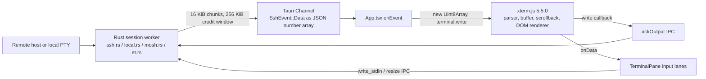
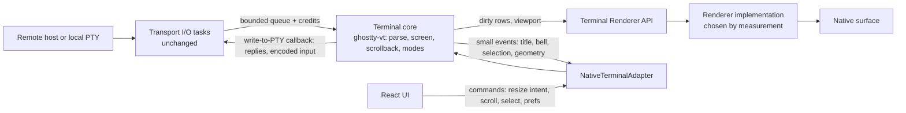
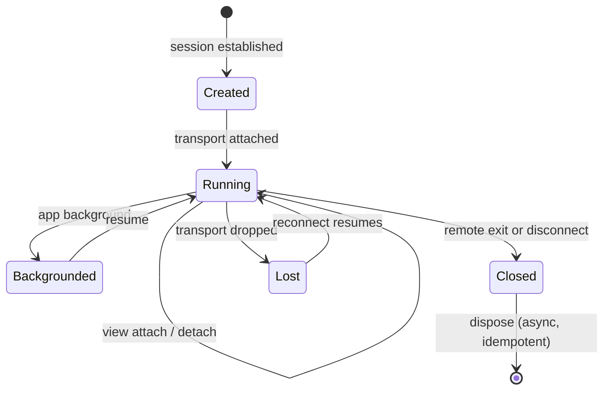

# Terminal runtime: current and proposed

Status: **proposed**. Facts about the current system were read from the checked-out source. The proposed runtime is a design to be validated by the [benchmarks](terminal-benchmarks.md) and the [composition gate](native-rendering.md#composition-gate); only the core crate and its transport-independent session service exist (see [Implementation status](#implementation-status)); nothing in the app uses them yet. Related: [PRD](terminal-performance-prd.md) · [adapter](terminal-adapter.md) · [ADR 0001](adr-0001-terminal-runtime.md).

## Current architecture

Ownership today:

| Concern | Owner | Where |
| --- | --- | --- |
| Transport I/O (SSH, Mosh, ET, local PTY) | Rust | `ssh.rs`, `mosh.rs`, `et.rs`, `local.rs`, `packages/mosh-transport`, `packages/et-transport` |
| Output flow control | Rust credits, returned by JS | `OUTPUT_WINDOW` (`ssh.rs`), `WINDOW` (`local.rs`), `ack_output`/`local_ack` |
| VT parsing, screen, cursor, scrollback, alternate screen | xterm.js, in the WebView | `terminal.ts`, `App.tsx` `prepareSession` |
| Terminal-generated replies (DA, DSR and similar) | xterm.js, forwarded as `terminal-nonuser` input | `TerminalPane.tsx` `observeTerminalInput` callback |
| Key and mouse encoding, bracketed paste | xterm.js | same |
| Selection, search, URL detection | xterm.js APIs plus lazysh code | `terminalTouchSelection.ts`, `TerminalSelectionTools.tsx`, `TerminalPane.tsx` |
| Mosh canonical resize | lazysh patch of xterm private buffers | `moshResize.ts` |
| Herdr switch-button detection | lazysh reads xterm buffer rows | `herdrNavigationCells.ts` |
| Rendering | xterm DOM renderer | WebView |

Not traced: the individual Mosh and ET output paths (only SSH and local were read to the chunk level), and any idle-time behaviour of the DOM renderer.

### Where the cost may be (hypotheses)

The data path performs these steps per chunk regardless of what is visible: serialize bytes to JSON text, parse it into a JavaScript array, copy it into a `Uint8Array`, parse VT in JavaScript, then issue one acknowledgement IPC. The encoding itself writes up to four characters per byte (for example `255,`). The cost of each step on target devices is **unmeasured**. See [benchmarks](terminal-benchmarks.md) for the stage-separated plan.

## Proposed architecture

Principles, each of which must hold in the implementation:

- **One authoritative state per session.** The core's screen is the only display state; xterm.js is a separate backend with its own state and is never mirrored.
- **Raw bytes are separate from display state.** The transport delivers bytes in order; the core consumes them; nothing re-derives bytes from cells.
- **No cells over the bridge.** React receives sizes, ranges, row text on request and events, never cell grids.
- **Transports are renderer-independent.** A session keeps running when no surface is attached.

## I/O ownership and flow control

The existing mechanism is kept in spirit and moved inside Rust for the native backend:

- Transport tasks keep the access-lease, background-epoch and renderer-replacement checks already in `deliver_output` (`ssh.rs`).
- The sink changes from a Tauri `Channel` to a bounded queue into the core's worker. Credits are returned after the core has parsed the bytes, so the window still bounds memory and overflow still blocks the producer. This removes the per-chunk IPC acknowledgement for the native path.
- The xterm path keeps the Channel and the write-callback acknowledgement exactly as today.
- Ordering and loss: a checksum workload across every transport is an acceptance criterion of the data-path issue ([#1315](https://github.com/mihazs/lazysh/issues/1315)).

## Threading

- Transport I/O stays on the existing async runtime tasks. No new thread per session.
- `ghostty_vt::Terminal` is `Send` but not `Sync` (`unsafe impl Send for Terminal`). A core can therefore move between workers but must be driven by one worker at a time.
- Implemented in the crate (`Hub`): a fixed VT worker pool; each session is assigned to the least-loaded worker, a worker serves one 16 KiB slice per turn and requeues a session that still has bytes, so one flooded session cannot starve the rest and a key press waits for at most one slice. Pool size and inactive-session policy are set from benchmark data ([#1339](https://github.com/mihazs/lazysh/issues/1339)); the default of two workers is a placeholder. A thread per session is rejected unless profiling justifies it; a test pins that 100 sessions add no threads beyond the pool.
- Rendering is scheduled by the renderer per surface, event-driven (see [native rendering](native-rendering.md#frame-scheduling)).

## Lifecycle

Requirements: attach and detach of a view never touch the transport; surface destruction and recreation rebuild the renderer from core state; switching the active session is serialized so no frame is drawn for an inactive session; dispose releases core, queues and GPU resources deterministically.

**Open security-sensitive item.** Today Activity/WebView replacement closes renderer-owned sessions by design (`cancel_for_renderer_rebind`, [session lifetime](../explanation/session-lifetime.md), [credentials](../credentials.md)). A Rust-resident core makes survival technically possible, but whether it is allowed is a security decision that needs its own review and tests; this document does not assume it.

## Mosh canonical framebuffer

The Mosh client emits display updates wrapped in private OSC 7777 envelopes `lazysh-mosh;1;begin;<id>;<cols>;<rows>` and `end;<id>` (`packages/mosh-transport/src/native.rs`, README "Runtime contract"). The server owns the screen size; UI geometry is only an intent. Today `moshResize.ts` replaces xterm's buffer resize to apply the envelope size top-anchored without reflowing history, and fails the display on an invalid or partial frame.

Proposed: the core applies the envelope as a transport-authoritative resize with the same limits (512 columns, 256 rows, 32768 cells), emits a `geometry` event, and reports `invalid-frame` and `partial-frame` failures. Ghostty's resize reflows by default; a non-reflowing, top-anchored resize must be implemented or the fixtures will fail. The Mosh C++ framebuffer remains transport state; the core holds display state. Fixtures: `apps/client/e2e/fixtures/mosh-resize-frames.json`.

## Herdr screen inspection

`herdrNavigationCell` reads viewport rows 0 and 1 as text to recognise Herdr's phone-layout switch button, so a tap there does not open the soft keyboard. The adapter exposes `readRows` (text only) under the explicit capability `screenInspection`; the detection becomes a pure function over strings shared by both backends. Herdr API navigation (`useHerdrNavigation.ts`) is unaffected.

## VT engine: libghostty-vt assessment

`packages/herdr-upstream` already contains the pieces. Recorded facts:

| Item | Fact |
| --- | --- |
| Herdr source | v0.9.5, commit `2ecf19a92fc3a7fff75b6ce3655ef04f4625ec01` (`PROVENANCE.md`) |
| Ghostty base | commit `44f2a44df7e8c4a0c6df3f7d872ef3d7ead88e51`, `VERSION` `1.3.2-HEAD-+44f2a44df`, MIT (`vendor/libghostty-vt.vendor.json`) |
| Binding crate | `crates/ghostty-vt`, package `ghostty-vt` 0.0.0, Apache-2.0, `publish = false`; deps `base64`, `libc`, `png`, `tracing` |
| Local patches (all active) | 0002 modifyOtherKeys query, 0004 hosted Wuffs builds, 0005 bounded word selection, 0006 clear screen preserving cursor line, 0007 experimental PNG retention (`vendor/libghostty-vt.patches.md`) |
| Toolchain | Zig 0.16.0 and Rust 1.96.1 (`PROVENANCE.md`) |
| Workspace | excluded from the root Cargo workspace; own `Cargo.lock`; no Bun package |
| Build mapping | `build.rs` maps Linux gnu/musl (x86_64, aarch64), macOS (x86_64, aarch64), iOS device and simulator (aarch64), Windows MSVC (x86_64, aarch64); **any other target, including Android, panics** |
| Upstream Android support | the vendored `src/build/GhosttyLibVt.zig` contains Android NDK and 16 KiB page-size handling, but nothing in lazysh selects it |
| CI | only the `herdr-native` job (ubuntu-22.04, x86_64) builds it; source archives (uucode, Highway, pixels) are admitted by Zig package hash |
| Open issue | #384: Ghostty source acquisition failures; no integrity check may be relaxed |

API surface relevant to a core (from `crates/ghostty-vt/src/lib.rs`): `Terminal::new(cols, rows, max_scrollback)`, `write`, `resize`, `scroll_viewport_*`, `mode_get`, `active_screen`, `scrollbar`, `read_text_*`/`read_ansi_*`, `set_write_pty_callback`, `take_clipboard_writes`, `take_bell_count`; `RenderState` with `dirty`, row and cell iterators; `KeyEncoder`, `MouseEncoder`; `unicode_grapheme_width`. Scrollback is configured through `SCROLLBACK_MAX_BYTES` (bytes), while lazysh preferences count lines.

Assessment: **reuse, do not add a second engine.** The binding already covers parsing, incremental dirty-row state, input encoding and terminal replies, and Herdr exercises it in production code. Gaps that block reuse today: no Android build target, no cross-compile CI beyond Linux x86_64, workspace placement, and #384. The Herdr-specific patches (0005 to 0007) travel with the vendored base; keeping them is cheaper than diverging, but each rebase of the base must carry them. These gaps are assigned to [#1312](https://github.com/mihazs/lazysh/issues/1312) ("one Ghostty dependency, shared binding crate, Android and iOS targets"). Not verified here: that the library builds for any Android target (no Zig toolchain or NDK was available to the authoring session).

## Memory and scrollback

Today each session's scrollback lives in WebView memory (default 5000 lines, maximum 20000). The proposed core holds it in native memory under a global budget with per-session caps; libghostty-vt exposes incremental compression (`compress_incremental`) that may help inactive sessions. Budget values are to be set from measured per-session memory at 5 and 10 sessions, not guessed.

## Failure handling

| Failure | Required behaviour |
| --- | --- |
| Renderer or surface lost | Rebuild the renderer from core state; session and transport untouched. |
| Core error on malformed input | Bounded, contained to that session; transport keeps running; failure surfaced as an event. |
| Queue full | Producer waits on credits; no byte is dropped or reordered. |
| Native backend unavailable at creation | Fall back to xterm.js with a recorded reason ([migration plan](terminal-migration-plan.md)). |
| Switching backend mid-session | Not lossless: xterm and Ghostty state are not interchangeable. Start the new backend from a visible-screen snapshot (`read_ansi_screen`); scrollback loss is documented. |

## Implementation status

[`packages/terminal-runtime`](../../packages/terminal-runtime/README.md) ([#1313](https://github.com/mihazs/lazysh/issues/1313)) is the first slice of the shared core. It depends on Herdr's vendored `ghostty-vt` binding by path and adds no second VT engine, Ghostty copy or patch. It is a nested workspace like `herdr-upstream` because building it compiles libghostty-vt with Zig 0.16.0; default lazysh builds are unaffected, and its tests run inside the `herdr-native` job against the same admitted archives (nothing about [#384](https://github.com/mihazs/lazysh/issues/384) is relaxed).

| Proposed element | In the crate | Not yet |
| --- | --- | --- |
| Binary-safe, ordered, bounded byte-in with credits after VT processing ([#1315](https://github.com/mihazs/lazysh/issues/1315)) | `Ingress`, `offer`, `pump` (rejected chunks returned intact; credit = bytes processed); `Hub`/`Session::feed` on a fixed worker pool, credit returned through `Hooks::credit` after each slice, queued bytes' credit returned on close | Wiring to SSH, local PTY, Mosh, ET in the Tauri bridge |
| Screen and cursor state, incremental dirty rows, snapshot for a recreated surface | `take_frame` (only changed rows, `None` when idle; a frame without rows when only the cursor changed), `snapshot` (all rows); the [Renderer API](native-rendering.md#terminal-renderer-api) and a CPU reference renderer consume them ([#1322](https://github.com/mihazs/lazysh/issues/1322)) | Frames carry per-cell `String`s; a compact format is [#1337](https://github.com/mihazs/lazysh/issues/1337). What "default color" looks like is the renderer's theme: OSC 10 and 11 produced no frame in a probe (OSC 4 produced a full one) |
| UI resize intent versus transport-authoritative size | `request_size`, `apply_transport_size`, `release_transport_authority`, `size_intent` | Mosh frame parsing and a non-reflowing resize ([#1317](https://github.com/mihazs/lazysh/issues/1317)); libghostty-vt reflows today and a test pins that |
| Terminal-generated replies | `take_replies`, capped at 64 KiB with a dropped-byte count; the pool hands each slice's replies to the session's `PtyWriter` tagged `Origin::Reply`, and a refusal (input gated) drops and counts them, never delays them | The bridge's `PtyWriter` that applies the access lease |
| Input encoding | keys, mouse, bracketed paste (end marker stripped), focus in/out (mode 1004), IME commit versus composition ([#1316](https://github.com/mihazs/lazysh/issues/1316)); `Session::send_*` encodes from the live modes and writes through the `PtyWriter` as `Origin::User`, which may refuse | Golden comparison with xterm.js output; Android soft keyboard/IME integration ([#1328](https://github.com/mihazs/lazysh/issues/1328)) |
| Screen inspection as text | `viewport_text`, `screen_text` | Herdr navigation use ([#1318](https://github.com/mihazs/lazysh/issues/1318)) |
| Selection, search, links, OSC 52 policy | OSC 52 payloads, bells and directory changes surfaced via `take_events`; at most 8 of each kind pending, overflow counted | Everything else ([#1320](https://github.com/mihazs/lazysh/issues/1320)) |

### Session service (`Hub`, `Session`)

`Hub` owns the worker pool and a registry keyed by session id; it is the one API every transport feeds, so SSH, Mosh, ET and the local PTY differ only in where their bytes come from. The contract, each point pinned by a test in `tests/session.rs` or `tests/process.rs`:

- **Credits after VT processing.** The transport takes credit for a chunk (its existing window, 256 KiB), calls `Session::feed`, and gets the bytes back through `Hooks::credit` only after a worker has run them through the VT. `feed` never parses and never blocks on a worker; a chunk over the queue budget is handed back intact (`Offer::Full`), so nothing is dropped or reordered. A checksum workload from six concurrent producers matches a single-threaded reference byte for byte, and the queue never exceeded the window.
- **Replies and input share one writer.** Terminal replies (DA, DSR) and encoded user input leave through `PtyWriter::write(Origin, bytes)`. The host's writer owns the access policy: while input is gated it refuses, a refused reply is dropped and counted (a stale answer typed into a shell after unlock would be worse than none), and a refused key reaches nobody.
- **Typing follows the live screen.** A key or paste the writer accepted returns a viewport scrolled into history to the live screen and wakes the attached view; `Session::set_scroll_on_user_input(false)` keeps the reader in history, like xterm.js's `scrollOnUserInput`. A refused key, a mouse report and a focus report do not move it. This is the [#1043](https://github.com/mihazs/lazysh/issues/1043) case: the toolbar Enter confirmed the agent's menu but left its answer out of view.
- **Lifecycle.** `create` reserves scrollback from a global budget (clamped to what is left, refused below 64 KiB); `close` is idempotent, frees the VT state immediately, returns the budget and the credit of anything still queued so a blocked producer wakes; `attach` returns a full snapshot and `detach` stops `Hooks::changed` wake-ups without touching the transport or the screen, so a backgrounded session wakes nothing. A panic in the binding or a host hook closes only that session when the build unwinds; the app's release profile sets `panic = "abort"`, where a panic ends the process, so that containment is a test-and-debug property, not a shipped one.
- **Not decided here.** Whether renderer replacement may keep a session alive is still the open security question above; the registry makes it technically possible and decides nothing.

Conformance coverage lives in `tests/conformance.rs` (30 cases: wrapping, ANSI and truecolor, CJK, combining marks and ZWJ emoji, alternate screen, cursor modes, bracketed paste, mouse reports, key encoding, split-sequence equivalence, binary noise, backpressure, resize authority, scrollback bounds, session isolation, bounded pending events, cursor-only frames, moving a live session to another thread). libghostty-vt marks no row dirty when only the cursor moves inside a row, changes shape, blinks or is hidden, so `take_frame` used to return `None` for those and a renderer kept a stale cursor; the runtime now compares the cursor and the active screen with the last frame it handed out and emits a frame without rows. The corpus does not yet include Claude/Codex/OpenCode transcripts, tmux/Zellij/Herdr captures or the Mosh frame fixture ([#1314](https://github.com/mihazs/lazysh/issues/1314)).

A `TerminalRuntime` is `Send` (not `Sync`), which the VT worker pool needs. The binding marks `Terminal` and `KeyEncoder` `Send` but not `MouseEncoder`, which first made every runtime `!Send`; the crate wraps that one handle in a documented `unsafe impl Send` (no thread-local state in the built libghostty-vt archive, same shape as `KeyEncoder`) instead of editing the vendored binding.

Scrollback is budgeted in bytes by libghostty-vt, while lazysh's setting is lines; the crate exposes the byte budget as is. The budget is coarse (256 KiB and 1 MiB kept the same rows) and the rows kept depend on column count and content, so a line setting needs a mapping that is part of [#1338](https://github.com/mihazs/lazysh/issues/1338); the measured table is in the [benchmarks](terminal-benchmarks.md#core-parse-throughput-host-microbenchmark-not-a-device-baseline).

## Unresolved questions

- Non-reflowing top-anchored resize in libghostty-vt for Mosh.
- Lines-to-bytes scrollback mapping and its effect on user expectations.
- Whether renderer replacement may preserve sessions (security review).
- Where the Mosh and ET output paths differ from the traced SSH path.
