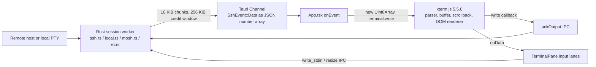
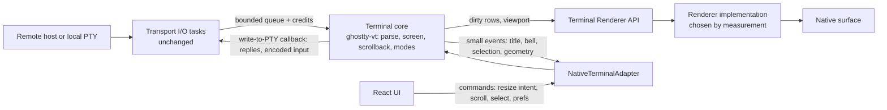
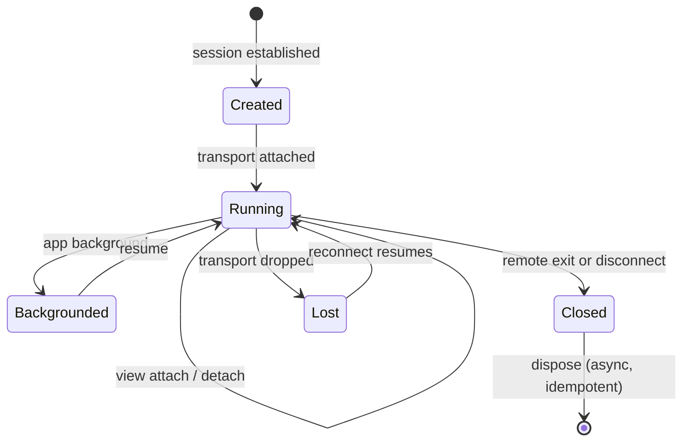

# Terminal runtime: current and proposed

Status: **proposed**. Facts about the current system were read from the checked-out source. The proposed runtime is a design to be validated by the [benchmarks](terminal-benchmarks.md) and the [composition gate](native-rendering.md#composition-gate); only the core crate and its transport-independent session service exist (see [Implementation status](#implementation-status)); nothing in the app uses them yet. Related: [PRD](terminal-performance-prd.md) · [adapter](terminal-adapter.md) · [ADR 0001](adr-0001-terminal-runtime.md).

## Current architecture

Ownership today:

| Concern | Owner | Where |
| --- | --- | --- |
| Transport I/O (SSH, Mosh, ET, local PTY) | Rust | `ssh.rs`, `mosh.rs`, `et.rs`, `local.rs`, `packages/mosh-transport`, `packages/et-transport` |
| Output flow control | Rust credits, returned by JS | `OUTPUT_WINDOW` (`ssh.rs`), `WINDOW` (`local.rs`), `ack_output`/`local_ack` |
| VT parsing, screen, cursor, scrollback, alternate screen | xterm.js, in the WebView | `terminal.ts`, `App.tsx` `prepareSession` |
| Terminal-generated replies (DA, DSR and similar) | xterm.js, forwarded as `terminal-nonuser` input | `TerminalPane.tsx` `observeTerminalInput` callback |
| Key and mouse encoding, bracketed paste | xterm.js | same |
| Selection, search, URL detection | xterm.js APIs plus lazysh code | `terminalTouchSelection.ts`, `TerminalSelectionTools.tsx`, `TerminalPane.tsx` |
| Mosh canonical resize | lazysh patch of xterm private buffers | `moshResize.ts` |
| Herdr switch-button detection | lazysh reads xterm buffer rows | `herdrNavigationCells.ts` |
| Rendering | xterm DOM renderer | WebView |

Not traced: the individual Mosh and ET output paths (only SSH and local were read to the chunk level), and any idle-time behaviour of the DOM renderer.

### Where the cost may be (hypotheses)

The data path performs these steps per chunk regardless of what is visible: serialize bytes to JSON text, parse it into a JavaScript array, copy it into a `Uint8Array`, parse VT in JavaScript, then issue one acknowledgement IPC. The encoding itself writes up to four characters per byte (for example `255,`). The cost of each step on target devices is **unmeasured**. See [benchmarks](terminal-benchmarks.md) for the stage-separated plan.

## Proposed architecture

Principles, each of which must hold in the implementation:

- **One authoritative state per session.** The core's screen is the only display state; xterm.js is a separate backend with its own state and is never mirrored.
- **Raw bytes are separate from display state.** The transport delivers bytes in order; the core consumes them; nothing re-derives bytes from cells.
- **No cells over the bridge.** React receives sizes, ranges, row text on request and events, never cell grids.
- **Transports are renderer-independent.** A session keeps running when no surface is attached.

## I/O ownership and flow control

The existing mechanism is kept in spirit and moved inside Rust for the native backend:

- Transport tasks keep the access-lease, background-epoch and renderer-replacement checks already in `deliver_output` (`ssh.rs`).
- The sink changes from a Tauri `Channel` to a bounded queue into the core's worker. Credits are returned after the core has parsed the bytes, so the window still bounds memory and overflow still blocks the producer. This removes the per-chunk IPC acknowledgement for the native path.
- The xterm path keeps the Channel and the write-callback acknowledgement exactly as today.
- Ordering and loss: a checksum workload across every transport is an acceptance criterion of the data-path issue ([#1315](https://github.com/mihazs/lazysh/issues/1315)).

**Bridge (implemented behind a feature, not reachable from the UI).** `apps/client/src-tauri/src/terminal_core.rs` generalises the one place every transport already passes through: `ssh::deliver_output` (SSH, ET and Mosh via `send_output`; the local PTY calls it directly) now hands admitted bytes to an `OutputSink`, which is the WebView `Channel` (unchanged) or, once a core is attached to the session, `Core::feed`. The access-lease, background-epoch and renderer-replacement checks run before the sink, byte for byte as before. A renderer asks for a core with `terminal_core_open(events, cols, rows)` and then starts the terminal with the same `events` Channel: the transport finds the offer by the Channel's id, so no connect command changed. The credit a chunk consumed returns through the core's own `Hooks::credit` into the session's existing semaphore after VT processing, `ack_output`/`local_ack` are refused for a core-fed session (a renderer cannot forge credit a core owns), a core whose session fails or is cancelled before the renderer learns its id is freed by that failure path, and a renderer replacement closes every core with its sessions. `terminal_core_text` reads the visible rows on request and `terminal_core_close` frees a core; all three commands have ACL entries, and close alone is allowed while locked (like `disconnect`). The real core links only with the `native-terminal` cargo feature (Zig 0.16.0); without it the commands report that the core is not built, so no default build changed. A resize the renderer sends through `resize` or `local_resize` goes to the transport first and then to the core (`request_size`), so the core's grid follows the PTY's; the core applies it at once, not in stream order with output still queued for the old size, the same ordering xterm has today, and the canonical size of Mosh is [#1317](https://github.com/mihazs/lazysh/issues/1317). Replies and encoded input are **not** routed back to the transport yet: the real core's `PtyWriter` refuses them until the write path gets a bytes variant with the same access gating (#1316).

## Threading

- Transport I/O stays on the existing async runtime tasks. No new thread per session.
- `ghostty_vt::Terminal` is `Send` but not `Sync` (`unsafe impl Send for Terminal`). A core can therefore move between workers but must be driven by one worker at a time.
- Implemented in the crate (`Hub`): a fixed VT worker pool; each session is assigned to the least-loaded worker, a worker serves one 16 KiB slice per turn and requeues a session that still has bytes, so one flooded session cannot starve the rest and a key press waits for at most one slice. Pool size and inactive-session policy are set from benchmark data ([#1339](https://github.com/mihazs/lazysh/issues/1339)); the default of two workers is a placeholder. A thread per session is rejected unless profiling justifies it; a test pins that 100 sessions add no threads beyond the pool.
- Rendering is scheduled by the renderer per surface, event-driven (see [native rendering](native-rendering.md#frame-scheduling)).

## Lifecycle

Requirements: attach and detach of a view never touch the transport; surface destruction and recreation rebuild the renderer from core state; switching the active session is serialized so no frame is drawn for an inactive session; dispose releases core, queues and GPU resources deterministically.

**Decision: renderer replacement does not preserve sessions.** Activity/WebView replacement closes renderer-owned sessions by design (`cancel_for_renderer_rebind`, [session lifetime](../explanation/session-lifetime.md), [credentials](../credentials.md)), and a Rust-resident core does not change that. The native core is freed together with the sessions it belongs to: `cancel_for_renderer_rebind` closes every core before it cancels the transports, so a renderer that never passed the lock or biometric gate cannot read the screen of the one it replaced through `terminal_core_text`, which also refuses a replaced renderer's lease like the other terminal commands (`a_replaced_renderer_cannot_read_a_core`), and the core cannot be re-attached to a transport that no longer exists. Keeping sessions alive would first have to move transports out of renderer ownership, which is a credentials decision of its own; it is not taken here, and the registry stays free of any code that would make it by accident. The tests: `renderer_rebind_without_biometric_policy_retires_all_old_transports_and_allows_fresh_session` (a core attached to a native terminal is closed and no longer registered), `renderer_replacement_frees_attached_cores`.

Other lifecycle rules, each with a test in `apps/client/src-tauri`:

| Event | Native core |
| --- | --- |
| App lock | Kept. Delivery is held back exactly like the Channel (`core_output_respects_the_lock_and_background_gates_like_the_channel`), so unreturned credit bounds memory at the transport window; `terminal_core_open` and `terminal_core_text` are refused, `terminal_core_close` is allowed (`a_locked_app_can_free_a_core_but_not_open_or_read_one`). The core of an adopted session is not freed by a lock or the unlock after it (`an_unadopted_local_terminal_frees_its_core_but_an_adopted_one_keeps_it_through_a_lock`), and held output is delivered after unlock (same gate test). |
| Lock before the renderer acknowledges a new terminal | Freed with the unadopted session (`native_adoption_revokes_unknown_ids_after_response_serialization_but_keeps_owned_sessions`). |
| Connect fails or is cancelled after the core was attached | Freed, since the renderer never learns the session id (`a_native_terminal_that_fails_to_start_frees_the_core_the_renderer_offered`). |
| Session ends (exit, disconnect, lost transport) | Kept until `terminal_core_close` or a renderer replacement, so the final screen stays readable; bounded by the hub's scrollback budget. |
| Renderer replacement | Freed (above). |
| Two terminals at once | Isolated: each core receives only its own session's bytes (`concurrent_local_terminals_feed_only_their_own_core`). |

A view attaching and detaching never touches the transport or the screen (`a_view_can_detach_and_reattach_without_losing_screen_or_scrollback` in the crate); there is no Tauri command for it yet because no native surface consumes frames, so the control-plane command for it belongs to [#1321](https://github.com/mihazs/lazysh/issues/1321), next to the renderer of [#1322](https://github.com/mihazs/lazysh/issues/1322).

## Mosh canonical framebuffer

The Mosh client emits display updates wrapped in private OSC 7777 envelopes `lazysh-mosh;1;begin;<id>;<cols>;<rows>` and `end;<id>` (`packages/mosh-transport/src/native.rs`, README "Runtime contract"). The server owns the screen size; UI geometry is only an intent. Today `moshResize.ts` replaces xterm's buffer resize to apply the envelope size top-anchored without reflowing history, and fails the display on an invalid or partial frame.

Implemented in the crate ([#1317](https://github.com/mihazs/lazysh/issues/1317), `src/mosh.rs`, `Config::canonical_frames`; the call must precede the first byte, like `enableCanonicalResize`):

- **Envelope scanner.** A byte-level state machine over the raw transport stream, so an envelope split at any byte by the chunking is still found. It withholds nothing: the VT parses the same bytes (it ignores OSC 7777) and the runtime applies the geometry right after the envelope's ST, between the bytes before it and the bytes after it, exactly where xterm's ordered write queue runs its OSC handler. It accepts what `moshResize.ts` accepts: version `1`, ids `[1-9][0-9]{0,15}` that increase and stay below 2^53, one open frame at a time, 2 to 512 columns, 1 to 256 rows, at most 32768 cells, at most 128 bytes of text. Any other `lazysh-mosh;` text, an envelope broken off by another escape, a stale or nested `begin` or an `end` with the wrong id fails the display with `invalid-frame`; OSC 7777 with another tag is left to the VT. The scanner only runs on sessions created with `canonical_frames`.
- **Failure.** `DisplayFailure::InvalidFrame` or `PartialFrame` is sticky, is reported once in `Events::display_failure`, stops the core from following the transport (later frames are ignored, UI sizes are `SizeOutcome::Dropped`), and does not stop the VT from parsing the bytes. `finish_canonical()` ends the stream: an open frame becomes `partial-frame`, and the final geometry stays; the pending UI intent is not applied (the xterm backend's `close()` does the same), the UI owns the size again.
- **Geometry.** `Events::geometry` carries the latest applied size and who decided it (`Transport` for a frame, `Local` for a UI request), only when the grid really changed.
- **UI geometry is intent.** With `canonical_frames` the runtime starts under transport authority: `request_size` records the intent, validates it against the same limits and returns `Deferred` for the caller to send to the transport. The existing `apply_transport_size` stays the entry for other transports and is a plain, reflowing resize: the top-anchored one writes VT sequences, which is only safe at a sequence boundary, and only the envelope path knows it is at one (a host call can land between two chunks of one escape sequence; a test pins that).

**The no-reflow, top-anchored resize** is the decision the first draft left open. libghostty-vt resizes with `reflow = wraparound-mode` (`Terminal.resize` in the vendored `Terminal.zig`), keeps the bottom of the grid when it shrinks (rows above the cursor become scrollback, unless trailing rows are blank), and pulls history down when it grows. All three are wrong for Mosh and the first one is the duplication the xterm patch exists to avoid. The core therefore does not call the binding's resize bare. It erases the rows that no longer fit (Ghostty trims blank trailing rows without making history), moves the cursor to the first cell so no row has a reason to move, resizes with wraparound off (the only no-reflow switch the C API exposes; mode 6 is cleared around the cursor moves because CUP is margin-relative under it), restores both modes, puts the cursor back clamped into the new grid, and returns a scrolled-up reader to the same row. The erase and the moves are ordinary VT input at a sequence boundary. No patch to the vendored Ghostty was needed, so the integrity checks of [#384](https://github.com/mihazs/lazysh/issues/384) are untouched.

Known differences from the xterm backend, each recorded rather than hidden:

| Case | xterm backend (`moshResize.ts`) | Core |
| --- | --- | --- |
| Narrower grid, history rows | History keeps its original width; a narrower view hides the right edge until it is widened again | Ghostty clears the cells beyond the new width in every page, so widening does not bring them back. Rows are neither reflowed, dropped nor duplicated |
| Pending wrap at the right edge when the cursor is restored | Kept (`x === cols`) | Lost; the cursor lands in the last column. Mosh repaints with an absolute cursor move, so only a bare envelope with no repaint could show it |
| Primary screen while the alternate screen is active and the grid shrinks | Both buffers are cut from the bottom | The alternate screen is cut from the bottom; the primary screen follows Ghostty (non-blank bottom rows become scrollback). Mosh's display never enters the alternate screen |
| Selection, markers | Cleared when a resize clips them | Selection is not in the core yet ([#1320](https://github.com/mihazs/lazysh/issues/1320)) |

The Mosh C++ framebuffer remains transport state; the core holds display state. Fixtures: `apps/client/e2e/fixtures/mosh-resize-frames.json`, replayed by `tests/mosh.rs` from the same file the Playwright suite reads. The acceptance criterion "existing mosh-resize and mosh-keyboard scenarios pass on the native backend" needs the native adapter ([#1321](https://github.com/mihazs/lazysh/issues/1321)) and is not met by this slice; the core scenarios that mirror them are in `tests/mosh.rs`.

## Herdr screen inspection

`herdrNavigationCell` reads viewport rows 0 and 1 as text to recognise Herdr's phone-layout switch button, so a tap there does not open the soft keyboard. The adapter exposes `readRows` (text only) under the explicit capability `screenInspection`; the detection becomes a pure function over strings shared by both backends. Herdr API navigation (`useHerdrNavigation.ts`) is unaffected.

## VT engine: libghostty-vt assessment

`packages/herdr-upstream` already contains the pieces. Recorded facts:

| Item | Fact |
| --- | --- |
| Herdr source | v0.9.5, commit `2ecf19a92fc3a7fff75b6ce3655ef04f4625ec01` (`PROVENANCE.md`) |
| Ghostty base | commit `44f2a44df7e8c4a0c6df3f7d872ef3d7ead88e51`, `VERSION` `1.3.2-HEAD-+44f2a44df`, MIT (`vendor/libghostty-vt.vendor.json`) |
| Binding crate | `crates/ghostty-vt`, package `ghostty-vt` 0.0.0, Apache-2.0, `publish = false`; deps `base64`, `libc`, `png`, `tracing` |
| Local patches (all active) | 0002 modifyOtherKeys query, 0004 hosted Wuffs builds, 0005 bounded word selection, 0006 clear screen preserving cursor line, 0007 experimental PNG retention (`vendor/libghostty-vt.patches.md`) |
| Toolchain | Zig 0.16.0 and Rust 1.96.1 (`PROVENANCE.md`) |
| Workspace | excluded from the root Cargo workspace; own `Cargo.lock`; no Bun package |
| Build mapping | `build.rs` maps Linux gnu/musl (x86_64, aarch64), macOS (x86_64, aarch64), iOS device and simulator (aarch64), Windows MSVC (x86_64, aarch64); **any other target, including Android, panics** |
| Upstream Android support | the vendored `src/build/GhosttyLibVt.zig` contains Android NDK and 16 KiB page-size handling, but nothing in lazysh selects it |
| CI | only the `herdr-native` job (ubuntu-22.04, x86_64) builds it; source archives (uucode, Highway, pixels) are admitted by Zig package hash |
| Open issue | #384: Ghostty source acquisition failures; no integrity check may be relaxed |

API surface relevant to a core (from `crates/ghostty-vt/src/lib.rs`): `Terminal::new(cols, rows, max_scrollback)`, `write`, `resize`, `scroll_viewport_*`, `mode_get`, `active_screen`, `scrollbar`, `read_text_*`/`read_ansi_*`, `set_write_pty_callback`, `take_clipboard_writes`, `take_bell_count`; `RenderState` with `dirty`, row and cell iterators; `KeyEncoder`, `MouseEncoder`; `unicode_grapheme_width`. Scrollback is configured through `SCROLLBACK_MAX_BYTES` (bytes), while lazysh preferences count lines.

Assessment: **reuse, do not add a second engine.** The binding already covers parsing, incremental dirty-row state, input encoding and terminal replies, and Herdr exercises it in production code. Gaps that block reuse today: no Android build target, no cross-compile CI beyond Linux x86_64, workspace placement, and #384. The Herdr-specific patches (0005 to 0007) travel with the vendored base; keeping them is cheaper than diverging, but each rebase of the base must carry them. These gaps are assigned to [#1312](https://github.com/mihazs/lazysh/issues/1312) ("one Ghostty dependency, shared binding crate, Android and iOS targets"). Not verified here: that the library builds for any Android target (no Zig toolchain or NDK was available to the authoring session).

## Memory and scrollback

Today each session's scrollback lives in WebView memory (default 5000 lines, maximum 20000). The core holds it in native memory under a global budget (256 MiB by default) with a per-session cap (`HubConfig::session_scrollback_max`, 64 MiB by default) so one request cannot take the budget from the others; both values are placeholders, not measurements, until the per-device data of [#1338](https://github.com/mihazs/lazysh/issues/1338) and [#1339](https://github.com/mihazs/lazysh/issues/1339) exists; libghostty-vt exposes incremental compression (`compress_incremental`) that may help inactive sessions. Budget values are to be set from measured per-session memory at 5 and 10 sessions, not guessed.

## Failure handling

| Failure | Required behaviour |
| --- | --- |
| Renderer or surface lost | Rebuild the renderer from core state; session and transport untouched. |
| Core error on malformed input | Bounded, contained to that session; transport keeps running; failure surfaced as an event. |
| Queue full | Producer waits on credits; no byte is dropped or reordered. |
| Native backend unavailable at creation | Fall back to xterm.js with a recorded reason ([migration plan](terminal-migration-plan.md)). |
| Switching backend mid-session | Not lossless: xterm and Ghostty state are not interchangeable. Start the new backend from a visible-screen snapshot (`read_ansi_screen`); scrollback loss is documented. |

## Implementation status

[`packages/terminal-runtime`](../../packages/terminal-runtime/README.md) ([#1313](https://github.com/mihazs/lazysh/issues/1313)) is the first slice of the shared core. It depends on Herdr's vendored `ghostty-vt` binding by path and adds no second VT engine, Ghostty copy or patch. It is a nested workspace like `herdr-upstream` because building it compiles libghostty-vt with Zig 0.16.0; default lazysh builds are unaffected, and its tests run inside the `herdr-native` job against the same admitted archives (nothing about [#384](https://github.com/mihazs/lazysh/issues/384) is relaxed).

| Proposed element | In the crate | Not yet |
| --- | --- | --- |
| Binary-safe, ordered, bounded byte-in with credits after VT processing ([#1315](https://github.com/mihazs/lazysh/issues/1315)) | `Ingress`, `offer`, `pump` (rejected chunks returned intact; credit = bytes processed); `Hub`/`Session::feed` on a fixed worker pool, credit returned through `Hooks::credit` after each slice, queued bytes' credit returned on close | Wiring to SSH, local PTY, Mosh, ET in the Tauri bridge |
| Screen and cursor state, incremental dirty rows, snapshot for a recreated surface | `take_frame` (only changed rows, `None` when idle; a frame without rows when only the cursor changed), `snapshot` (all rows); the [Renderer API](native-rendering.md#terminal-renderer-api) and a CPU reference renderer consume them ([#1322](https://github.com/mihazs/lazysh/issues/1322)) | Frames carry per-cell `String`s; a compact format is [#1337](https://github.com/mihazs/lazysh/issues/1337). What "default color" looks like is the renderer's theme: OSC 10 and 11 produced no frame in a probe (OSC 4 produced a full one) |
| UI resize intent versus transport-authoritative size | `request_size`, `apply_transport_size`, `release_transport_authority`, `size_intent`; Mosh frames: `Config::canonical_frames` applies OSC 7777 envelopes as a top-anchored resize without reflow, `Events::geometry` and `display_failure`, `finish_canonical` ([#1317](https://github.com/mihazs/lazysh/issues/1317)) | Wiring to the Mosh transport and the native adapter ([#1321](https://github.com/mihazs/lazysh/issues/1321)); a plain `request_size` still reflows and a test pins that |
| Terminal-generated replies | `take_replies`, capped at 64 KiB with a dropped-byte count; the pool hands each slice's replies to the session's `PtyWriter` tagged `Origin::Reply`, and a refusal (input gated) drops and counts them, never delays them | The bridge's `PtyWriter` that applies the access lease |
| Input encoding | keys, mouse, bracketed paste (end marker stripped, line breaks sent as CR like xterm.js), focus in/out (mode 1004), IME commit versus composition ([#1316](https://github.com/mihazs/lazysh/issues/1316)); `Session::send_*` encodes from the live modes and writes through the `PtyWriter` as `Origin::User`, which may refuse. Ctrl+Enter, Ctrl+Shift+Enter, Ctrl+Tab and Ctrl+[ send CR, HT and ESC (what xterm.js sends) and Shift+Enter sends `CSI 13;2u` (what lazysh sends today, [#805](https://github.com/mihazs/lazysh/issues/805); xterm.js alone would send CR and an agent TUI would submit) until the program enables Kitty keyboard flags or modifyOtherKeys, then the encoder's protocol form; committed text (IME, soft-keyboard Enter) is sent verbatim in every mode, because under Kitty flags the encoder turned it into `CSI 13u` ([#1043](https://github.com/mihazs/lazysh/issues/1043)); the encoder is given each key's unshifted codepoint, without which a Kitty-enabled program received Ctrl+C as plain `c` | Golden comparison with xterm.js output; Android soft keyboard/IME integration ([#1328](https://github.com/mihazs/lazysh/issues/1328)) |
| Screen inspection as text | `viewport_text`, `screen_text` | Herdr navigation use ([#1318](https://github.com/mihazs/lazysh/issues/1318)) |
| Selection, search, links, OSC 52 policy | OSC 52 payloads, bells and directory changes surfaced via `take_events`; at most 8 of each kind pending, overflow counted | Everything else ([#1320](https://github.com/mihazs/lazysh/issues/1320)) |

### Session service (`Hub`, `Session`)

`Hub` owns the worker pool and a registry keyed by session id; it is the one API every transport feeds, so SSH, Mosh, ET and the local PTY differ only in where their bytes come from. The contract, each point pinned by a test in `tests/session.rs` or `tests/process.rs`:

- **Credits after VT processing.** The transport takes credit for a chunk (its existing window, 256 KiB), calls `Session::feed`, and gets the bytes back through `Hooks::credit` only after a worker has run them through the VT. `feed` never parses and never blocks on a worker; a chunk over the queue budget is handed back intact (`Offer::Full`), so nothing is dropped or reordered. A checksum workload from six concurrent producers matches a single-threaded reference byte for byte, and the queue never exceeded the window.
- **Replies and input share one writer.** Terminal replies (DA, DSR) and encoded user input leave through `PtyWriter::write(Origin, bytes)`. The host's writer owns the access policy: while input is gated it refuses, a refused reply is dropped and counted (a stale answer typed into a shell after unlock would be worse than none), and a refused key reaches nobody.
- **Key parity with xterm.js.** `KeyInput::from_dom(DomKey { code, key, mods, repeat, release, composing })` and `dom_mods` map a browser `KeyboardEvent` to the encoder (physical key by `code`, named keys by `key` when a soft keyboard reports no code, a single printable character as text). `tests/keys.rs` compares 104 chords with what xterm.js 5.5.0 sends for the same `keydown` (captured on a mounted `Terminal`, the way #1314's `keys.json` is): 69 are byte-identical and 35 differ, each with a reason in the table. The classes: Shift+printable (xterm.js sends that text from `keypress`, not `keydown`); Ctrl+digit, Ctrl+Shift+digit, Ctrl+/ and Ctrl+Shift+Space (xterm.js sends nothing, the core the conventional byte); Alt+arrow, Alt+PageDown, Alt+Insert, Alt+Tab (xterm.js rewrites Alt to Ctrl on arrows and drops it on the others, the core sends the standard Alt form: check shells, vim, tmux and the agent TUIs before the Android default stage); Shift+PageDown and Shift+Insert (xterm.js leaves them to the host, the core encodes them, so the adapter must route them first); Ctrl+Alt+Shift+letter (xterm.js sends ESC and the control byte, the core nothing); Meta on navigation keys; and Shift+Enter, by design. Without a keyboard protocol the core never sends a `CSI u` or `CSI 27;m;c~` form (a shell prints them as junk, and xterm.js sends nothing for Ctrl+Shift+letter or Ctrl+;), and a printable key with Super (Cmd+C) sends nothing instead of typing its text.
- **Typing follows the live screen.** A key or paste the writer accepted returns a viewport scrolled into history to the live screen and wakes the attached view; `Session::set_scroll_on_user_input(false)` keeps the reader in history, like xterm.js's `scrollOnUserInput`. A refused key, a mouse report and a focus report do not move it. This is the [#1043](https://github.com/mihazs/lazysh/issues/1043) case: the toolbar Enter confirmed the agent's menu but left its answer out of view.
- **Lifecycle.** `create` reserves scrollback from a global budget (clamped to what is left, refused below 64 KiB); `close` is idempotent, frees the VT state immediately, returns the budget and the credit of anything still queued so a blocked producer wakes; `attach` returns a full snapshot and `detach` stops `Hooks::changed` wake-ups without touching the transport or the screen, so a backgrounded session wakes nothing. A panic in the binding or a host hook closes only that session when the build unwinds; the app's release profile sets `panic = "abort"`, where a panic ends the process, so that containment is a test-and-debug property, not a shipped one.
- **Renderer replacement.** Decided in the Lifecycle section: sessions, and with them cores, are not preserved.

Conformance coverage lives in `tests/conformance.rs` (37 cases: wrapping, ANSI and truecolor, CJK, combining marks and ZWJ emoji, alternate screen, cursor modes, bracketed paste, mouse reports (X10, SGR, wheel, motion, modifiers, written from the ctlseqs documentation; the fixtures below compare them with xterm.js's own encoder), key encoding including the Kitty and modifyOtherKeys forms, application keypad, toolbar versus soft-keyboard Enter in eight modes, split-sequence equivalence, binary noise, backpressure, resize authority, scrollback bounds, session isolation, bounded pending events, cursor-only frames, repeated motion in one cell, a zero cell size, moving a live session to another thread). libghostty-vt marks no row dirty when only the cursor moves inside a row, changes shape, blinks or is hidden, so `take_frame` used to return `None` for those and a renderer kept a stale cursor; the runtime now compares the cursor and the active screen with the last frame it handed out and emits a frame without rows. The cross-engine fixtures of [#1314](https://github.com/mihazs/lazysh/issues/1314) live in [`packages/terminal-runtime/fixtures`](../../packages/terminal-runtime/fixtures/README.md): 91 screen fixtures (SGR, cursor, editing and edge cases such as charsets, tab stops, wide-glyph overwrites, explicit zero counts, tab clears, REP, the wrap-pending state, origin mode and resize reflow, wrapping, Unicode, alternate screen, modes and queries, paste, events, resize, synthetic TUI streams, real first-run captures of vim, less, tmux, Claude Code, Codex, OpenCode, Zellij and Herdr, and the six captured Mosh frames, three of them alone and all six in order), 75 key presses and 130 mouse events in 18 protocol and encoding setups, replayed through xterm.js 5.5.0 in the `client` vitest run and through the core in `tests/vt_fixtures.rs`. The core matches xterm.js on every screen, key and mouse report except where a recorded divergence says otherwise. `fixtures/divergences.json` lists 28 differences with a reason and a status; 13 are open questions for the gates, most importantly Unicode widths and grapheme clustering (emoji, ZWJ and flags), Alt+arrow, the Kitty keyboard protocol, the missing theme (OSC 10/11 queries go unanswered and OSC 4 answers with ghostty's palette), and the device-attribute identity. The comparison found and fixed one core defect (repeated motion reports in one cell, plus a division by a zero cell size in that fix). It also showed that the core's key encoding differed from xterm.js for Ctrl+Enter, Ctrl+Tab, Ctrl+[ and the newline of a bracketed paste, which [#1471](https://github.com/mihazs/lazysh/pull/1471) fixed under [#1316](https://github.com/mihazs/lazysh/issues/1316); those four divergences are gone, and Shift+Enter stays a listed, accepted difference (`CSI 13;2u`, by design for #805). Not covered: signed-in sessions of the agents (the captures stop at their first-run screens), the DOM half of xterm.js's mouse handling, and any platform but Linux.

A `TerminalRuntime` is `Send` (not `Sync`), which the VT worker pool needs. The binding marks `Terminal` and `KeyEncoder` `Send` but not `MouseEncoder`, which first made every runtime `!Send`; the crate wraps that one handle in a documented `unsafe impl Send` (no thread-local state in the built libghostty-vt archive, same shape as `KeyEncoder`) instead of editing the vendored binding.

Scrollback is budgeted in bytes by libghostty-vt, while lazysh's setting is lines; the crate exposes the byte budget as is. The budget is coarse (256 KiB and 1 MiB kept the same rows) and the rows kept depend on column count and content, so a line setting needs a mapping that is part of [#1338](https://github.com/mihazs/lazysh/issues/1338); the measured table is in the [benchmarks](terminal-benchmarks.md#core-parse-throughput-host-microbenchmark-not-a-device-baseline).

The bridge slice is verified with a core stand-in on a worker thread (checksum of 3 MiB of pseudo-random bytes through `send_output`, 1 MiB of text echoed through a real russh channel into the core, 2 MiB from a Mosh/ET-shaped native driver in 16 KiB chunks, 60,000 lines through a real local PTY, peak queued bytes at most the 256 KiB window, zero Channel messages on the core path, lock and background gating, forged acknowledgements refused, renderer replacement) and, with `--features native-terminal` on this Linux host, by one test that runs a local PTY into the real libghostty-vt core and reads the screen text back. The feature build is not exercised by CI.

## Unresolved questions

- History cells beyond a narrower Mosh grid: Ghostty clears them where the xterm backend only hides them (see the table under [Mosh canonical framebuffer](#mosh-canonical-framebuffer)); whether that matters needs a decision after the Mosh path runs on a device.
- Lines-to-bytes scrollback mapping and its effect on user expectations.
- Whether transports could ever leave renderer ownership so that a session survives renderer replacement: a credentials review, not assumed by this design.
- Where the Mosh and ET output paths differ from the traced SSH path.
