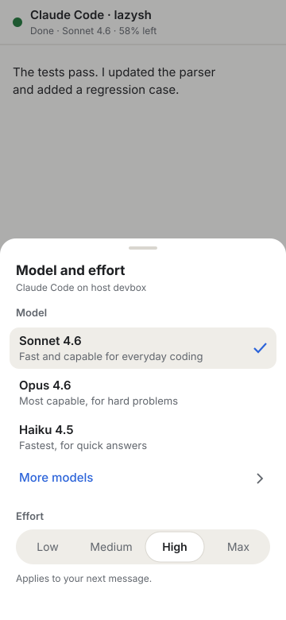
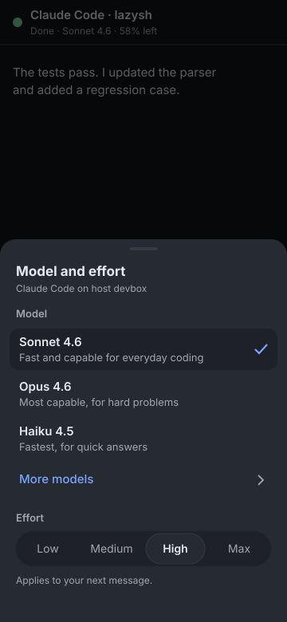
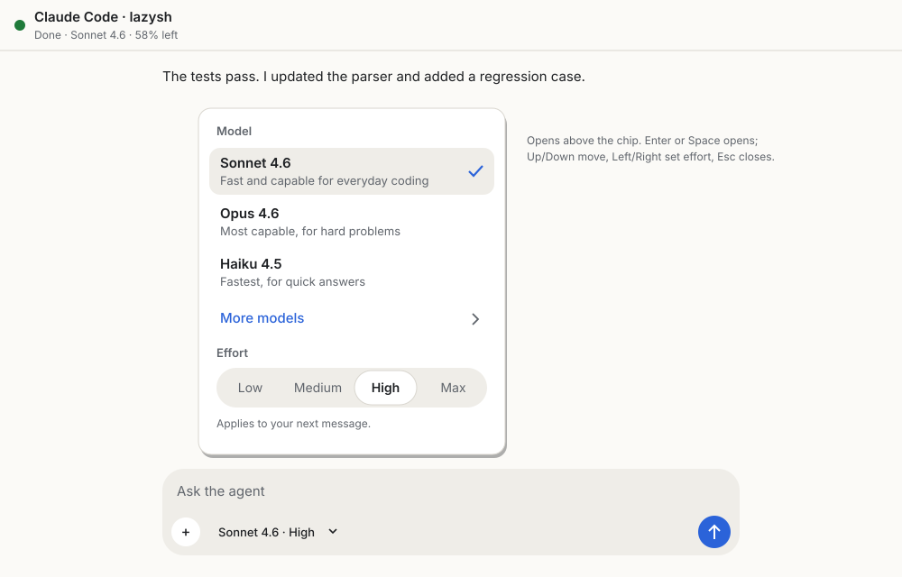
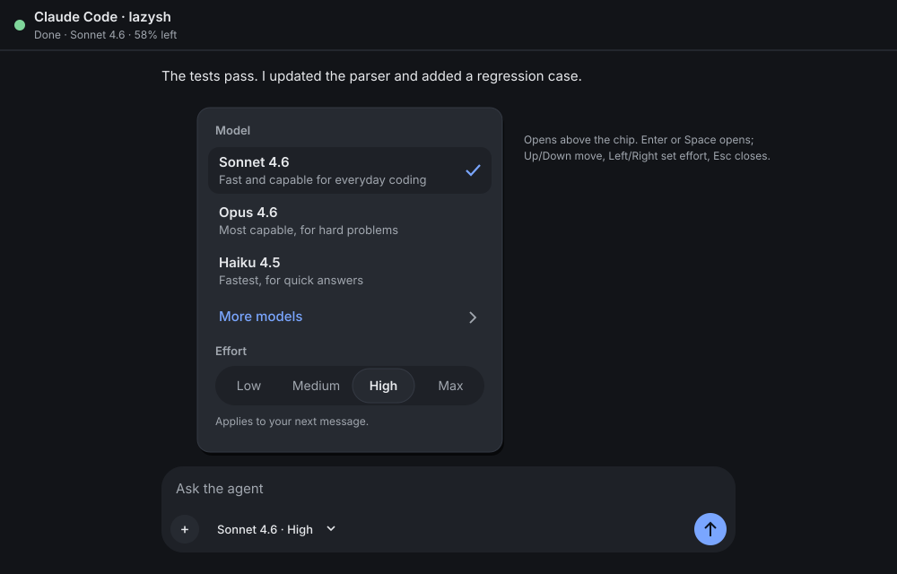
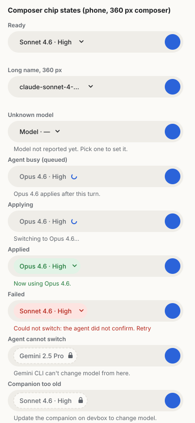
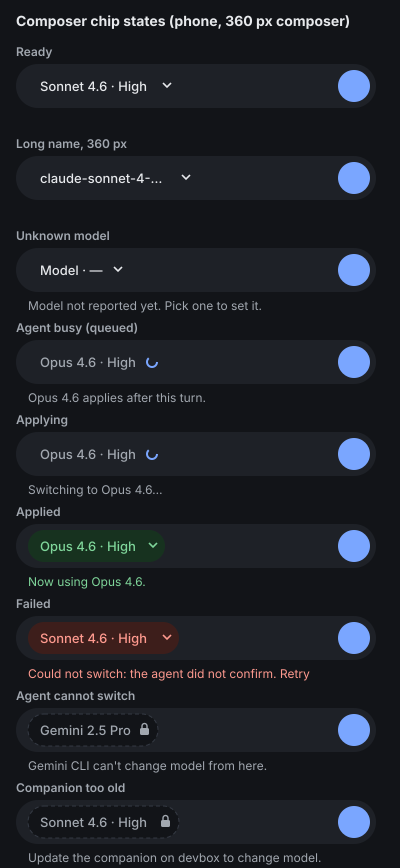

# Agent view model and effort picker

Status: specification, not built. Issue [#2237](https://github.com/mihazs/lazysh/issues/2237), epic
[#2236](https://github.com/mihazs/lazysh/issues/2236). Implemented by the host actions
([#2238](https://github.com/mihazs/lazysh/issues/2238)), the client chip and picker
([#2239](https://github.com/mihazs/lazysh/issues/2239)) and the other agents
([#2240](https://github.com/mihazs/lazysh/issues/2240)). Behaviour around it lives in [Agent view](../agent-view.md); the
type, spacing and colour scale in [Agent view design](../reference/agent-view-design.md), which this page follows.

The goal: the current model and effort are always visible where you type, one tap opens the choice, one more tap
applies it, and the chip then shows what the agent itself reports.

## Reference review

Only general, public interaction patterns are taken; no screens, copy, icons or brand are copied.

| Reference | What it does | Adopted | Not adopted, and why |
| --- | --- | --- | --- |
| Claude, web | The model name sits in the composer next to send; a short list with a one-line description per model and a check on the current one; less used models under "More models"; extended thinking sits in the same menu. | The composer chip, the description line, the check, "More models", effort inside the same picker. | Nothing removed. |
| Claude, mobile | The same list as a bottom sheet from the composer. | Bottom sheet on phones. | — |
| ChatGPT, web | The model is a dropdown in the header with modes (Auto, Instant, Thinking); the thinking level is a pill in the composer with a few named levels. | Effort as a small fixed, named scale. The header pill opens the same picker. | Model in the header only: on a phone it is far from the thumb and drops out under 520 px (see the header rule). A separate effort pill: two chips crowd a 360 px composer, so model and effort share one chip. |
| ChatGPT, mobile | Model as a sheet from the header, thinking level in the composer. | Sheet. | Splitting the two controls, for the reason above. |
| Codex CLI | `/model` shows model and reasoning effort as one combined list (a model, then its effort). | The combined idea survives as one chip and one sheet with two sections. | A flat list of every model-plus-effort pair: it multiplies rows (models × levels) and hides which part changed. |

Shared rule adopted from all of them: the choice applies to the next message and is confirmed in place, never in a
toast that disappears.

## The composer chip

- Placement: in the composer's control row, right after attach and the mode switch, before Stop and Send
  ([composer slice](../reference/agent-view-design.md#composer-slice-3)). When the draft is tall and the controls drop
  under the field, the chip drops with them. The header model pill opens the same picker; there is one picker.
- Content: `<model> · <effort>`. With no effort (the agent has none, or does not report it) it is `<model>` only.
- Size: 32 px tonal pill, 13 px medium text, a chevron; its tap area is 44 px.
- Truncation: the chip is at most 45% of the composer row (162 px on a 360 px phone). A longer name is cut at the end
  with an ellipsis, keeping the effort: `claude-sonnet-4-… · High`; when even that does not fit, the effort goes first and
  the chip shows the model alone. The full name and effort are always in the accessible name and in the picker title.
- Looks: **normal** (tonal, chevron), **pending** (muted text, a spinner in place of the chevron, so nothing moves),
  **applied** (success tint for 2 s, then normal), **failed** (danger tint, chevron; tap reopens the picker with the
  reason), **read-only** (no fill, dashed hairline, a lock in place of the chevron; tap shows the reason, never a list).
- Compact layout (window under 620 px tall): the chip stays, 28 px high, with a 40 px tap area.

## The picker

Model names and descriptions in the wireframes are placeholders; the real list always comes from the host's
`list_models` (#2238), never from the app.

- Form: a bottom sheet under 720 px of window width (drag handle, scrim, swipe down or tap the scrim to close); a
  popover anchored above the chip at 720 px and wider, 340 px wide, with the same content. It opens above the keyboard
  and keeps the draft.
- Title: **Model and effort**, with the agent and host under it ("Claude Code on host devbox").
- **Model** section: rows of 52 px (name in 15 px semibold, one-line description in 13 px muted, the check on the
  current one). Order: the current model, then recently used ones on this host (at most three, most recent first), then
  the rest in the agent's own order. When there are more than five, the first five show and **More models** opens the
  full list in place (a back arrow returns). A list being read shows three placeholder rows; a list that fails to load
  says why and offers **Retry**; the effort section still works.
- **Effort** section: a segmented control of the levels the agent's capability record lists, in its order, with the
  agent's own names translated (for example Low, Medium, High). One level is selected. A model that supports no effort
  hides the section; a model that supports fewer levels shows only those. Under it: "Applies to your next message."
- Selecting: one tap on a model row or an effort segment applies that one change. The sheet closes when the host
  answers applied or queued; it stays open with the reason when the change fails. Model and effort are separate
  requests, so a failed effort never undoes an applied model.
- Combined entries: an agent whose own mechanism only offers model-plus-effort pairs (as Codex's list does) is still
  shown as two sections; the host maps the pair. A pair the agent does not offer (an effort that model lacks) is not
  shown as a segment.

## States

The note sits under the composer as a tinted line, like the send receipt; it is also announced through the composer's
status region.

| State | When | Chip | Note (English) |
| --- | --- | --- | --- |
| Ready | The agent reported a model (and effort). | normal | — |
| Unknown model | The agent has not reported a model yet (no turn, or a source that does not record it). | normal, `Model · —` | Model not reported yet. Pick one to set it. |
| Agent busy | A change was asked while a turn runs and the agent allows changes only when idle. | pending, the new choice | {model} applies after this turn. |
| Applying | The host is applying the change and waiting for the read-back. | pending, the new choice | Switching to {model}… |
| Applied | The read-back matches. | applied, the reported value | Now using {model}. |
| Failed | The host answered refused or the read-back did not match. | failed, the reported (old) value | Could not switch: {reason}. **Retry** |
| Agent cannot switch | The capability record says no, or the multiplexer has no input path for it. | read-only, the reported value | {agent} can't change model from here. |
| Companion too old | The companion does not answer the new actions. | read-only, the reported value | Update the companion on {host} to change model. |

The chip shows the value the agent reports, never only the value asked for: after Applied or Failed it is the read-back.
Queued and Applying show the requested value muted, with the spinner, until the read-back settles it.

Fixed failure reasons the host may give (#2238), with their copy: `not_confirmed` "the agent did not confirm",
`dialog_closed` "the agent's menu closed", `unknown_model` "that model is not available", `unsupported_effort` "that
model has no such effort", `pane_busy` "the agent is answering a prompt", `timeout` "no answer in time".

## Copy

| Key | English | Português (Brasil) | Español |
| --- | --- | --- | --- |
| Picker title | Model and effort | Modelo e esforço | Modelo y esfuerzo |
| Model section | Model | Modelo | Modelo |
| Effort section | Effort | Esforço | Esfuerzo |
| More models | More models | Mais modelos | Más modelos |
| Effort hint | Applies to your next message. | Vale a partir da próxima mensagem. | Se aplica a tu próximo mensaje. |
| Unknown | Model not reported yet. Pick one to set it. | O modelo ainda não foi informado. Escolha um para defini-lo. | El modelo aún no se ha informado. Elige uno para fijarlo. |
| Queued | {model} applies after this turn. | {model} entra depois desta resposta. | {model} se aplica después de este turno. |
| Applying | Switching to {model}… | Trocando para {model}… | Cambiando a {model}… |
| Applied | Now using {model}. | Usando {model} agora. | Ahora usando {model}. |
| Failed | Could not switch: {reason}. | Não foi possível trocar: {reason}. | No se pudo cambiar: {reason}. |
| Retry | Retry | Tentar de novo | Reintentar |
| Cannot switch | {agent} can't change model from here. | {agent} não permite trocar o modelo por aqui. | {agent} no permite cambiar el modelo desde aquí. |
| Too old | Update the companion on {host} to change model. | Atualize o companion em {host} para trocar o modelo. | Actualiza el companion en {host} para cambiar el modelo. |
| List failed | Could not load the models. | Não foi possível carregar os modelos. | No se pudieron cargar los modelos. |
| Chip label (a11y) | Model {model}, effort {effort}. Change | Modelo {model}, esforço {effort}. Alterar | Modelo {model}, esfuerzo {effort}. Cambiar |
| Read-only chip (a11y) | Model {model}, effort {effort}. {reason} | Modelo {model}, esforço {effort}. {reason} | Modelo {model}, esfuerzo {effort}. {reason} |

Effort levels are translated by key, not by the agent's raw string: low Baixo / Bajo, medium Médio / Medio, high Alto /
Alto, and the agent's highest level (for example `xhigh` or `max`) Máximo / Máximo. A level with no key shows the
agent's own word.

## Accessibility and keyboard

- The chip is a button with `aria-haspopup="dialog"` and the label above; the read-only chip is a button that shows its
  reason, not a disabled control, so it stays reachable.
- The sheet and popover are a dialog named by the title. The model list is a `listbox` (the current row
  `aria-selected`); the effort control is a `radiogroup`.
- Desktop keys: Enter or Space on the chip opens it, focus lands on the current model; Up and Down move in the list,
  Home and End jump; Tab moves to the effort group, where Left and Right move; Enter or Space selects; Esc closes and
  returns focus to the chip. Focus is kept inside while it is open.
- Every row, segment, **More models**, **Retry** and the chip have a 44 px tap area (40 px in the compact layout).
- State is never colour alone: each state has its note text and a mark (spinner, lock).
- Motion: the sheet slides and the popover fades under 0.2 s, only behind `prefers-reduced-motion: no-preference`.

## Per-agent capability table

What each supported agent is expected to allow, from the code and measurements already in this repository. Every cell
marked *to observe* is confirmed or corrected on the pinned version by #2238 (Claude Code, Codex) or #2240 (the rest),
and this table is updated then. Until a row is confirmed, the chip is read-only for that agent.

| Agent | Model | Effort | Mechanism | When | Evidence today |
| --- | --- | --- | --- | --- | --- |
| Claude Code | Yes | Yes, *to observe* the levels | `/model` opens the agent's "Switch model?" list; its reasoning page sets effort; driven as a list dialog with guarded keys and read back from the status line and transcript | Idle only; a change asked mid-turn is queued | `/model` measured on 2.1.318 ([Agent view, Model](../agent-view.md#input-and-control-mapping)); the model is read from the transcript |
| Codex | Yes | Yes, *to observe* the levels | `/model` list (model, then reasoning effort) with guarded keys; the app-server daemon's settings where attached; read back from the rollout's `turn_context` (`model`, `reasoning_effort`) | Idle only, *to observe* whether the daemon allows mid-turn | The companion reads `model` and `reasoning_effort` from `turn_context` (`apps/agent/src/transcript/session_info.rs`) |
| OpenCode | *To observe* | *To observe* | The OpenCode 2.x background service where usable; its `/models` list cannot be read from the screen (colour-only highlight) | *To observe* | [Agent view, shipped per agent](../agent-view.md#what-is-shipped-per-agent) |
| Gemini CLI | *To observe* | *To observe* | *To observe* | — | Model read from its transcript |
| Grok Build | *To observe* | *To observe* | *To observe* | — | Its log records no model |
| GitHub Copilot CLI | *To observe* | *To observe* | *To observe* | — | Read-only records, no composer |
| Kimi CLI | *To observe* | *To observe* | *To observe* | — | Read-only records, no composer |
| Droid | *To observe* | *To observe* | *To observe* | — | Read-only records, no composer |
| Cursor CLI | *To observe* | *To observe* | *To observe* | — | State only |
| Amp | *To observe* | *To observe* | *To observe* | — | State only |
| Cline | *To observe* | *To observe* | *To observe* | — | — |
| Pi, OMP, Hermes | *To observe* | *To observe* | *To observe* | — | State only |

Multiplexers: a mechanism that uses guarded keys works wherever the guarded input path does (tmux, Zellij, Herdr and no
multiplexer, per [Agent view](../agent-view.md)); a pane without that path shows the read-only chip with the reason.

## Out of scope

- Editing the agent's configuration file to change the default model for new sessions.
- Models or levels typed as free text.
- Cost or speed figures per model; the description line is the agent's or the catalog's one-liner.
