# Android workspace UX critique and benchmark

The next redesign should put ongoing work first, move healthy configuration behind an explicit action, and preserve a clear route back to the terminal. Apply the requested glass treatment to compact navigation and temporary controls after that hierarchy is corrected.

Study date: 2026-11-01 UTC. Tracked in [#668](https://github.com/mihazs/lazysh/issues/668), which links every reported problem. This is a research checkpoint, not a claim that the fixes shipped.

## Evidence and scope

The user tested the latest Android release on a Galaxy S23+ and reported all eight issues below. The public release was verified as **1.4.0**, source `95bbb8c8cf986d69a8f249e1bb6852706776b1f3`.

The ten Lazysh captures below were made afresh from that source in Playwright Chromium at **393×852 CSS pixels**, with touch/mobile layout and the existing synthetic native bridge. Host names, terminal output, agent reports and quota readings are synthetic. They demonstrate the actual frontend hierarchy and focus behavior, not a working SSH connection, real agent reporting or native Android navigation. Final capture had no page errors. Every saved image was opened and inspected. Earlier transitional/invalid-fixture captures were rejected; no such frame is included here.

Comparator media was fetched afresh from the publishers at 01:01–01:02 UTC. Moshi clips and Termish's explicitly labeled iOS screenshots establish visual patterns, not verified Android behavior. Termish source is pinned to `e5add7cf12cd00d75234e19c3c125f2299023294`. Its keyboard behavior is excluded as a reliability reference, following the user's report.

## Captured journey

|Step|Surface and evidence|Health|What the capture establishes|
|---|---|---|---|
|1|[Home](android-workspace-2026-11-01/01-home.png)|Mixed|Correct Lazysh logo and clear primary action; a returning user with a saved host still starts on promotional content. This is not the native splash.|
|2|[Saved hosts](android-workspace-2026-11-01/02-hosts.png)|Mixed|Host selection is discoverable, but desktop hints and an unavailable local-terminal action compete with remote work.|
|3|[Saved Mosh connection](android-workspace-2026-11-01/03-saved-connection.png)|Poor|Advanced Mosh fields are expanded. Actual focused element is **Mosh server path**, even with saved credentials selected.|
|4|[Connected terminal](android-workspace-2026-11-01/04-terminal.png)|Good foundation|One compact header and an edge-to-edge terminal preserve space. Compose/key controls already use icons; retain this improvement.|
|5|[Workspace tools](android-workspace-2026-11-01/05-tools.png)|Poor|A 365×824 overlay contains 935px of content. Navigation, setup, unrelated platform features and ending the connection share one large menu.|
|6|[Live agents](android-workspace-2026-11-01/06-agents-top.png)|Poor hierarchy|Server selection, explanation, search and attach actions precede the agent rows. The shared drawer has **2,583px of content in a 568px viewport**.|
|7|[Activity entry](android-workspace-2026-11-01/07-activity-entry.png)|Poor discoverability|Keep-awake instructions, approvals and setup entries precede reported activity. Some setup sections are already collapsed, but the combined screen remains crowded.|
|8|[Activity reports](android-workspace-2026-11-01/08-activity-reports.png)|Mixed|Supplied activity renders after scrolling. Companion settings continue below it. This does not reproduce or resolve missing real host events.|
|9|[AI usage](android-workspace-2026-11-01/09-usage.png)|Poor return path|The quota shortcut expands three navigation rows. A Terminal tab exists, but there is no local Back/return affordance explaining the origin of this view.|
|10|[Preferences](android-workspace-2026-11-01/10-preferences.png)|Poor entry and grouping|The container is already full screen on mobile. Autofocus targets Font size and starts its 2,219px content at scrollTop 436. Unavailable iOS icon controls still occupy space.|
|11|Native cold/warm launch|Not captured|A browser cannot establish Android system splash, first-Activity handoff, warm-start flicker or restored-session behavior. The user's continuing failure remains open in #582.|

No horizontal page overflow was observed at the captured width. This does not establish reflow at enlarged fonts, every phone width or with a native keyboard open.

## Highest-impact changes

### 1. Give agents and activity their own primary space

The healthy Agents screen should begin with the selected host/server summary, compact search/filter controls and actual agent rows. Put companion installation, hook profiles, server changes and collection settings behind one **Setup and connection** action. A single-server healthy connection should show its name rather than an expanded chooser. Keep the user's explicit ability to change it.

Separate **Live agents** from **Activity** with clear counts and labels. Herdr discovery and companion hook events are different sources. A running process appearing in Herdr does not prove that the companion received an activity event. Installation/version, hook configuration, event freshness and unsupported integration must remain distinguishable.

When activity is empty or unhealthy, show one concise status and one relevant repair action. Preserve the existing event/approval checks; a status card alone must not enable an unverified terminal action. Keep real pending requests visible at the top. An empty approval panel and its instruction paragraph can collapse into a count.

Acceptance: healthy setup starts collapsed; first agent rows appear without scrolling at the target phone size; activity is reachable in one deliberate action; an actual supported CLI event reaches the updated companion and then the Android board. The latter remains a functional verification requirement, not something this browser capture proves. Tracks [#663](https://github.com/mihazs/lazysh/issues/663) and [#666](https://github.com/mihazs/lazysh/issues/666).

### 2. Make navigation preserve context

Every secondary tool should have a consistent top-leading Back control and a clear **Return to terminal** action when a live terminal is the origin. Android Back should dismiss the current local overlay first, then return through the visited views. Repeatedly selecting the same destination should not create a loop. Returning must preserve the same session, scroll position and draft.

Use one compact navigation layer instead of expanding the header, connection tabs and tool rail whenever a quota chip is tapped. The existing compact terminal layout is the space budget to preserve. Android's documented back-stack behavior supports returning through visited destinations. [Android navigation guidance](https://developer.android.com/guide/navigation/backstack).

Acceptance: terminal → usage → Back returns to the original live terminal; agents → usage → Back returns to agents; Back from a short action surface closes it without disconnecting. Test system Back separately on Android. Tracks [#665](https://github.com/mihazs/lazysh/issues/665).

### 3. Choose a surface by task length

|Task|Recommended mobile surface|
|---|---|
|Read agents, activity, files or a conversation|Dedicated content screen with contextual Back|
|Edit a host, appearance or connection settings|Categorized full-screen page with a stable heading and explicit save/cancel|
|Choose a short contextual action|Small anchored menu or bottom sheet with a clear dismiss action|
|Inspect one account's usage|Compact view with a direct return; expand to a page when content warrants it|
|Approve a destructive or authority-changing action|Focused confirmation preserving the existing explicit review|

Preferences and connection entry are already full-height in these captures; replacing their dialog tag alone would not improve them. Reduce simultaneous fields and repair focus. The remaining Workspace tools overlay needs a shorter set of context actions, with application settings and unsupported platform controls removed from that menu. Android documents sheets with explicit state and dismissal; they are suitable for bounded temporary tasks, not a replacement for every long page. [Android bottom sheets](https://developer.android.com/develop/ui/compose/components/bottom-sheets).

Acceptance: one main scroll region per long task; frequent actions visible at normal text size; no nested wall of settings. Enlarged text may legitimately scroll—do not shrink text or touch targets to force everything onto one screen. Tracks [#588](https://github.com/mihazs/lazysh/issues/588) and [#585](https://github.com/mihazs/lazysh/issues/585).

### 4. Let a saved connection focus on connecting

Present host identity, effective transport/multiplexer summary, required authentication and Connect. Put server paths, UDP ranges and fallback explanation behind **Connection options**, collapsed by default. With saved credentials, focus the heading or primary action rather than an advanced text input. With missing credentials, focus the required credential field. Preserve host-key verification and explicit changes to saved settings.

The same focus issue affects Preferences: opening it should not jump to Font size and request text input. Acceptance includes opening both screens without changing a value or moving past the heading. Tracks [#667](https://github.com/mihazs/lazysh/issues/667).

### 5. Apply restrained branded glass

Keep the actual Lazysh logo, navy background, cyan primary accent and existing theme tokens. The current stylesheet already contains a **16px blur** treatment; additional blur alone cannot correct the hierarchy shown above.

Use frosted glass for the compact header and temporary action surfaces, with a visible edge and restrained elevation. Keep terminal output, agent messages and forms on readable surfaces. Retain solid fallbacks for reduced transparency, forced colors and unsupported rendering. Avoid stacking several blurred containers around the same content.

Apple's current material guidance separates the floating control layer from content and recommends sparse use. This supports selective glass rather than covering every card with it. [Apple materials guidance](https://developer.apple.com/design/human-interface-guidelines/materials).

Acceptance: measure text/background contrast over representative terminal content; preserve focus visibility, reduced motion and enlarged text; measure Android rendering during scrolling. The study does not certify WCAG compliance or blur performance. Normal text should meet the applicable 4.5:1 contrast requirement. [W3C contrast guidance](https://www.w3.org/WAI/WCAG22/Understanding/contrast-minimum.html). Tracks [#664](https://github.com/mihazs/lazysh/issues/664).

### 6. Verify the native launch separately

Capture cold start, warm start, recreation and restoration as frame sequences: branded system/boot cover → ready workspace. Confirm there is no interactive placeholder or unrelated content between them. A home-screen logo is not evidence of a working splash. Android's system splash has its own Activity/window handoff. [Android splash guidance](https://developer.android.com/develop/ui/views/launch/splash-screen). Tracks [#582](https://github.com/mihazs/lazysh/issues/582).

## Benchmark decisions

|Reference|Observed pattern|Original Lazysh decision|
|---|---|---|
|[Moshi Agents and Usages](https://getmoshi.app/docs/agents-usages), freshly fetched agent-view video|Status-grouped compact cards prioritize work; provider/project/recency form secondary information. Usage has a dedicated entry.|Put work above configuration; keep Live and Activity source labels explicit.|
|[Moshi shortcuts video](https://getmoshi.app/videos/features/shortcuts.mp4), frame 4.375s|A temporary translucent palette sits near terminal controls with an explicit close action.|Use glass for a small task surface while preserving the terminal context.|
|[Termish official screens](https://termish.dev/)|Hosts use concise rows and a contextual action menu; agent conversation gives most of the screen to reading/composing. Surfaces are predominantly opaque.|Simplify saved-host and agent layouts; preserve readable content backing.|
|[Termish BackNavigation](https://github.com/farlume/termish/blob/e5add7cf12cd00d75234e19c3c125f2299023294/composeApp/src/commonMain/kotlin/dev/termish/ui/BackNavigation.kt)|Published source resolves local overlays before leaving the current work area.|Use contextual Back, independently implemented and tested on Android.|
|[Termish HostEdit](https://github.com/farlume/termish/blob/e5add7cf12cd00d75234e19c3c125f2299023294/composeApp/src/commonMain/kotlin/dev/termish/ui/HostEditScreen.kt)|Mosh-specific options are conditional on transport; this source does not prove advanced-field collapse.|Collapse advanced controls because the user requested it; do not misattribute that decision to a comparator.|

Neither comparator packet establishes native splash quality, complete agent reporting, Android keyboard correctness, accessibility compliance or simultaneous-session safety. Those require runtime checks.

## Delivery order

1. Diagnose missing activity while prioritizing agent content and collapsing healthy setup (#666/#663); make saved-host focus intentional (#667).
2. Establish contextual return and replace the remaining oversized task overlays (#665/#588).
3. Verify native launch transitions (#582).
4. Refine glass, spacing and platform-specific visibility, then repeat the same captured journey with font scaling and native Android Back (#664/#585).

Each completed checkpoint needs review, relevant executable/device evidence, merge and a published version with verified assets. The research and issue board do not mark these fixes complete.

## Inspected screenshot gallery

The Lazysh images are original captures, not mockups. Open each step for the exact viewport. Comparator images are limited publisher excerpts for critique; ownership remains with their respective publishers and they are not application assets.

Step 1: Home

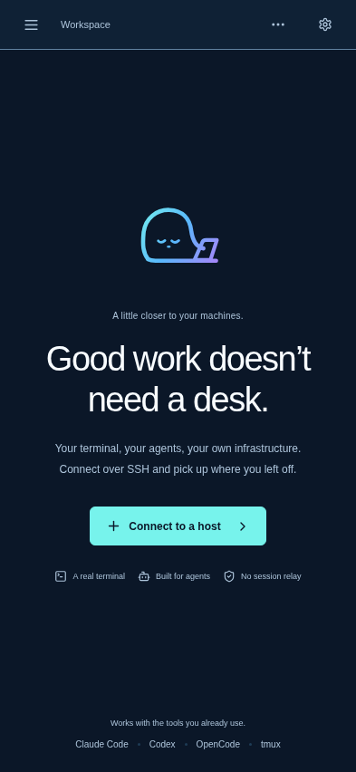

Step 2: Saved hosts

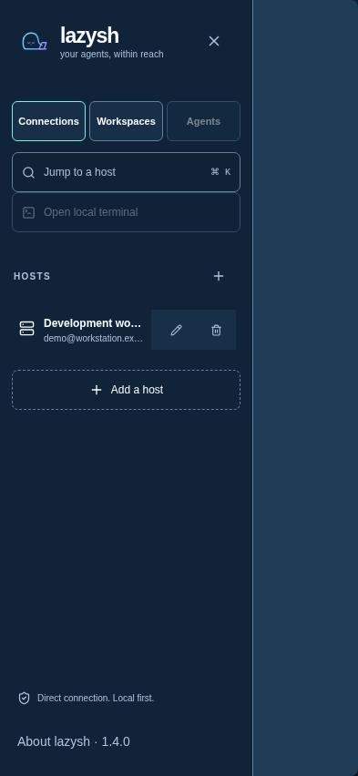

Step 3: Saved Mosh connection

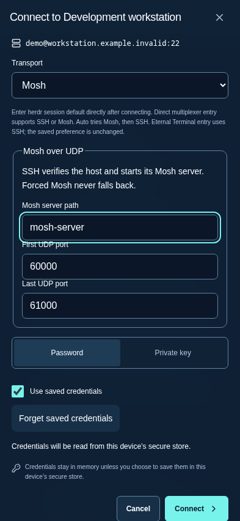

Step 4: Connected terminal

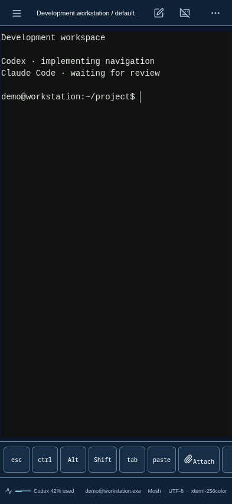

Step 5: Workspace tools

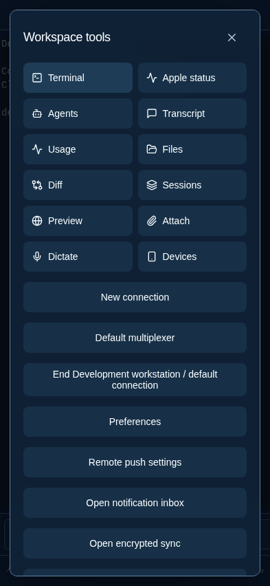

Step 6: Live agents

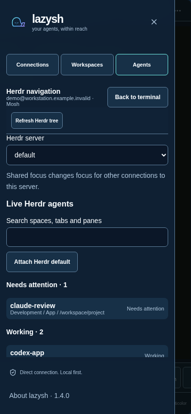

Step 7: Activity entry

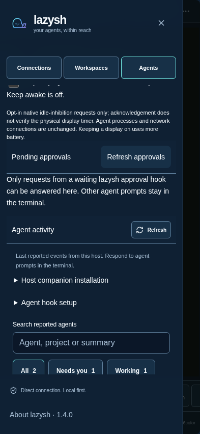

Step 8: Activity reports

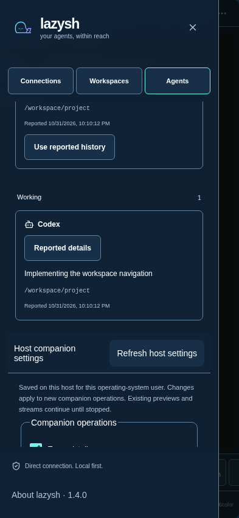

Step 9: AI usage

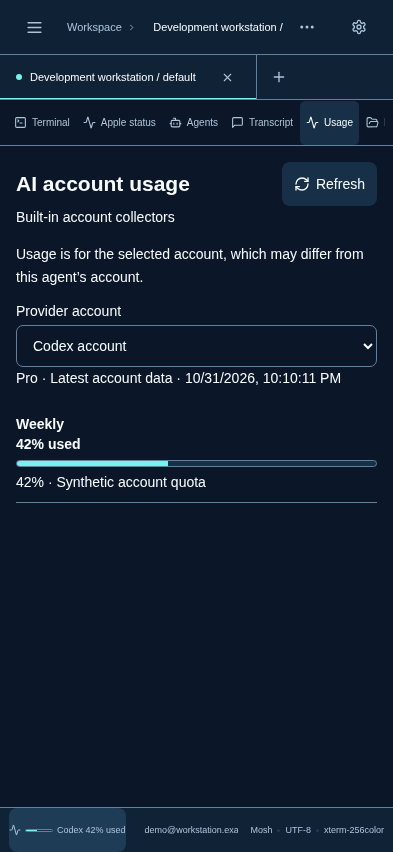

Step 10: Preferences

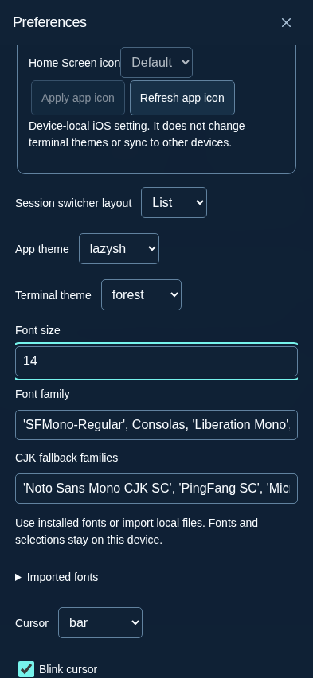

### Comparator excerpts

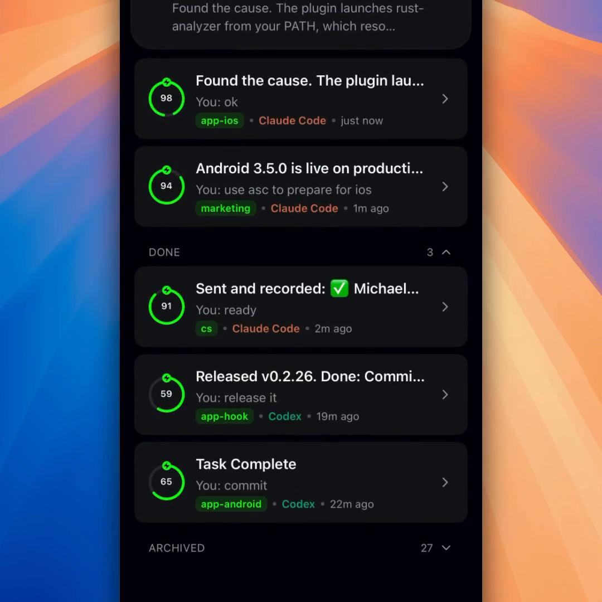

Source: [agent-view.mp4](https://getmoshi.app/videos/features/agent-view.mp4), SHA256 `caf24bed52de53962077013d124c062d18ee5b7036d4d9118c278e220b7eefc9`. This is the publisher’s zoomed video frame.

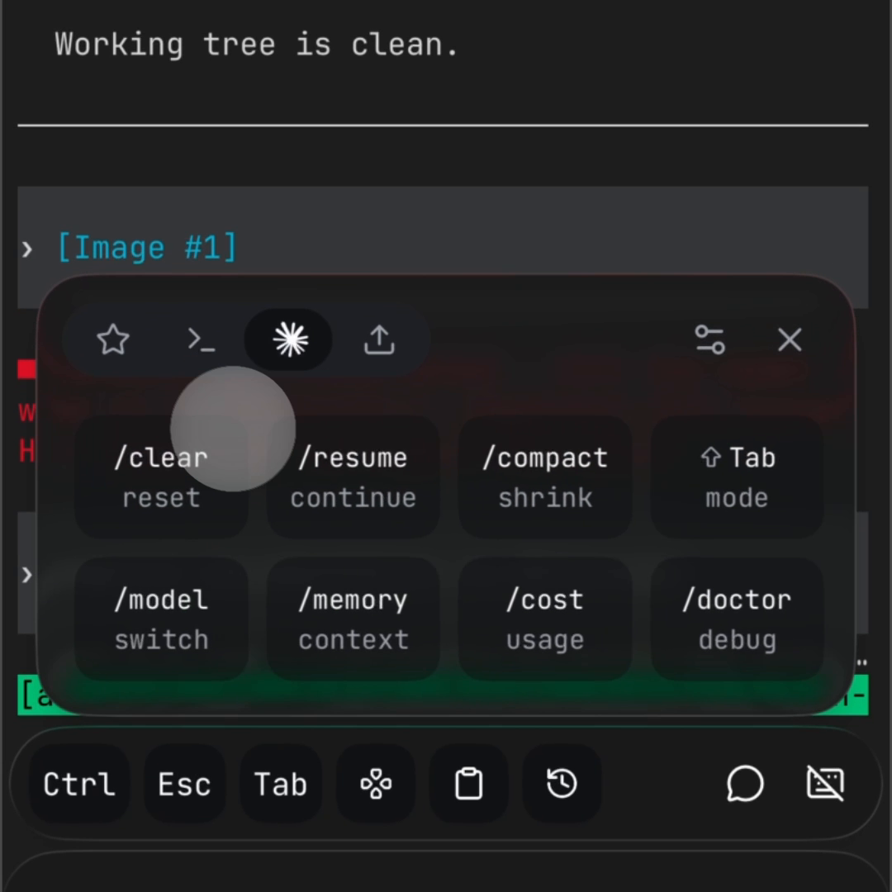

Source: [shortcuts.mp4](https://getmoshi.app/videos/features/shortcuts.mp4), SHA256 `58f6cac955d9cd311c123723e339de0a2eb9de2ff35db57083e595bbade3a8fa`.

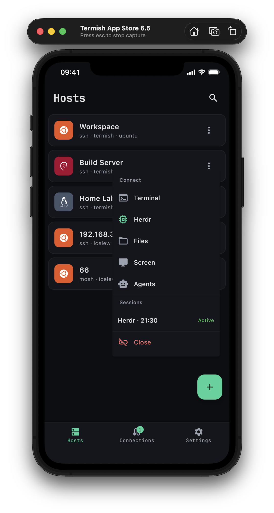

Source: [official iOS Hosts screenshot](https://termish.dev/screenshots/ios/hosts-en-full.webp).

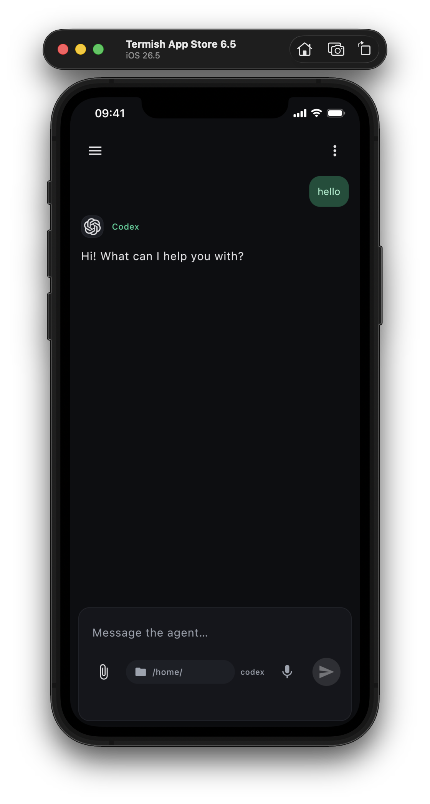

Source: [official iOS chat screenshot](https://termish.dev/screenshots/ios/agent-chat-en-full.webp). These are prepared iOS images, not our Android captures.

### Capture integrity

All ten PNG captures are 393×852; final page-error list was empty. Each metadata receipt records the focused control and scroll regions. The original receipt/DOM snapshots are retained in `/home/mihazs/.cache/tmp/lazysh-ux-audit-20261101/`; comparator HTTP/frame receipts are retained in `/home/mihazs/.cache/tmp/lazysh-ux-bench-fresh-20261101/`.

|Capture|SHA256|
|---|---|
|01-home.png|`feaf02e4e43f622a4d56ffb4d84ad7877b17d53329d14071ae6a76b6a16a4d67`|
|02-hosts.png|`d1c6703b88bf32eb814f18d30aaa069e46c6422617ffbae83de45db16afa25c9`|
|03-saved-connection.png|`bd51230c9801ab96af27377f6e3acc716c26e7a7427b97eb954914e4b2ad88e5`|
|04-terminal.png|`4026848ffdc9a31170beaaeb268dad58cebe63b39d2efe175e183d79430bcbb0`|
|05-tools.png|`c26099fa8c4f2cc3dde8d1a186e53124c49c02e44392ab8d2323214dfe95059b`|
|06-agents-top.png|`5f7f2fbfe9f7a6ba0d948b7ddc1b53ca400de72472e68d84d669e3e6e57a9744`|
|07-activity-entry.png|`771e902051c291401d67f7e96b5833219540d20a2ebbe621c952da71575b3f56`|
|08-activity-reports.png|`07d990778b3e3da9907c0cad6406fb3fe024ab8d3886842519a84c13a86f15e0`|
|09-usage.png|`ec8c5b04b14ed742e61d5281f5f2f9b1c7c36e15568a77322833a66668342bcd`|
|10-preferences.png|`f2dcd4aa3b76aa1f481ae4a91f9f3cd781038d972df4738945ab33a2d100fff1`|
